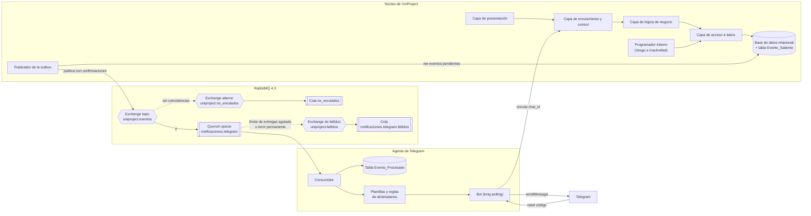
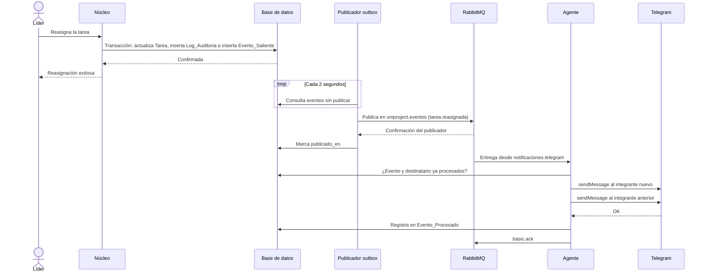
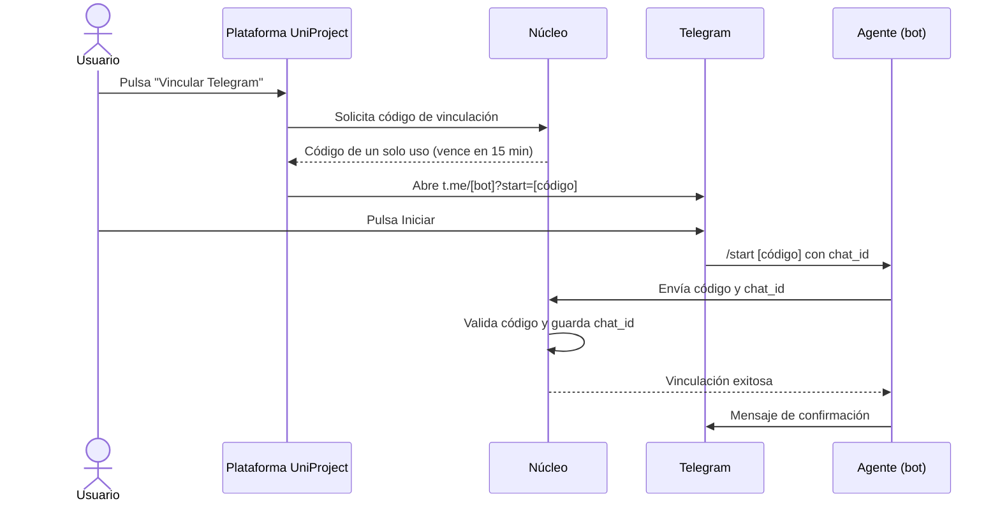

# Plan de notificaciones por eventos para UniProject

**Proyecto:** UniProject, sistema de gestión de proyectos colaborativos universitarios
**Curso:** Diseño de Software I, segunda parte del proyecto final
**Equipo:** Juan Benavides, Samuel Lambertino, Santy Baza
**Reto:** manejar las notificaciones con una arquitectura dirigida por eventos, un broker RabbitMQ y mensajería por Telegram con un agente que entrega los mensajes
**Fecha de consolidación:** 24 de octubre de 2026 (los datos técnicos se verificaron el 10 de octubre de 2026)

---

## Índice

1. Para qué sirve este documento
2. El reto y las reglas que se fijaron para resolverlo
3. Lo que exige la primera entrega y condiciona el diseño
4. Escala de clasificación
5. Los seis eventos de UniProject
6. Arquitectura propuesta
7. Decisiones por capa, con su ranking y su porqué
8. Especificación propuesta de cada pieza
9. Flujos completos paso a paso
10. Ruta recomendada consolidada
11. Opciones descartadas y motivo
12. Impactos sobre la primera entrega
13. Riesgos y cómo se mitigan
14. Decisiones pendientes
15. Glosario
16. Fuentes

---

## 1. Para qué sirve este documento

Este plan reúne en un solo lugar todo lo que se discutió sobre la segunda parte de UniProject: el catálogo de formas de resolver el reto, el filtro que eliminó lo que exige pagos o suscripciones, y el ranking de cada apartado aplicado al proyecto. No ordena tareas ni fija fechas de trabajo. Su función es dejar cada decisión escrita, con su justificación y sus alternativas, para que los tres integrantes la entiendan igual y la puedan defender en la exposición.

Todo lo que aparece como **propuesta** (nombres de colas, valores de configuración, campos de tablas, textos de plantillas) es una concreción de lo conversado y se puede ajustar. Lo que todavía depende de una respuesta del equipo está en la sección 14 y no se asumió en ninguna parte del documento.

---

## 2. El reto y las reglas que se fijaron para resolverlo

### 2.1. Enunciado del reto

Las notificaciones de UniProject se manejan con una arquitectura dirigida por eventos. RabbitMQ actúa como broker de mensajes y los avisos llegan a los usuarios por Telegram, a través de un agente que consume los eventos y entrega los mensajes.

### 2.2. Filtro aplicado al catálogo de opciones

Durante la conversación se fijaron estas reglas:

| Regla | Efecto |
|---|---|
| Se eliminan las opciones que requieren suscripciones a plataformas o métodos de pago | Salieron la difusión pagada de Telegram (se paga con Telegram Stars) y Amazon MQ |
| Se eliminan las formas de agente con inteligencia artificial | Salieron el agente con IA que redacta o resume y el agente de IA con herramientas, porque normalmente dependen de APIs de pago |
| Las herramientas con versión gratuita se conservan si esa versión alcanza para lo que se necesita, con una aclaración de qué versión es la gratuita | Se conservaron n8n Community, Novu Community, MassTransit v8, Docker Desktop (uso educativo) y el plugin de mensajes diferidos (con advertencias) |
| El plan gratuito de CloudAMQP se conserva solo si sirve de manera completa para lo que se necesita | Con la ruta recomendada no cumple esa condición (ver sección 7.10.1) |

### 2.3. Corrección registrada durante la conversación

El plugin oficial de mensajes diferidos de RabbitMQ fue archivado el 16 de abril de 2026 y el equipo de RabbitMQ ya no lo mantiene. Dependía de Mnesia, que RabbitMQ eliminó durante el desarrollo de la versión 4.3, y su reemplazo distribuido solo existe en la edición comercial VMware Tanzu RabbitMQ. La versión gratuita llegó hasta la 4.2. En la primera versión del catálogo esto no se había mencionado.

---

## 3. Lo que exige la primera entrega y condiciona el diseño

El plan parte del documento de la primera entrega (versión con los cambios del 30/09/2026). Estos son los puntos que pesan en las decisiones.

### 3.1. Responsabilidades del actor Sistema de notificaciones (sección 2.2)

1. Avisar al equipo y al docente cuando una tarea de la ruta crítica se retrase hasta comprometer la fecha del hito.
2. Enviar las alertas de inactividad al líder del equipo y, si el docente lo eligió, también al docente.
3. Informar al docente cuando un equipo envía un hito a revisión y a los estudiantes cuando el hito ha sido evaluado.
4. Avisar a los integrantes afectados cuando cambian sus asignaciones por una reasignación.
5. Avisar al integrante cuando el líder le solicita rehacer una entrega.

Las cinco son avisos de una sola vía: el sistema informa y el usuario no tiene que responder nada.

### 3.2. Requerimientos relacionados

| Requerimiento | Qué dice, en lo que toca a notificaciones |
|---|---|
| RF4 | Notificaciones automáticas al equipo y al docente cuando una tarea de la ruta crítica sufra un retraso que comprometa la fecha límite del hito |
| RF5 | El líder puede pedir que se rehaga una entrega indicando qué corregir; la tarea vuelve a "En progreso" |
| RF6 | Alertas de inactividad configurables por el docente; siempre van al líder y el docente decide si también las recibe |
| RF7 | Bloqueo del envío del hito si hay prerrequisitos críticos incompletos (el envío exitoso genera un aviso al docente) |
| RF8 | Calificación del hito con nota provisional o definitiva según la fecha límite |
| RF9 | Identificación de tareas con alto riesgo de retraso por avance, tiempo restante, duración estimada y dependencias |
| RF11 | Reasignación de tareas con registro inmutable de auditoría |
| RF15 | Reporte de trazabilidad exportable en PDF |
| RNF2 | 500 usuarios simultáneos en los módulos de evaluación sin que la respuesta del servidor supere 3 segundos |
| RNF3 | Disponibilidad mínima de 99,5 % en las semanas pico (8 y 16) |

### 3.3. Otros elementos del documento que influyen

- **Estructura del sistema (2.5).** Ya existe un "Gestor Asíncrono de Notificaciones" descrito como componente paralelo que despacha correos electrónicos y alertas internas sin detener la interfaz. La capa de acceso a datos debe garantizar transacciones ACID. Cuando un proceso crítico termina, la lógica de negocio dispara un evento hacia el gestor.
- **Base de datos.** Modelo relacional de 19 tablas, entre ellas `Notificacion` y `Log_Auditoria`.
- **Prototipos.** La pantalla P10 de Figma es la bandeja de notificaciones dentro de la plataforma.
- **Restricción 1.** Sin presupuesto: solo herramientas gratuitas o con licencia académica.
- **Restricción 6.** El manejo de datos personales debe cumplir la Ley 1581 de 2012.
- **Penalizaciones del enunciado.** Diagramas inconsistentes con la implementación, y exposición débil o sin dominio técnico del patrón asignado.

---

## 4. Escala de clasificación

Cada forma lleva entre paréntesis dos etiquetas, en este orden.

**Dificultad** (esfuerzo de construirla): baja, media, alta o muy alta. Cuando queda entre dos niveles se escribe, por ejemplo, "baja a media".

**Alcance** (cuánto cubre):

- **Normal:** el aviso llega cuando todo sale bien.
- **Estándar:** agrega lo que se espera de un sistema bien hecho.
- **Completo:** contempla fallos, duplicados, volumen alto y casos borde.

En los rankings, el puesto 1 es la recomendación para UniProject.

---

## 5. Los seis eventos de UniProject

Las cinco responsabilidades del Sistema de notificaciones se traducen en seis eventos. Dos dependen del paso del tiempo y los detecta un programador interno. Los otros cuatro nacen de una acción de un usuario y se registran en la misma transacción que esa acción.

| # | Evento | Clave de enrutamiento | Origen | Requerimiento | Destinatarios |
|---|---|---|---|---|---|
| 1 | Tarea de la ruta crítica en riesgo | `tarea.ruta_critica.riesgo` | Programador interno | RF4, RF9 | Integrantes del equipo y docente |
| 2 | Inactividad detectada | `equipo.inactividad` | Programador interno | RF6 | Líder; docente solo si activó la opción |
| 3 | Hito enviado a revisión | `hito.enviado` | Acción del estudiante | RF7 | Docente |
| 4 | Hito evaluado | `hito.evaluado` | Acción del docente | RF8 | Integrantes del equipo |
| 5 | Tarea reasignada | `tarea.reasignada` | Acción del líder | RF11 | Integrante que deja la tarea e integrante que la recibe |
| 6 | Corrección solicitada | `tarea.correccion` | Acción del líder | RF5 | Integrante responsable de la tarea |

### 5.1. Datos que viajan con cada evento (propuesta)

Como se eligió el **evento con el estado incluido** (sección 7.1), cada evento trae lo necesario para redactar el aviso sin consultar la base del núcleo. Para los destinatarios se incluye el identificador, el nombre, el rol y el `chat_id` de Telegram cuando la persona lo vinculó (ver la propuesta de vinculación en 8.8).

| Evento | Datos propuestos |
|---|---|
| Tarea en riesgo | Proyecto, equipo, tarea (id y título), responsable, porcentaje de avance, hito afectado, fecha límite del hito, integrantes del equipo, docente |
| Inactividad detectada | Proyecto, equipo, estudiante inactivo, fecha de su última actividad, periodo configurado por el docente, líder, docente, indicador de si el docente pidió recibir estas alertas |
| Hito enviado | Proyecto, equipo, hito, fecha de envío, estudiante que lo envió, docente |
| Hito evaluado | Proyecto, equipo, hito, carácter de la nota (provisional o definitiva), integrantes del equipo |
| Tarea reasignada | Proyecto, equipo, tarea, integrante anterior, integrante nuevo, líder que reasignó, fecha |
| Corrección solicitada | Proyecto, equipo, tarea, integrante responsable, líder, resumen de los puntos a corregir |

Propuesta de privacidad: el aviso de hito evaluado no incluye la nota, solo si es provisional o definitiva y un enlace para verla en la plataforma. Así se envía a Telegram, que es un tercero, el mínimo de datos personales, en línea con la Ley 1581 de 2012.

---

## 6. Arquitectura propuesta

### 6.1. Vista general



### 6.2. Cómo se lee el diagrama

1. Una acción de usuario (por ejemplo, reasignar una tarea) llega a la lógica de negocio. En la **misma transacción** se guarda el cambio, el registro de auditoría y una fila en la tabla `Evento_Saliente`.
2. El programador interno revisa periódicamente el riesgo de las tareas críticas y la inactividad de los estudiantes, y cuando detecta un caso escribe también su evento en `Evento_Saliente`.
3. El publicador de la outbox lee los eventos pendientes, los publica en el exchange `uniproject.eventos` con confirmaciones del publicador y los marca como publicados cuando RabbitMQ confirma.
4. El exchange topic entrega cada evento a las colas enlazadas. La cola del agente se enlaza con `#`, así que recibe todos.
5. El agente toma el evento, comprueba que no lo haya procesado antes, decide los destinatarios, llena la plantilla y envía el mensaje por la Bot API de Telegram. Solo cuando Telegram acepta el mensaje confirma la entrega en RabbitMQ.
6. Si Telegram falla de forma temporal, el mensaje vuelve a la cola con una espera que crece en cada intento. Si el fallo es permanente o se agotan los intentos, el mensaje termina en la cola de fallidos.
7. La vinculación de cada usuario con su chat de Telegram ocurre una sola vez, mediante un enlace profundo, y queda guardada en el núcleo.

### 6.3. Relación con la estructura de la sección 2.5

El "Gestor Asíncrono de Notificaciones" de la primera entrega se concreta en tres piezas: la tabla `Evento_Saliente` con su publicador, RabbitMQ y el agente de Telegram. La relación que ya estaba escrita ("la lógica de negocio dispara un evento al gestor asíncrono") se mantiene. Lo que cambia es el mecanismo, que ahora pasa por la outbox y el broker.

---

## 7. Decisiones por capa, con su ranking y su porqué

### 7.1. Capa 1a. Qué viaja dentro del mensaje

**Decisión: evento con el estado incluido (media · completo).**

| Puesto | Forma | Clasificación | Por qué ocupa ese lugar |
|---|---|---|---|
| 1 | Evento con el estado incluido | media · completo | El agente es un componente paralelo al núcleo, como ya lo plantea la sección 2.5. Con todos los datos dentro del evento, arma el aviso sin consultar la base del núcleo, que en las semanas 8 y 16 debe atender a 500 usuarios (RNF2). En la exposición se ve el patrón como es: el núcleo publica hechos y no sabe quién los escucha. |
| 2 | Evento de dominio delgado | media · estándar | Es más limpio en el papel, pero obliga al agente a pedir los datos al núcleo por cada evento, lo que crea dependencia y más consultas en las semanas pico. |
| 3 | Comando de notificación | baja · normal | El núcleo decidiría texto y destinatarios, y el broker quedaría como un buzón. En la exposición se vería como una cola de tareas y no como una arquitectura por eventos, que es justo lo que apunta la penalización por falta de dominio del patrón asignado. |

### 7.2. Capa 1b. Cómo sale el evento hacia RabbitMQ

**Decisión: outbox transaccional con publicador por sondeo (media a alta · completo). Plan B: publicación con confirmaciones del publicador.**

| Puesto | Forma | Clasificación | Por qué ocupa ese lugar |
|---|---|---|---|
| 1 | Outbox transaccional con publicador por sondeo | media a alta · completo | La capa de acceso a datos ya exige transacciones ACID, así que guardar el evento en la misma transacción que el cambio cuesta una tabla y un proceso pequeño. Si RabbitMQ se cae en una semana pico, la plataforma sigue funcionando y los avisos salen cuando vuelva, lo que protege el RNF3. Tampoco suma la espera del broker a cada petición (RNF2). Su costo es que el publicador puede enviar un mensaje más de una vez, lo que se resuelve con el consumidor idempotente. |
| 2 | Publicación con confirmaciones del publicador | baja a media · estándar | Asegura que el broker recibió el evento, pero si el servidor falla entre guardar el cambio y publicar, el aviso se pierde. Es el plan B si el tiempo no alcanza. |
| 3 | Publicación directa sin confirmación | baja · normal | Un aviso que se pierde sin dejar rastro no cuadra con un sistema que promete avisar a tiempo. |
| 4 | Outbox con captura de cambios (CDC, Debezium Server) | alta · completo | Logra lo mismo que el puesto 1 con menos consultas, pero exige configurar el registro de transacciones del motor y montar otro servidor. Para el volumen de un curso no compensa. |
| 5 | Event sourcing | muy alta · completo | Obligaría a rehacer el modelo relacional ya entregado y dejaría los diagramas inconsistentes. |

### 7.3. Capa 1c. Eventos que dependen del tiempo

**Decisión: programador dentro de la aplicación (media · estándar).**

| Puesto | Forma | Clasificación | Por qué ocupa ese lugar |
|---|---|---|---|
| 1 | Programador dentro de la aplicación | media · estándar | Detectar una tarea crítica en riesgo usa el motor de ruta crítica y los criterios del RF9, que viven en la capa de lógica de negocio. Un trabajo periódico dentro de esa capa revisa riesgo e inactividad y escribe los eventos en la misma outbox. Funciona igual en cualquier computador o contenedor. |
| 2 | Tarea programada externa (cron) | baja · estándar | Hace lo mismo, pero depende del sistema operativo del servidor y deja una parte de la lógica fuera de la aplicación, que también habría que dibujar en los diagramas. |
| 3 | Mensaje diferido creado de antemano | media · completo | No encaja con la inactividad, porque el plazo lo define cada docente y se reinicia con cada actividad del estudiante. Con TTL por mensaje, las quorum queues solo envían al dead letter exchange los mensajes vencidos cuando llegan a la cabeza de la cola, así que un plazo corto puede quedar detrás de uno largo. El plugin de mensajes diferidos está sin mantenimiento. |

### 7.4. Capa 2. Cómo se enrutan los mensajes

**Decisión: exchange topic (media · completo), complementado con un exchange alterno.**

| Puesto | Forma | Clasificación | Por qué ocupa ese lugar |
|---|---|---|---|
| 1 | Exchange topic | media · completo | Los seis eventos se nombran con claves jerárquicas (sección 5). La cola del agente se enlaza con `#` y recibe todo; si más adelante la bandeja de la pantalla P10 se alimenta de los mismos eventos, su cola se enlaza al exchange sin tocar el núcleo. Es la forma más clara de mostrar publicación y suscripción en la exposición. |
| 2 | Exchange alterno, sumado al topic | media a alta · completo | No compite con el puesto 1, lo complementa: un evento publicado con una clave mal escrita cae en una cola de revisión en vez de perderse. |
| 3 | Exchange direct | baja · estándar | Funciona con seis claves exactas, pero no admite comodines y cada consumidor nuevo necesita un enlace por clave. |
| 4 | Exchange fanout | baja · estándar | Todos los consumidores recibirían todos los eventos y tendrían que filtrarlos por su cuenta. |
| 5 | Exchange headers | media · estándar | Con seis eventos no aporta nada que el topic no resuelva de forma más simple. |
| 6 | Una sola cola por el exchange por defecto | baja · normal | Sería una cola de trabajo y no publicación y suscripción. |
| 7 | Exchanges de reparto por hash | alta · completo | Sirven para repartir mucha carga entre varios agentes, y el volumen de un curso no lo necesita. |

### 7.5. Capa 3. Dónde se guardan los mensajes

**Decisión: quorum queue (media · completo).**

| Puesto | Forma | Clasificación | Por qué ocupa ese lugar |
|---|---|---|---|
| 1 | Quorum queue | media · completo | Aunque corra en un solo nodo, trae dos funciones que el agente necesita y que se activan con políticas: el límite de entregas fallidas (20 por defecto desde RabbitMQ 4.0) y el reintento diferido de la 4.3. Con un solo nodo no tolera fallas, porque la tolerancia aparece desde tres nodos; si el diseño quiere sostener el RNF3, la misma cola pasa a un clúster sin cambiar el código. |
| 2 | Cola clásica durable con mensajes persistentes | baja · estándar | Alcanza para el volumen, pero no tiene límite de entregas ni reintento diferido, y los reintentos tendrían que armarse con colas TTL. |
| 3 | Stream | alta · completo | Su ventaja es releer eventos pasados, y esa trazabilidad ya la cubren `Log_Auditoria` y el reporte en PDF del RF15. |

### 7.6. Capa 4. Cómo consume el agente y qué hace cuando algo falla

En esta capa varias formas se suman, así que el orden indica qué se incluye primero. Las cuatro últimas no conviene usarlas.

| Puesto | Forma | Clasificación | Papel en UniProject |
|---|---|---|---|
| 1 | Confirmación manual con prefetch | baja a media · estándar | Base del consumo: el aviso sale de la cola solo cuando Telegram lo aceptó. Como Telegram permite un mensaje por segundo por chat, basta un prefetch bajo, del orden de 10. |
| 2 | Consumidor idempotente | media · completo | La outbox producirá duplicados ocasionales. Sin este control, un estudiante recibiría dos veces el mismo aviso. Se guarda el identificador de cada evento enviado. |
| 3 | Reintento diferido nativo de las quorum queues | media · completo | Ante un error 429 o una caída momentánea de Telegram, el mensaje se aparta y vuelve más tarde con una espera que crece de forma lineal. Se configura con una política. En la 4.3, `basic.nack` no aumenta el contador de entregas y `basic.reject` sí, así que el agente rechaza con `basic.reject` para que el límite funcione. |
| 4 | Dead letter exchange y cola de fallidos | media · completo | Recibe lo que agotó el límite o tuvo un error permanente, por ejemplo cuando un estudiante bloqueó el bot. El aviso sigue disponible en la bandeja de la plataforma. |
| 5 | Reintentos con colas TTL | media a alta · completo | Solo si el equipo termina en una versión anterior a la 4.3 o en un servidor sin quorum queues. |
| 6 | Varios agentes en paralelo | media a alta · completo | El volumen no lo exige. Se puede mencionar como forma de escalar. |
| 7 | Rechazo con reencolado inmediato | baja · normal | No conviene: una caída de Telegram genera un bucle de reentregas. |
| 8 | Plugin de mensajes diferidos | media · estándar | No conviene: está sin mantenimiento y no funciona con la 4.3. *Versión gratuita:* solo sirve hasta RabbitMQ 4.2; CloudAMQP mantiene una versión propia compatible con la 4.3, pero no se confirmó que se pueda usar fuera de su servicio. |
| 9 | Confirmación automática | baja · normal | No conviene: una caída del agente perdería avisos. |
| 10 | Autoescalado con KEDA | muy alta · completo | No conviene: exige Kubernetes para un volumen que atiende un solo agente. |

### 7.7. Capa 5. Cómo llega el mensaje a Telegram

#### 7.7.1. Envío

**Decisión: librería de bots (baja a media · estándar). La librería concreta depende del lenguaje del backend (pendiente D1).**

| Puesto | Forma | Clasificación | Por qué ocupa ese lugar |
|---|---|---|---|
| 1 | Librería de bots | baja a media · estándar | El agente también debe recibir el `/start` del enlace profundo, y la librería resuelve la recepción, el formato y las esperas ante errores 429. |
| 2 | Llamada HTTP directa a la Bot API | baja · normal | Sirve para enviar, pero la recepción y el manejo de errores tendrían que programarse a mano. |
| 3 | Servidor Bot API propio | alta · completo | Sus ventajas son los archivos grandes y los webhooks sin restricciones, y los avisos de UniProject son texto con enlaces. |
| 4 | Cliente MTProto | muy alta · no aplica | El remitente sería una cuenta de usuario y no un bot. |

Librerías gratuitas listadas por Telegram, según el lenguaje:

| Lenguaje | Librerías |
|---|---|
| Python | aiogram, python-telegram-bot, pyTelegramBotAPI |
| JavaScript / TypeScript | grammY, Telegraf |
| Java | TelegramBots, java-telegram-bot-api |
| .NET | Telegram.Bot |

#### 7.7.2. Recepción

**Decisión: long polling (baja · estándar).**

| Puesto | Forma | Clasificación | Por qué ocupa ese lugar |
|---|---|---|---|
| 1 | Long polling con `getUpdates` | baja · estándar | No necesita dominio, certificado ni dirección pública, así que funciona sin costo en el computador de cualquiera de los tres y en la demostración. |
| 2 | Webhook | media · completo | Vale la pena solo si UniProject se despliega en un servidor con dirección pública. No obliga a comprar un certificado, porque Telegram acepta certificados autofirmados. |
| 3 | Sin recepción | baja · normal | Impide vincular a los usuarios de forma automática. |

#### 7.7.3. Vinculación de cada persona con su chat

Condición de partida: un bot de Telegram no puede escribirle a alguien que nunca interactuó con él.

**Decisión: enlace profundo (media · completo).**

| Puesto | Forma | Clasificación | Por qué ocupa ese lugar |
|---|---|---|---|
| 1 | Enlace profundo | media · completo | Desde el perfil de UniProject, la persona pulsa "Vincular Telegram", se abre el bot con un código de un solo uso y, al pulsar Iniciar, el bot asocia el código con su chat. Como es la persona quien da el paso, queda constancia de su autorización, que es lo que exige la Ley 1581 de 2012. |
| 2 | Inicio de sesión con Telegram | media · completo | Cambiaría el módulo de autenticación, ya diseñado con contraseñas y bcrypt, y obligaría a ajustar diagramas y prototipos. |
| 3 | Registro manual del `chat_id` | baja · normal | Con un curso completo, copiar identificadores a mano no es viable. |

#### 7.7.4. Destino del mensaje

**Decisión: chat privado con cada persona (baja · estándar).**

| Puesto | Forma | Clasificación | Por qué ocupa ese lugar |
|---|---|---|---|
| 1 | Chat privado con cada persona | baja · estándar | Los avisos dependen del rol. La alerta de inactividad le llega al líder sobre un compañero y no debería verla todo el grupo, y la corrección solicitada es para un solo integrante. |
| 2 | Grupo del equipo | media · completo | Complemento opcional para avisos de todo el equipo, como el riesgo en la ruta crítica. Exige vincular cada grupo con su equipo y respetar el límite de 20 mensajes por minuto en grupos. |
| 3 | Supergrupo con temas | media · estándar | Los avisos no se organizan por temas. |
| 4 | Canal | baja · normal | Es de difusión pública y los avisos son personales. |

#### 7.7.5. Formato del mensaje

**Decisión: HTML con un botón en línea de tipo enlace (baja a media · estándar).**

| Puesto | Forma | Clasificación | Por qué ocupa ese lugar |
|---|---|---|---|
| 1 | HTML con botón en línea de tipo enlace | baja a media · estándar | El aviso lleva un botón que abre la tarea o el hito en UniProject. HTML es más fácil de escapar que MarkdownV2 y un botón de enlace no exige programar respuestas. |
| 2 | Texto plano | baja · normal | Funciona, aunque los enlaces y las fechas se leen peor. |
| 3 | Botones con respuesta (callback) | media · completo | Solo si el agente pasa a conversar, porque cada botón exige manejar su respuesta. |
| 4 | Mensajes enriquecidos (Bot API 10.1, junio de 2026) | media · completo | Lucen con contenido largo y estructurado, y un aviso corto no los aprovecha. |

#### 7.7.6. Límites de envío

Telegram pide no pasar de un mensaje por segundo en un mismo chat, limita los grupos a 20 mensajes por minuto y no permite más de unos 30 mensajes por segundo en avisos masivos. Por encima responde con errores 429.

**Decisión: respetar la espera del error 429, unida al reintento diferido de la capa 4 (baja · estándar).**

| Puesto | Forma | Clasificación | Por qué ocupa ese lugar |
|---|---|---|---|
| 1 | Respetar la espera del error 429 con reintento diferido | baja · estándar | El 429 se trata como fallo y RabbitMQ lo reintenta después. El momento más cargado sería un docente calificando varios equipos seguidos, muy lejos del tope de unos 30 mensajes por segundo. |
| 2 | Limitador de tasa en el agente | media · completo | Útil si la librería lo trae listo (python-telegram-bot lo incluye desde la versión 20). Programarlo aparte no se justifica. |
| 3 | No controlarlo | baja · normal | Con este volumen casi nunca fallaría, pero un 429 sin manejar terminaría en un aviso perdido. |

### 7.8. Capa 6. Qué tan inteligente es el agente

**Decisión: agente con plantillas (baja a media · estándar), sujeta a la decisión pendiente D2.**

| Puesto | Forma | Clasificación | Por qué ocupa ese lugar |
|---|---|---|---|
| 1 | Agente con plantillas | baja a media · estándar | Las cinco responsabilidades del Sistema de notificaciones son avisos de una sola vía. Seis plantillas, una por evento, las cubren. El agente decide los destinatarios según el tipo de evento con los datos que trae, por ejemplo la regla del RF6 para la inactividad. |
| 2 | Agente con reglas de entrega | media a alta · completo | Un horario de silencio o un resumen diario tendrían sentido para un docente con muchos equipos, pero ningún requerimiento lo pide y habría que agregar uno nuevo. |
| 3 | Bot conversacional con comandos | alta · completo | Queda fuera de los requerimientos actuales. Si el profesor entiende "agente" como algo que conversa, pasa al puesto 1. |
| 4 | Reenviador | baja · normal | Exige que el núcleo redacte el texto, lo que contradice la decisión de la capa 1a. |

### 7.9. Capa 7. Con qué se construye

El lenguaje del backend no aparece en la primera entrega, así que esta capa se ordena por tipo de herramienta (pendiente D1).

**Decisión: framework de mensajería del mismo lenguaje del backend (media · completo).**

| Puesto | Forma | Clasificación | Por qué ocupa ese lugar |
|---|---|---|---|
| 1 | Framework de mensajería del lenguaje del backend | media · completo | Declara exchanges, colas y consumidores con poco código y trae manejo de reintentos. FastStream genera además la documentación AsyncAPI automáticamente, lo que ayuda a que el diagrama coincida con la implementación. |
| 2 | Cliente AMQP de bajo nivel | baja a media · estándar | Razonable para un agente pequeño, aunque la topología y los reintentos se programan a mano. |
| 3 | Apache Camel | media a alta · completo | Solo si el backend es Java, y aun así suma otro framework por aprender en el semestre. |
| 4 | Novu Community | media · completo | Resolvería plantillas y Telegram, pero es otra plataforma completa por instalar y esconde justo la parte que el curso quiere ver. *Versión gratuita:* la edición Community autoalojada no tiene costo; funciones como el inicio de sesión único y los roles solo existen en la nube o en la edición empresarial. |
| 5 | n8n Community o Node-RED | baja · normal a estándar | Buenos para un prototipo rápido, pero la idempotencia y los reintentos quedan difíciles de controlar. *Versión gratuita:* n8n Community autoalojada es gratis, sin límite de tiempo y con casi todas las funciones; su licencia permite el uso propio pero no ofrecerla como servicio comercial a terceros. Node-RED es libre. |
| 6 | Celery | media · estándar | Su modelo es de tareas y no de eventos con varios suscriptores. |

Equivalencias del puesto 1 según el lenguaje:

| Lenguaje del backend | Framework de mensajería | Aclaración |
|---|---|---|
| Java | Spring AMQP | Libre |
| Python | FastStream (funciona sobre aio-pika) | Libre; genera AsyncAPI automáticamente |
| Node.js | Microservicios de NestJS | Libre |
| .NET | MassTransit v8 | *Versión gratuita:* la v8 es de código abierto; la v9 salió en 2026 con licencia comercial y el mantenimiento oficial de la v8 termina después de 2026 |

### 7.10. Capa 8. Dónde corre y cómo se documentan los eventos

#### 7.10.1. Despliegue

**Decisión: Docker Compose (baja · estándar).**

| Puesto | Forma | Clasificación | Por qué ocupa ese lugar |
|---|---|---|---|
| 1 | Docker Compose | baja · estándar | Levanta RabbitMQ 4.3, la base de datos, el núcleo y el agente con un solo comando en cualquiera de los tres computadores, y fija la versión 4.3 que necesita el reintento diferido. *Versión gratuita:* Docker Desktop es gratis para uso personal y educativo, para proyectos de código abierto no comerciales y para empresas con menos de 250 empleados y menos de 10 millones de dólares de ingresos anuales; Docker Engine mantiene su licencia de código abierto. |
| 2 | CloudAMQP Little Lemur | baja · estándar | Sirve si se necesita un broker accesible desde internet. Exige crear una cuenta, pero no pide datos de facturación. Permite 1 millón de mensajes al mes, 20 conexiones, 100 colas y 10.000 mensajes en cola, en un servidor compartido. Las colas replicadas, los streams y los plugins aparecen como funciones de los planes dedicados, y no se pudo confirmar que use la 4.3. **Con la ruta recomendada no cumple la condición que el equipo fijó para conservarlo.** |
| 3 | Instalación local | baja · normal | Con versiones distintas en cada computador aparecen errores que no se reproducen en los otros. |
| 4 | Clúster de tres nodos con monitoreo | alta · completo | Es lo que respalda el RNF3, pero tres nodos en un mismo computador no dan disponibilidad real. Sirve para presentarlo en el diseño como escenario de producción. *Versión gratuita:* Prometheus y la edición de código abierto de Grafana no tienen costo. |
| 5 | Kubernetes con el operador de RabbitMQ y KEDA | muy alta · completo | Desproporcionado para un semestre. *Versión gratuita:* el operador y KEDA son libres, y un clúster local con kind o minikube no tiene costo. |

#### 7.10.2. Contrato de los eventos

**Decisión: AsyncAPI con mensajes en formato CloudEvents (media a alta · completo).**

| Puesto | Forma | Clasificación | Por qué ocupa ese lugar |
|---|---|---|---|
| 1 | AsyncAPI | media a alta · completo | Documenta el exchange, las seis claves y la forma de cada evento, y es un artefacto que se puede mostrar junto a los diagramas. Describe los mensajes con JSON Schema, así que incluye el puesto 3. |
| 2 | CloudEvents | media · completo | Se combina con el puesto 1. Sus campos estándar sirven directamente: `id` para el consumidor idempotente, `type` coincide con la clave de enrutamiento y `time` registra el momento del hecho. |
| 3 | JSON Schema con número de versión | media · estándar | Valida cada evento, pero sin AsyncAPI no documenta el exchange ni las claves. |
| 4 | JSON libre | baja · normal | Cualquier cambio en un evento rompería el agente sin aviso. |

---

## 8. Especificación propuesta de cada pieza

Todo lo de esta sección es propuesta y se puede ajustar. Los nombres siguen las convenciones del modelo de datos de la primera entrega (tablas con mayúscula inicial y guion bajo).

### 8.1. Tabla de la outbox: `Evento_Saliente`

| Campo | Tipo sugerido | Descripción |
|---|---|---|
| `id` | UUID, clave primaria | Identificador único del evento. Es el mismo `id` de CloudEvents y el que usa el agente para descartar duplicados |
| `tipo` | Texto | Tipo del evento, igual a la clave de enrutamiento (por ejemplo, `tarea.reasignada`) |
| `carga` | JSON o texto | Evento completo en formato CloudEvents |
| `creado_en` | Fecha y hora | Momento en que se registró el evento |
| `publicado_en` | Fecha y hora, nulo | Se llena cuando RabbitMQ confirma la publicación |
| `intentos` | Entero | Número de intentos de publicación |

Reglas de uso:

- La fila se inserta **en la misma transacción** que el cambio de negocio. Si la transacción se revierte, el evento tampoco existe.
- El publicador consulta las filas con `publicado_en` nulo, ordenadas por `creado_en`, en lotes pequeños.
- Publica cada evento con confirmaciones del publicador y solo marca `publicado_en` después de la confirmación.
- Intervalo de sondeo propuesto: 2 segundos. Para avisos que el usuario lee en su celular, esa demora no se nota.
- Si el motor de base de datos permite bloquear filas sin esperar a otras transacciones (por ejemplo, con `FOR UPDATE SKIP LOCKED`), conviene usarlo para que dos publicadores no tomen la misma fila. Depende del motor, que no está definido (pendiente D4).
- Las filas publicadas se pueden borrar o archivar periódicamente. La auditoría formal sigue en `Log_Auditoria`.

### 8.2. Formato del evento (CloudEvents en JSON)

Ejemplo del evento 5 (tarea reasignada). Los valores son ilustrativos.

```json
{
  "specversion": "1.0",
  "id": "7f3c2a90-1b4e-4c1a-9d2f-0e6b5a8c3d11",
  "source": "/uniproject/nucleo",
  "type": "tarea.reasignada",
  "time": "2026-10-24T14:05:00-05:00",
  "datacontenttype": "application/json",
  "data": {
    "proyecto": { "id": 12, "nombre": "Proyecto final" },
    "equipo": { "id": 4, "nombre": "Equipo 4" },
    "tarea": { "id": 45, "titulo": "Diagramas de secuencia" },
    "integrante_anterior": { "id": 101, "nombre": "Estudiante A", "chat_id": 123456789 },
    "integrante_nuevo": { "id": 102, "nombre": "Estudiante B", "chat_id": null },
    "lider": { "id": 100, "nombre": "Estudiante C" },
    "fecha": "2026-10-24T14:05:00-05:00",
    "url": "https://[dominio de UniProject]/tareas/45"
  }
}
```

Cuando un destinatario no ha vinculado Telegram, su `chat_id` va en `null` y el agente lo omite. El aviso le sigue llegando por la bandeja de la plataforma.

### 8.3. Topología en RabbitMQ

| Elemento | Nombre propuesto | Tipo | Configuración |
|---|---|---|---|
| Exchange principal | `uniproject.eventos` | topic, durable | Exchange alterno: `uniproject.no_enrutados` |
| Exchange alterno | `uniproject.no_enrutados` | fanout, durable | Recibe lo que no coincidió con ninguna cola |
| Cola de no enrutados | `no_enrutados` | quorum | Se revisa a mano |
| Cola del agente | `notificaciones.telegram` | quorum | Enlace con `#`; dead letter exchange `uniproject.fallidos` |
| Exchange de fallidos | `uniproject.fallidos` | fanout, durable | Recibe lo que agotó intentos o tuvo error permanente |
| Cola de fallidos | `notificaciones.telegram.fallidos` | quorum | Se revisa a mano |

Política propuesta para la cola del agente:

| Clave de política | Valor propuesto | Efecto |
|---|---|---|
| `delivery-limit` | 20 (valor por defecto) | Tras 20 entregas fallidas, el mensaje va al dead letter exchange |
| `dead-letter-exchange` | `uniproject.fallidos` | Destino de los mensajes descartados |
| `delayed-retry-type` | `failed` | Solo se difieren los mensajes rechazados con `basic.reject` o los que quedaron pendientes por una caída del agente |
| `delayed-retry-min` | 10000 ms | Primera espera de 10 segundos |
| `delayed-retry-max` | 300000 ms | Espera máxima de 5 minutos |

La espera se calcula como el mínimo entre `delayed-retry-min × número de entregas` y `delayed-retry-max`. Con estos valores, los reintentos esperan 10, 20, 30 segundos y así sucesivamente hasta llegar al tope de 5 minutos. En total, un mensaje insiste algo más de media hora antes de ir a fallidos, tiempo suficiente para cubrir una caída corta de Telegram.

Propuesta: declarar esta topología en un archivo de definiciones que RabbitMQ carga al arrancar, en lugar de declararla desde el código. Así la topología queda versionada en el repositorio y es fácil compararla con el diagrama.

### 8.4. Comportamiento del agente

Configuración del consumidor:

- Confirmación manual.
- Prefetch propuesto: 10.
- Un solo agente.

Pasos por cada mensaje recibido:

1. Leer el evento y validar su forma contra el esquema definido en AsyncAPI. Si es inválido, rechazarlo sin reencolar (`basic.reject` con `requeue=false`) para que vaya a fallidos.
2. Buscar el `id` del evento en la tabla `Evento_Procesado`. Si ya existe, confirmar el mensaje (`basic.ack`) y terminar.
3. Determinar los destinatarios según el tipo de evento (sección 8.6).
4. Para cada destinatario con `chat_id`, llenar la plantilla correspondiente y enviarla con `sendMessage`.
5. Si todos los envíos salieron bien, registrar el `id` en `Evento_Procesado` y confirmar el mensaje.
6. Si hubo un error temporal, rechazar con `basic.reject` y `requeue=true` para que el reintento diferido lo devuelva más tarde.
7. Si hubo un error permanente, rechazar con `requeue=false` para que vaya a fallidos.

Envíos parciales: si un evento tiene varios destinatarios y uno falla, al reintentar el evento completo se repetiría el envío a quienes ya lo recibieron. Para evitarlo, `Evento_Procesado` puede registrar la pareja evento y destinatario en vez del evento solo. Se propone esa variante.

Tabla `Evento_Procesado` (propia del agente):

| Campo | Descripción |
|---|---|
| `evento_id` | `id` del evento |
| `usuario_id` | Destinatario al que ya se le envió |
| `enviado_en` | Fecha y hora del envío |

La clave primaria es la pareja (`evento_id`, `usuario_id`). La tabla puede vivir en un esquema aparte del mismo servidor de base de datos, para que el agente no toque las tablas del núcleo.

### 8.5. Manejo de errores de Telegram

| Situación | Tipo | Acción del agente |
|---|---|---|
| Error 429 (demasiadas solicitudes) | Temporal | `basic.reject` con `requeue=true`; el reintento diferido espera |
| Error de red o tiempo de espera agotado | Temporal | `basic.reject` con `requeue=true` |
| Error 5xx de Telegram | Temporal | `basic.reject` con `requeue=true` |
| Error 403 (el usuario bloqueó el bot) | Permanente | Se omite ese destinatario y se registra; el resto del evento sigue |
| Error 400 (chat inexistente o mensaje mal formado) | Permanente | Se omite ese destinatario y se registra; si el problema es la plantilla, el evento va a fallidos |
| Evento con formato inválido | Permanente | `basic.reject` con `requeue=false`; va a fallidos |

Propuesta: cuando un usuario bloquea el bot, el agente avisa al núcleo para que marque su vinculación como inactiva y deje de incluir su `chat_id` en los eventos.

### 8.6. Reglas de destinatarios y plantillas

Las plantillas están en HTML de Telegram. Todas terminan con un botón en línea de tipo enlace hacia la plataforma. Los textos son una primera versión.

**Evento 1. Tarea de la ruta crítica en riesgo**
Destinatarios: integrantes del equipo y docente.

```
<b>Tarea en riesgo</b>
La tarea «{tarea}», a cargo de {responsable}, va en {avance} % y pone en riesgo el hito «{hito}», que vence el {fecha_hito}.
[Botón: Ver tarea]
```

**Evento 2. Inactividad detectada**
Destinatarios: el líder siempre; el docente solo si el indicador viene en verdadero (RF6).

```
<b>Alerta de inactividad</b>
{estudiante} no registra actividad en sus tareas desde el {ultima_actividad}. El periodo configurado para el proyecto «{proyecto}» es de {periodo}.
[Botón: Ver tablero del equipo]
```

**Evento 3. Hito enviado a revisión**
Destinatario: docente.

```
<b>Hito enviado a revisión</b>
El {equipo} envió el hito «{hito}» del proyecto «{proyecto}».
[Botón: Evaluar hito]
```

**Evento 4. Hito evaluado**
Destinatarios: integrantes del equipo.

```
<b>Hito evaluado</b>
El docente calificó el hito «{hito}». La nota es {provisional_o_definitiva}.
[Botón: Ver evaluación]
```

Si la nota es provisional, se puede agregar una línea que recuerde que el equipo aún puede editar sus tareas hasta la fecha límite (RF8).

**Evento 5. Tarea reasignada**
Destinatarios: integrante anterior e integrante nuevo, con textos distintos.

```
Para quien recibe la tarea:
<b>Nueva tarea asignada</b>
{lider} te asignó la tarea «{tarea}», que antes estaba a cargo de {integrante_anterior}.
[Botón: Ver tarea]

Para quien la deja:
<b>Tarea reasignada</b>
{lider} reasignó la tarea «{tarea}» a {integrante_nuevo}.
[Botón: Ver mis tareas]
```

**Evento 6. Corrección solicitada**
Destinatario: integrante responsable.

```
<b>Corrección solicitada</b>
{lider} te pidió rehacer la entrega de «{tarea}». Puntos a corregir: {resumen}.
[Botón: Ver tarea]
```

### 8.7. Programador interno

| Revisión | Frecuencia propuesta | Condición | Evento |
|---|---|---|---|
| Riesgo en la ruta crítica | Cada hora | Una tarea de la ruta crítica cumple los criterios de riesgo del RF9 | `tarea.ruta_critica.riesgo` |
| Inactividad | Cada hora | Un estudiante supera el periodo sin actividad definido por el docente | `equipo.inactividad` |

Para no repetir la misma alerta cada hora:

- **Riesgo:** el evento se publica cuando la tarea **pasa** de "sin riesgo" a "en riesgo", no cada vez que se revisa. Hace falta guardar el último estado de riesgo de cada tarea.
- **Inactividad:** se publica una sola alerta por periodo de inactividad. Si el estudiante vuelve a registrar actividad, el contador se reinicia. Hace falta guardar la fecha de la última alerta enviada por estudiante.

Ambos datos implican campos o tablas nuevas en el modelo de datos (sección 12).

### 8.8. Vinculación con Telegram

Propuesta principal (la vinculación vive en el núcleo):

1. El usuario abre su perfil en UniProject y pulsa "Vincular Telegram".
2. El núcleo genera un código aleatorio de un solo uso con vencimiento corto (propuesta: 15 minutos) y lo guarda asociado al usuario.
3. La plataforma abre el enlace `https://t.me/[nombre_del_bot]?start=[código]`.
4. En Telegram, el usuario pulsa Iniciar. El bot recibe `/start [código]`.
5. El agente envía al núcleo el código y el `chat_id` por un endpoint interno protegido.
6. El núcleo valida que el código exista, no esté usado ni vencido, guarda el `chat_id` en el usuario y marca el código como usado.
7. El bot responde en Telegram con un mensaje de confirmación.

Desvinculación: el perfil incluye una opción para desvincular Telegram. Al usarla, el núcleo borra el `chat_id` y los eventos dejan de incluirlo. La Ley 1581 de 2012 reconoce al titular el derecho a revocar la autorización, así que esta opción responde a esa norma.

Alternativa (vinculación por eventos): en vez del endpoint, el agente publica un evento `telegram.vinculacion.solicitada` que el núcleo consume. Muestra comunicación por eventos en ambos sentidos, pero obliga a tener un consumidor dentro del núcleo. Queda como alternativa.

Datos nuevos que requiere la propuesta principal:

| Elemento | Descripción |
|---|---|
| Campo `telegram_chat_id` en `Usuario` (o tabla `Vinculacion_Telegram`) | Chat vinculado, nulo si no hay vinculación |
| Tabla `Codigo_Vinculacion` | Código, usuario, fecha de vencimiento, indicador de uso |

El token del bot, que entrega BotFather al crear el bot, se guarda como variable de entorno y nunca en el repositorio.

### 8.9. Contenedores de Docker Compose

| Servicio | Imagen o base | Función |
|---|---|---|
| `rabbitmq` | Imagen oficial de RabbitMQ 4.3 con panel de administración | Broker; carga el archivo de definiciones de la topología |
| `base_de_datos` | Según el motor elegido (pendiente D4) | Datos del núcleo, outbox y tablas del agente |
| `nucleo` | Según el lenguaje elegido (pendiente D1) | Aplicación web, publicador de la outbox y programador interno |
| `agente` | Según el lenguaje elegido (pendiente D1) | Consumidor de RabbitMQ y bot de Telegram |

Los secretos (token del bot, credenciales de RabbitMQ y de la base) van en un archivo de variables de entorno excluido del control de versiones.

### 8.10. Documento AsyncAPI

El documento AsyncAPI describe un canal por cada clave de enrutamiento, la operación (el núcleo publica, el agente recibe) y el esquema del mensaje en JSON Schema. Esqueleto propuesto para un canal:

```yaml
asyncapi: 3.0.0
info:
  title: Eventos de UniProject
  version: 1.0.0
servers:
  broker:
    host: rabbitmq:5672
    protocol: amqp
channels:
  tareaReasignada:
    address: tarea.reasignada
    messages:
      tareaReasignada:
        $ref: '#/components/messages/TareaReasignada'
operations:
  publicarTareaReasignada:
    action: send
    channel:
      $ref: '#/channels/tareaReasignada'
components:
  messages:
    TareaReasignada:
      contentType: application/json
      payload:
        type: object
        required: [specversion, id, source, type, time, data]
        properties:
          specversion: { type: string, const: '1.0' }
          id: { type: string, format: uuid }
          source: { type: string }
          type: { type: string, const: tarea.reasignada }
          time: { type: string, format: date-time }
          data: { type: object }
```

Si el lenguaje elegido es Python y se usa FastStream, este documento se genera desde el código.

---

## 9. Flujos completos paso a paso

### 9.1. Evento por acción de usuario: tarea reasignada



### 9.2. Evento por tiempo: inactividad detectada

1. El programador interno se ejecuta cada hora.
2. Por cada proyecto con alertas de inactividad configuradas, busca estudiantes cuya última actividad sea anterior al periodo definido por el docente y que no tengan ya una alerta enviada para ese periodo.
3. Por cada caso, en una transacción, registra la fecha de la alerta e inserta el evento `equipo.inactividad` en `Evento_Saliente`, con el indicador de si el docente quiere recibirla.
4. A partir de ahí el flujo sigue igual que en 9.1. El agente aplica la regla del RF6: el líder siempre y el docente solo si el indicador es verdadero.

### 9.3. Fallo temporal de Telegram

1. El agente intenta enviar y Telegram responde con un error 429 o no responde.
2. El agente rechaza el mensaje con `basic.reject` y `requeue=true`.
3. La quorum queue aparta el mensaje y lo devuelve tras 10 segundos; si vuelve a fallar, tras 20, luego 30, hasta un máximo de 5 minutos por espera.
4. Si se alcanzan las 20 entregas fallidas, el mensaje pasa a `notificaciones.telegram.fallidos`.
5. Mientras tanto, la plataforma funciona con normalidad y el aviso está disponible en la bandeja de la pantalla P10.

### 9.4. Caída de RabbitMQ

1. El núcleo sigue registrando eventos en `Evento_Saliente`, porque escribir en la outbox no depende del broker.
2. El publicador no recibe confirmaciones y deja los eventos sin marcar.
3. Cuando RabbitMQ vuelve, el publicador publica los pendientes en orden de creación.
4. Si alguno se publicó dos veces durante la caída, el agente lo descarta gracias a `Evento_Procesado`.

### 9.5. Vinculación de un usuario



---

## 10. Ruta recomendada consolidada

Clasificación de la ruta completa: **media a alta · completo**. Queda entre las rutas B (estándar) y C (completa) del catálogo general.

| Capa | Decisión |
|---|---|
| 1a. Contenido del mensaje | Evento con el estado incluido |
| 1b. Publicación | Outbox transaccional con publicador por sondeo, que publica con confirmaciones |
| 1c. Eventos por tiempo | Programador dentro de la aplicación |
| 2. Enrutamiento | Exchange topic con exchange alterno |
| 3. Cola | Quorum queue |
| 4. Consumo y fallos | Confirmación manual con prefetch bajo, consumidor idempotente, reintento diferido nativo de la 4.3 y cola de fallidos |
| 5. Telegram | Librería de bots, long polling, enlace profundo, chat privado, HTML con botón de enlace y manejo del error 429 |
| 6. Agente | Agente con plantillas |
| 7. Construcción | Framework de mensajería del lenguaje del backend |
| 8. Despliegue y contrato | Docker Compose; eventos en CloudEvents documentados con AsyncAPI |

Diferencias frente a la ruta C del catálogo: long polling en lugar de webhook, plantillas en lugar de reglas de entrega y sin monitoreo con Prometheus. Ninguna de esas tres cosas la pide un requerimiento y todas suman trabajo.

---

## 11. Opciones descartadas y motivo

| Opción | Motivo |
|---|---|
| Difusión pagada de Telegram | Requiere pagar con Telegram Stars |
| Amazon MQ | Servicio de pago |
| Agente con IA que redacta o resume | Depende normalmente de APIs de pago; el equipo decidió eliminarlo |
| Agente de IA con herramientas | Mismo motivo |
| Plugin de mensajes diferidos | Sin mantenimiento desde abril de 2026; no funciona con la 4.3 |
| CloudAMQP Little Lemur | Con la ruta recomendada no cumple la condición de servir de manera completa (sin colas replicadas ni plugins, versión no confirmada) |
| Event sourcing | Obligaría a rehacer el modelo de datos entregado |
| Comando de notificación | Debilita la demostración del patrón por eventos |
| Confirmación automática y reencolado inmediato | Pérdida de avisos o bucles de reentrega |
| Kubernetes y KEDA | Desproporcionados para el volumen y el semestre |

---

## 12. Impactos sobre la primera entrega

Estas decisiones tocan partes del documento ya entregado. Ninguno de estos cambios se ha aplicado; se listan para que el equipo decida si los incorpora (pendiente D3). La penalización por diagramas inconsistentes con la implementación hace que valga la pena revisarlos.

| Sección o artefacto | Cambio que implicaría |
|---|---|
| 2.1 Supuestos | Agregar que el uso de Telegram es opcional (o que todos los usuarios tienen cuenta de Telegram, según D5) |
| 2.2 Actores | Precisar que el Sistema de notificaciones se apoya en Telegram como sistema externo |
| 2.4 Requerimientos funcionales | Agregar un requerimiento para vincular y desvincular la cuenta de Telegram |
| 2.5 Estructura del sistema | Describir el Gestor Asíncrono como outbox, RabbitMQ y agente de Telegram; revisar la mención a correos electrónicos (D6) |
| 2.6 Módulos | Evaluar un módulo de notificaciones o integrarlo en el de trazabilidad |
| Diagrama de base de datos | Agregar `Evento_Saliente`, `Evento_Procesado`, `Codigo_Vinculacion`, el `chat_id` del usuario y los datos para no repetir alertas de riesgo e inactividad |
| Diagrama de secuencia "Envío de hito para revisión académica" | Reemplazar la línea de vida SistemaNotificaciones por la outbox, RabbitMQ y el agente |
| Diagrama de actividades "Resolución de cuellos de botella" | Revisar la acción "Notificar afectados" |
| Prototipos de Figma | Agregar al perfil el botón "Vincular Telegram" y la opción de desvincular |

---

## 13. Riesgos y cómo se mitigan

| Riesgo | Mitigación |
|---|---|
| Avisos duplicados por la outbox o por reentregas | Consumidor idempotente con la tabla `Evento_Procesado` por evento y destinatario |
| RabbitMQ caído en una semana pico | La outbox guarda los eventos y la plataforma sigue funcionando (RNF3) |
| Telegram caído o con límite de envío | Reintento diferido de la quorum queue y cola de fallidos |
| Usuario sin Telegram vinculado o que bloqueó el bot | El aviso queda en la bandeja de la plataforma (P10) |
| Exigencia de RabbitMQ 4.3 para el reintento diferido | Docker Compose fija la versión; si no fuera posible, reintentos con colas TTL |
| Fin del mantenimiento de MassTransit v8 (solo si el backend es .NET) | Evaluar otra opción para .NET antes de empezar |
| Datos personales enviados a un tercero (Telegram) | Vinculación por iniciativa del usuario, opción de desvincular y mensajes sin notas ni datos sensibles (Ley 1581 de 2012) |
| Alertas repetidas cada hora | Publicar solo en el cambio de estado (riesgo) o una vez por periodo (inactividad) |
| Topología distinta a la de los diagramas | Topología declarada en un archivo de definiciones y eventos documentados en AsyncAPI |
| Exposición sin dominio del patrón | Evento con estado, topic exchange y AsyncAPI hacen visible la publicación y suscripción |

---

## 14. Decisiones pendientes

| Código | Pregunta | Qué cambia según la respuesta |
|---|---|---|
| D1 | ¿En qué lenguaje se hará el backend? | Framework de mensajería (7.9), librería de Telegram (7.7.1) y contenedores (8.9) |
| D2 | ¿El profesor espera que el agente converse con los usuarios o solo que envíe avisos? | Si debe conversar, el bot conversacional con comandos pasa al puesto 1 de la capa 6, y cambian el formato (botones con respuesta) y el diseño del agente |
| D3 | ¿Se aplican los cambios de la sección 12 a la primera entrega? | Documento, diagramas y prototipos |
| D4 | ¿Qué motor de base de datos usarán? | Consulta del publicador de la outbox y contenedor de la base |
| D5 | ¿Telegram será opcional u obligatorio para los usuarios? | Supuestos y flujo de vinculación |
| D6 | ¿Se mantienen los correos electrónicos que menciona la sección 2.5? | Si se mantienen, un segundo consumidor se enlaza al mismo exchange |
| D7 | ¿La vinculación se hace por endpoint (propuesta) o por evento (alternativa)? | Sección 8.8 |

---

## 15. Glosario

| Término | Significado |
|---|---|
| Arquitectura dirigida por eventos | Estilo en el que los componentes se comunican publicando hechos ocurridos (eventos) que otros componentes reciben sin que el emisor sepa quiénes son |
| Broker | Servidor intermedio que recibe, guarda y entrega mensajes; aquí, RabbitMQ |
| Exchange | Elemento de RabbitMQ que recibe los mensajes publicados y los envía a las colas según reglas de enrutamiento |
| Exchange topic | Exchange que enruta por patrones sobre la clave de enrutamiento; `*` reemplaza un segmento y `#` cero o más |
| Exchange alterno | Exchange que recibe los mensajes que no coincidieron con ninguna cola |
| Clave de enrutamiento | Etiqueta que acompaña al mensaje, por ejemplo `hito.evaluado`, usada para decidir a qué colas llega |
| Quorum queue | Cola durable de RabbitMQ basada en el algoritmo Raft; puede replicarse entre nodos y ofrece límite de entregas y reintento diferido |
| Dead letter exchange | Exchange al que van los mensajes rechazados sin reencolar, vencidos o que agotaron el límite de entregas |
| Prefetch | Número máximo de mensajes sin confirmar que un consumidor puede tener a la vez |
| Confirmación del publicador | Aviso del broker al publicador de que ya se hizo cargo del mensaje |
| Outbox transaccional | Patrón que guarda los eventos en una tabla de la misma base y transacción que el cambio de negocio, para publicarlos después |
| Consumidor idempotente | Consumidor que produce el mismo resultado aunque reciba el mismo mensaje varias veces |
| Long polling | Forma de recibir mensajes de Telegram en la que el bot pregunta y espera hasta que haya novedades |
| Webhook | Forma en la que Telegram envía cada novedad a una dirección pública del bot |
| Enlace profundo | Enlace `t.me/bot?start=código` que abre el bot y le entrega un código cuando el usuario pulsa Iniciar |
| `chat_id` | Identificador del chat entre el bot y una persona o grupo |
| CloudEvents | Especificación estándar para los metadatos de un evento (`id`, `type`, `source`, `time`) |
| AsyncAPI | Especificación para documentar APIs basadas en mensajes, equivalente a OpenAPI para REST |

---

## 16. Fuentes

- RabbitMQ. *Quorum Queues*. https://www.rabbitmq.com/docs/quorum-queues
- RabbitMQ. *Time-To-Live and Expiration*. https://www.rabbitmq.com/docs/ttl
- RabbitMQ. *Consumer Acknowledgements and Publisher Confirms*. https://www.rabbitmq.com/docs/confirms
- RabbitMQ. *Exchanges*. https://www.rabbitmq.com/docs/exchanges
- RabbitMQ. *RabbitMQ 4.3 release* (blog, 23 de abril de 2026). https://www.rabbitmq.com/blog/2026/04/23/rabbitmq-4.3-release
- RabbitMQ. *RabbitMQ Delayed Message Plugin* (repositorio archivado). https://github.com/rabbitmq/rabbitmq-delayed-message-exchange
- Richardson, C. *Pattern: Transactional outbox*. https://microservices.io/patterns/data/transactional-outbox.html
- Telegram. *Telegram Bot API*. https://core.telegram.org/bots/api
- Telegram. *Bots FAQ*. https://core.telegram.org/bots/faq
- Telegram. *Bot API Library Examples*. https://core.telegram.org/bots/samples
- FastStream. https://pypi.org/project/faststream/
- MassTransit. *Announcing MassTransit v9*. https://masstransit.io/introduction/v9-announcement
- n8n. *Compare plans and editions*. https://docs.n8n.io/deploy/host-n8n/community-edition-features/
- Novu. *README y licencia*. https://github.com/novuhq/novu/blob/next/README.md
- Docker. *Docker Desktop license agreement*. https://docs.docker.com/subscription/desktop-license/
- CloudAMQP. *Plans & Pricing*. https://www.cloudamqp.com/pricing
- CloudAMQP. *How to get started*. https://www.cloudamqp.com/docs/
- CloudEvents. *AMQP Protocol Binding*. https://github.com/cloudevents/spec/blob/4a4aa2b5d0e5e8c369abfb203d04e94395e44570/amqp-protocol-binding.md
- Congreso de Colombia. *Ley Estatutaria 1581 de 2012*, por la cual se dictan disposiciones generales para la protección de datos personales.
