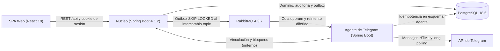

# UniProject

[](https://github.com/JDriveBB/UniProject-2/actions/workflows/calidad.yml)

Sistema web para gestionar proyectos académicos universitarios organizados por hitos, controlar dependencias y ruta crítica, detectar riesgos e inactividad y evaluar la contribución individual con trazabilidad auditable.

## El problema y la solución

En los proyectos grupales universitarios es frecuente que el trabajo se concentre en pocos integrantes, que una tarea atrasada frene a las que dependen de ella sin aviso temprano y que el docente reciba solo el entregable final sin visibilidad del proceso, terminando por calificar a todos por igual.

UniProject organiza cada proyecto por hitos con fechas límite y rúbrica, calcula la ruta crítica y las dependencias entre tareas, bloquea el envío mientras falten prerrequisitos críticos y emite alertas automáticas en la bandeja web y por Telegram. Al evaluar, sugiere notas individuales ajustadas por las tareas completadas a tiempo y mantiene una auditoría inmutable exportable en PDF.

## Qué hace

### Docente
- Crea y actualiza proyectos con múltiples hitos, fechas límite y rúbricas de evaluación cuyos pesos suman 100 % (**RF1**).
- Configura alertas de inactividad por hito (días sin actividad y si desea recibir copia además del líder) (**RF6**).
- Habilita los correos de estudiantes y monitores en el proyecto, crea equipos, invita estudiantes aún sin cuenta, designa líderes y asigna o retira monitores cuando el proyecto los habilita (**RF14**).
- Supervisa el curso desde el panel de control del proyecto, donde se resaltan los equipos con integrantes inactivos o tareas bloqueadas por más de 48 horas (**RF10**).
- Califica los hitos enviados según la rúbrica (nota provisional mientras no venza la fecha límite y definitiva al vencer), ajusta la nota grupal y confirma la nota individual a partir de la sugerida (**RF8**).
- Consulta el historial del equipo y descarga el reporte de trazabilidad en PDF (**RF15**).

### Líder de equipo
- Conserva las funciones del estudiante y puede registrar avance o adjuntar evidencias en las tareas de su equipo (**RF13**).
- Crea, edita y asigna tareas dentro de un hito, estima su duración en horas, marca prerrequisitos críticos y establece dependencias entre tareas del mismo hito sin permitir ciclos (**RF2**).
- Revisa evidencias y solicita correcciones con observaciones; si la tarea estaba completada, vuelve a «En progreso» hasta que se adjunte una nueva entrega (**RF5**).
- Reasigna tareas de forma total o parcial (dividiendo horas en una tarea nueva que hereda dependencias) ante cambios o solicitudes de apoyo (**RF11**).

### Estudiante
- Consulta sus tareas asignadas, el tablero del equipo, la gráfica de ruta crítica y la evaluación de cada hito viendo únicamente su propia nota individual (**RF3**, **RF8**, **RF13**).
- Actualiza el porcentaje de avance y adjunta evidencias (PDF, PNG o JPEG de hasta 10 MB, o enlaces `http`/`https`) solo en sus tareas asignadas; las tareas con prerrequisitos incompletos quedan bloqueadas (**RF12**, **RF13**).
- Solicita apoyo al líder en sus tareas asignadas y deja comentarios en tareas en curso de su equipo.
- Envía el hito a revisión del docente cuando todos los prerrequisitos críticos están completados (**RF7**).

### Monitor
- Consulta proyectos, tableros, tareas y evaluaciones (sin notas individuales ni historial) de los proyectos a los que fue asignado, y publica comentarios de retroalimentación en tareas en curso sin cambiar su estado ni avance (**RF14**).

### Sistema
- Calcula orden topológico, ruta crítica, holguras y bloqueos por dependencia cada vez que cambian tareas, avances o dependencias (**RF3**).
- Calcula el nivel de riesgo (`BAJO`, `MEDIO`, `ALTO`) y ejecuta revisiones horarias de riesgo en ruta crítica e inactividad sin repetir alertas mientras no cambie el estado o haya nueva actividad (**RF4**, **RF6**, **RF9**).
- Registra avisos en la bandeja web y envía notificaciones por Telegram (vía outbox y RabbitMQ) ante tareas críticas en riesgo, inactividad, envío o evaluación de hitos, reasignaciones, correcciones y eventos de cuenta (**RF4**, **RF5**, **RF6**, **RF7**, **RF8**, **RF11**).
- Registra acciones críticas y rechazos de acceso en una auditoría inmutable (**RF11**).

> El acceso requiere habilitación previa del correo: el **Administrador** (creado opcionalmente al arranque mediante variables de entorno) habilita correos de docentes en `/admin/docentes`, y cada docente habilita a los estudiantes y monitores de sus proyectos.

## Arquitectura



- **Monolito modular y agente independiente:** `nucleo` separa los módulos de [entrega1.md](Archivos_contexto/entrega1.md) §2.6 (`configuracionacademica`, `ejecucion`, `evaluacion`, `trazabilidad`), más `seguridad`, `notificaciones` y `vinculaciontelegram`, sirviendo el SPA desde el mismo origen; `agente-telegram` corre como proceso aparte para aislar fallos de Telegram o del broker.
- **Eventos CloudEvents con contrato JSON Schema:** `eventos-contrato` centraliza `EventoCloud` (1.0), los ocho tipos de `TipoEvento` y `CodecEventos`, que valida contra esquemas JSON Schema draft-07 al serializar y al leer.
- **Outbox con `SKIP LOCKED`:** `RegistroEventosJdbc` guarda los eventos en `evento_saliente` dentro de la transacción de negocio y `PublicadorOutbox` los publica con `FOR UPDATE SKIP LOCKED` y confirmaciones hacia `uniproject.eventos`, mientras el agente garantiza idempotencia por `(evento_id, usuario_id)` en `agente.evento_procesado`.
- **Sesión + CSRF:** el frontend usa cookie de sesión (`HttpOnly`, `SameSite=Lax`, 2 h), protección CSRF para SPA (`XSRF-TOKEN` / `X-XSRF-TOKEN`) y `BCryptPasswordEncoder(12)`, mientras `/interno/**` se autentica con token compartido en tiempo constante.
- **Auditoría inmutable por trigger:** `RegistroAuditoriaJdbc` escribe los hechos en `log_auditoria` (y textos libres en el anexo `texto_auditoria`) dentro de la misma transacción, protegida en PostgreSQL por un trigger que bloquea `UPDATE`, `DELETE` y `TRUNCATE`.

## Tecnologías

| Capa | Tecnología y versión |
|---|---|
| Lenguaje y compilación | Java 25 (Eclipse Temurin, imágenes `eclipse-temurin:25-jdk-noble` / `25-jre-noble`) · Maven 3.9.16 (`mvnw`) |
| Backend | Spring Boot 4.1.2 (Spring Framework 7.0.10, Spring Data JPA 4.1.2, Hibernate 7.4.13.Final, Spring AMQP 4.1.2) |
| Base de datos y migraciones | PostgreSQL 18.6 (driver `42.7.14`) · Flyway 12.4.0 |
| Broker de mensajería | RabbitMQ 4.3.7 (`rabbitmq:4.3.7-management`) |
| Bot de Telegram | TelegramBots 10.3.0 (`telegrambots-longpolling` + `telegrambots-client`) |
| Contratos, plantillas y PDF | Jackson 3 (`3.1.7`) · `json-schema-validator` 3.0.8 · JMustache · Apache PDFBox 3.0.8 |
| Frontend web | React 19.3.1 · React Router 8.5.1 · TypeScript 7.0.2 · Vite 8.3.5 · oxlint 1.94.0 (Node `>= 22.22.0`) |
| Pruebas | JUnit 5 · AssertJ · Testcontainers 2.0.5 · Vitest 5.0.5 |

## Cómo ejecutarlo

### Requisitos
- **Para ejecutar el sistema completo:** Docker Desktop (con Docker Compose).
- **Para desarrollo y pruebas locales:** JDK 25 y Node `>= 22.22.0` (además de Docker Desktop para Testcontainers).

### Puesta en marcha con Docker Compose

1. Copie `.env.example` como `.env` en la raíz del repositorio y defina valores propios en todas las variables (el archivo `.env` está excluido de git):

| Variable | Propósito |
|---|---|
| `TZ` | Zona horaria de los contenedores y cálculos de fechas. |
| `POSTGRES_PASSWORD` | Contraseña del superusuario de PostgreSQL para inicializar roles y esquemas. |
| `NUCLEO_DB_PASSWORD` | Contraseña del rol de base de datos del núcleo (esquema `public`). |
| `AGENTE_DB_PASSWORD` | Contraseña del rol de base de datos del agente (esquema `agente`). |
| `RABBITMQ_ADMIN_USER` | Usuario administrador del panel de gestión de RabbitMQ. |
| `RABBITMQ_ADMIN_PASSWORD` | Contraseña del administrador de RabbitMQ. |
| `RABBITMQ_NUCLEO_PASSWORD` | Contraseña del usuario de RabbitMQ usado por el núcleo para publicar eventos. |
| `RABBITMQ_AGENTE_PASSWORD` | Contraseña del usuario de RabbitMQ usado por el agente para consumir la cola. |
| `TELEGRAM_BOT_TOKEN` | Token del bot de Telegram (opcional si se opera solo con la bandeja web). |
| `TELEGRAM_BOT_USERNAME` | Nombre de usuario del bot en Telegram para construir el enlace profundo de vinculación. |
| `UNIPROJECT_TOKEN_INTERNO` | Secreto aleatorio obligatorio compartido entre núcleo y agente para `/interno/**`. |
| `UNIPROJECT_URL_BASE` | URL base pública de la aplicación web usada en enlaces de avisos. |
| `UNIPROJECT_TELEGRAM_BOTON_ENLACE` | Activa el botón de enlace en mensajes de Telegram (desactivado en entornos locales, ya que Telegram rechaza enlaces a `localhost`). |
| `UNIPROJECT_ADMIN_EMAIL` | Correo de la cuenta administradora inicial creada al arrancar si no existe ninguna. |
| `UNIPROJECT_ADMIN_NOMBRE` | Nombre visible de la cuenta administradora inicial. |
| `UNIPROJECT_ADMIN_CONTRASENA` | Contraseña de la cuenta administradora inicial (entre 10 y 72 caracteres). |
| `UNIPROJECT_PERFILES` | Perfiles activos de Spring en el núcleo (por defecto sin datos de muestra; con el perfil `demo` precarga el escenario de demostración). |
| `UNIPROJECT_DEMO_CONTRASENA` | Contraseña asignada a las cuentas ficticias cuando el perfil `demo` está activo. |

2. Levante todos los servicios desde la raíz del repositorio:

```bash
docker compose --env-file .env -f infra/docker-compose.yml up -d --build
```

3. Abra `http://localhost:8080` en el navegador.

### Cuentas demo

Al arrancar el núcleo con el perfil `demo` en `UNIPROJECT_PERFILES` y una contraseña válida en `UNIPROJECT_DEMO_CONTRASENA`, `DatosDemo` / `CargaDemo` (`nucleo/src/main/java/co/uniproject/nucleo/demo/`) cargan en una transacción dos proyectos de demostración («Biblioteca digital (demo)» y «App de turnos (demo)») con cuentas ficticias bajo el dominio `@demo.uniproject.test` usando la contraseña definida en esa variable (si `UNIPROJECT_ADMIN_EMAIL` y `UNIPROJECT_ADMIN_CONTRASENA` están configuradas, `InicializadorAdministrador` crea además la cuenta `ADMINISTRADOR`):

| Rol | Correos demo | Detalle del escenario |
|---|---|---|
| `DOCENTE` | `docente@demo.uniproject.test` | Laura Méndez, docente de ambos proyectos demo. |
| `ESTUDIANTE` (Líder) | `ana@demo.uniproject.test`, `diego@demo.uniproject.test` | Ana Rojas (líder Equipo Alfa y Equipo Gamma) y Diego Pérez (líder Equipo Beta; integrante en Gamma). |
| `ESTUDIANTE` (Integrante) | `bruno@demo.uniproject.test`, `camila@demo.uniproject.test`, `elena@demo.uniproject.test`, `felipe@demo.uniproject.test`, `hugo@demo.uniproject.test` | Bruno Díaz (Alfa y líder Delta), Camila Torres (Alfa), Elena Gómez (Beta y Delta; inactividad simulada), Felipe Ruiz (Beta; apoyo solicitado) y Hugo Lara (sin equipo). |
| `MONITOR` | `monitor@demo.uniproject.test` | Gabriela Soto, monitora en «Biblioteca digital (demo)». |
| Pendientes de registro | `ines@demo.uniproject.test`, `jorge@demo.uniproject.test` | Correos habilitados como estudiantes sin cuenta creada aún. |

## Pruebas y calidad

- **Puerta de calidad (`python scripts/verificar.py`):** ejecuta en secuencia la revisión de formato sobre archivos Java (Spotless con `palantir-java-format`) y web (`prettier`) cambiados respecto a `main` mediante `scripts/formatear.py --revisar`, la instalación limpia de dependencias en `web/` (`npm ci`), el linter + verificación de tipos + build (`npm run build`), las pruebas unitarias del frontend (`npm test` con Vitest) y la verificación completa de Maven (`mvnw verify`).
- **Pruebas de integración con Testcontainers:** `nucleo` y `agente-telegram` levantan contenedores reales de PostgreSQL 18.6 y RabbitMQ 4.3.7 (`ApiIntegracionBase`, `PostgresPrueba`) para verificar migraciones Flyway, permisos, outbox transaccional con `SKIP LOCKED`, reintentos diferidos, idempotencia y flujos HTTP con cookies de sesión y CSRF (requiere Docker Desktop activo).
- **`ContratoOpenApiTest`:** valida que las operaciones `@*Mapping` expuestas bajo `/api/**` coincidan exactamente con las definidas en [docs/openapi/openapi.yaml](docs/openapi/openapi.yaml) y que el contrato documente `RespuestaError` y `CSRF_INVALIDO` sin exponer rutas internas ni datos personales.
- **Sesión de pruebas manual:** descrita en [docs/pruebas/guia-sesion-pruebas.md](docs/pruebas/guia-sesion-pruebas.md) y apoyada por `infra/pruebas/sesion-pruebas.ps1`, que levanta un entorno aislado (`uniproject-pruebas`) con datos precargados para recorrer los casos por rol, Telegram real, reportes PDF, límites de tasa, recuperación y supresión de cuenta.
- **Evidencias de RNF1–RNF5:** mediciones sobre la sesión de pruebas en [docs/pruebas/evidencias-rnf.md](docs/pruebas/evidencias-rnf.md) (500 usuarios simultáneos con k6 en `p95 = 4,4 ms`, recuperación automática en ≈ 7 s tras caída del núcleo, creación de tarea con dependencia en 4 clics, ruta crítica de 150 tareas en 140–176 ms y `BCryptPasswordEncoder(12)`).

## Estructura del repositorio

```text
.
├── .github/workflows/   # Flujo de integración continua en GitHub Actions (calidad.yml)
├── eventos-contrato/    # Eventos CloudEvents, enum TipoEvento, CodecEventos y JSON Schemas
├── nucleo/              # Aplicación Spring Boot principal, dominio, seguridad, outbox y migraciones public
├── agente-telegram/     # Consumidor RabbitMQ sin servidor web, idempotencia (agente), plantillas y bot
├── web/                 # SPA en React 19, TypeScript 7, Vite 8 y pruebas Vitest
├── infra/               # Docker Compose, inicialización de PostgreSQL/RabbitMQ y script de sesión de pruebas
├── docs/                # Contratos OpenAPI y AsyncAPI y guía de la sesión de pruebas manuales
├── scripts/             # Puerta de calidad (verificar.py) y formateo incremental (formatear.py)
├── Archivos_contexto/   # Requisitos de entrega 1, decisiones técnicas y plan de notificaciones
├── DESIGN.md            # Tokens y guía del sistema de diseño visual
├── PRODUCT.md           # Definición de producto, actores y principios de diseño
├── .env.example         # Plantilla de nombres de variables de entorno para Compose
└── pom.xml              # POM padre Maven multi-módulo y configuración del wrapper (mvnw)
```

## Documentación

- [docs/diseno/](docs/diseno/README.md) — Documento de diseño: arquitectura, patrones, decisiones, modelo de datos, dominio, comportamiento y matriz de trazabilidad (con su PDF).
- [docs/openapi/openapi.yaml](docs/openapi/openapi.yaml) — Especificación OpenAPI 3.1 de la API REST (`/api/**`).
- [docs/asyncapi/asyncapi.yaml](docs/asyncapi/asyncapi.yaml) — Especificación AsyncAPI 3.0 de los eventos publicados en RabbitMQ.
- [docs/pruebas/](docs/pruebas/) — Documentación de pruebas manuales ([guia-sesion-pruebas.md](docs/pruebas/guia-sesion-pruebas.md)).
- [DESIGN.md](DESIGN.md) — Sistema de diseño visual («El cuaderno del curso»).
- [PRODUCT.md](PRODUCT.md) — Visión del producto, actores y restricciones.
- [Archivos_contexto/entrega1.md](Archivos_contexto/entrega1.md) — Requisitos funcionales (RF1–RF15), no funcionales (RNF1–RNF5) y casos de uso.
- [Archivos_contexto/decisiones-tecnicas-java.md](Archivos_contexto/decisiones-tecnicas-java.md) — Decisiones arquitectónicas y versiones fijadas del backend.
- [Archivos_contexto/plan-notificaciones-uniproject.md](Archivos_contexto/plan-notificaciones-uniproject.md) — Diseño de la arquitectura de notificaciones por eventos.

## Datos personales (Ley 1581)

- **Consentimiento:** el registro exige autorización explícita y fechada de tratamiento de datos (`autoriza_tratamiento_datos` y `fecha_autorizacion`), y la vinculación con Telegram es iniciada por el titular y revocable en cualquier momento desde `/perfil`.
- **Derechos de acceso, rectificación y supresión:** el titular puede consultar sus datos, rectificar su nombre (propagado por id a la outbox y bandeja) o suprimir su cuenta desde `/perfil`; la supresión anonimiza la fila de `usuario`, borra `telegram_chat_id`, códigos, bandeja y textos libres e invalida las sesiones abiertas conservando los registros académicos sin datos personales.
- **Privacidad en logs y contratos:** las conexiones PostgreSQL desactivan detalles de error (`logServerErrorDetail=false`), Hibernate omite errores SQL con datos (`org.hibernate.orm.jdbc.error=OFF`), los logs registran solo nombres de clase de excepción sin nombres, correos ni `chatId`, y las cuentas de demostración usan el dominio reservado `@demo.uniproject.test`.

## Equipo

Proyecto final de Diseño de Software 1:

- Juan Benavides
- Samuel Lambertino
- Santy Baza
