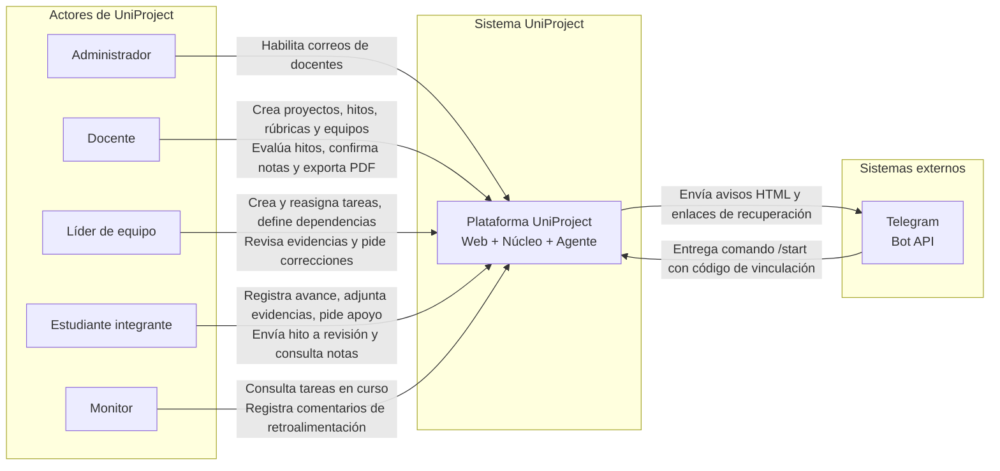
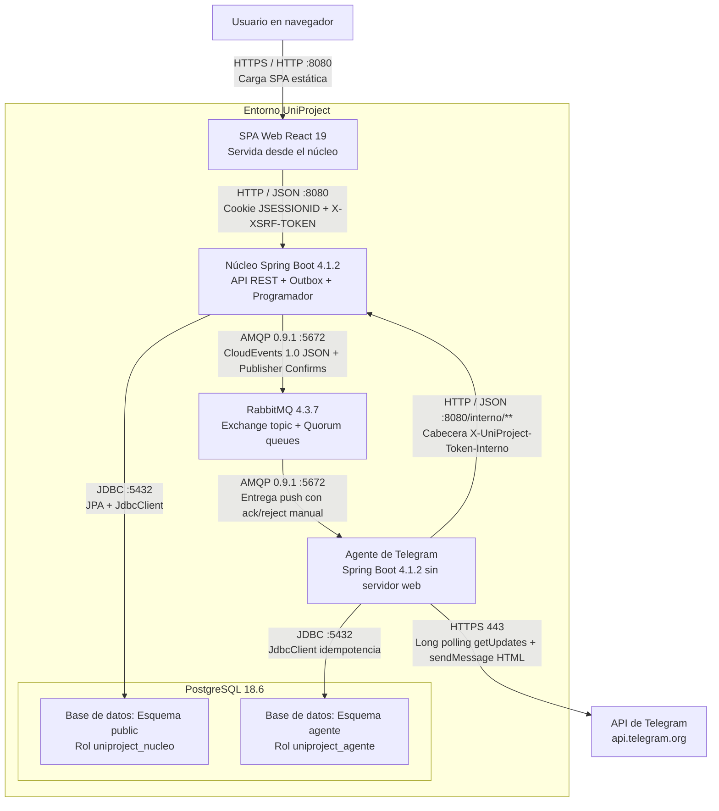
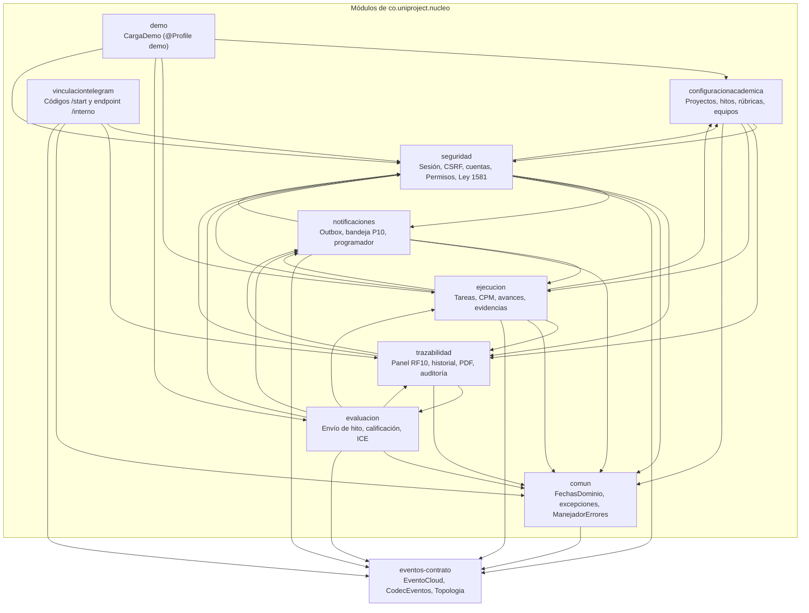
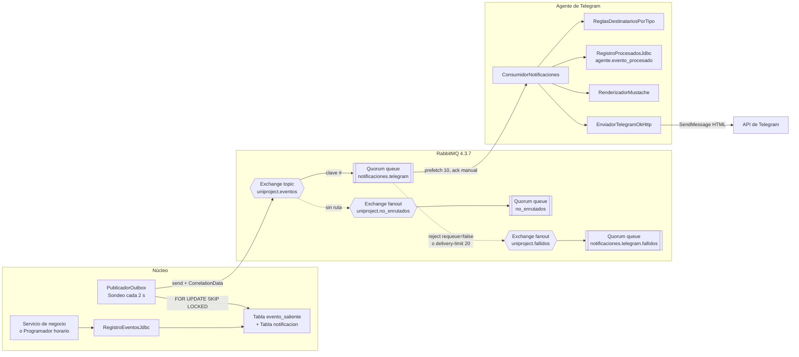
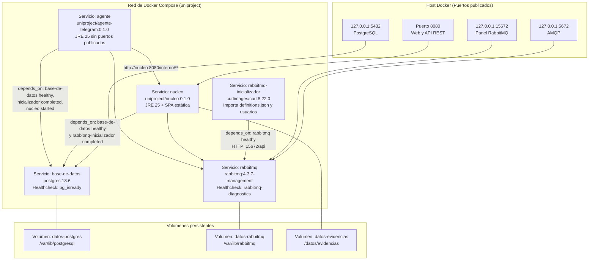

# 01. Arquitectura del sistema — UniProject

Este documento presenta la arquitectura real de **UniProject** a través de cinco vistas complementarias (contexto, contenedores, componentes del núcleo, componentes del agente de Telegram y despliegue) y la correspondencia entre los requerimientos no funcionales y las tácticas implementadas en el código.

---

## 1.1. Vista de contexto

UniProject interactúa con cinco actores humanos diferenciados por su rol en la plataforma ([`nucleo/src/main/java/co/uniproject/nucleo/seguridad/dominio/RolPlataforma.java`](../../nucleo/src/main/java/co/uniproject/nucleo/seguridad/dominio/RolPlataforma.java)) o en el equipo ([`nucleo/src/main/resources/db/migration/V3__modelo_dominio.sql`](../../nucleo/src/main/resources/db/migration/V3__modelo_dominio.sql)) y con un sistema externo (**Telegram**), que materializa el actor secundario «Sistema de notificaciones» planteado en [`Archivos_contexto/entrega1.md`](../../Archivos_contexto/entrega1.md) §2.2.

### Intercambios por actor y diferencias frente a la entrega 1

| Actor | Qué envía a UniProject | Qué recibe de UniProject | Implementación y diferencias con la entrega 1 |
|---|---|---|---|
| **Administrador** | Alta de correos institucionales de docentes (`POST /api/admin/docentes`). | Listado de docentes habilitados y estado de registro. | **Adición frente a la entrega 1:** se incorporó el rol `ADMINISTRADOR` ([`nucleo/src/main/java/co/uniproject/nucleo/seguridad/web/ControladorAdministracion.java`](../../nucleo/src/main/java/co/uniproject/nucleo/seguridad/web/ControladorAdministracion.java)) porque no se envían correos de verificación (decisión D6 y K2 en [`Archivos_contexto/decisiones-tecnicas-java.md`](../../Archivos_contexto/decisiones-tecnicas-java.md) §13). El primer administrador se crea al arranque desde variables de entorno. |
| **Docente** | Creación y edición de proyectos, hitos, criterios de rúbrica, alertas de inactividad, habilitación de correos de estudiantes/monitores, conformación de equipos, evaluación de hitos y confirmación de notas individuales. | Panel de seguimiento con alertas visuales (RF10), cálculo de nota grupal e Índice de Contribución Efectiva (ICE), historial de auditoría, reporte PDF (RF15) y avisos de envío/riesgo/inactividad. | Definido en [`nucleo/src/main/java/co/uniproject/nucleo/configuracionacademica/web/ControladorProyectos.java`](../../nucleo/src/main/java/co/uniproject/nucleo/configuracionacademica/web/ControladorProyectos.java), [`nucleo/src/main/java/co/uniproject/nucleo/evaluacion/servicio/ServicioEvaluacion.java`](../../nucleo/src/main/java/co/uniproject/nucleo/evaluacion/servicio/ServicioEvaluacion.java) y [`nucleo/src/main/java/co/uniproject/nucleo/trazabilidad/web/ControladorTrazabilidad.java`](../../nucleo/src/main/java/co/uniproject/nucleo/trazabilidad/web/ControladorTrazabilidad.java). |
| **Líder de equipo** | Creación y edición de tareas, asignación inicial, definición de dependencias, reasignación total o parcial (RF11) y solicitud de corrección sobre evidencias (RF5), además de las acciones de estudiante. | Tablero del equipo, ruta crítica recalculada (RF3), carga de trabajo por integrante, solicitudes de apoyo y alertas de inactividad/riesgo. | Modelado como estudiante con `rol_equipo = 'LIDER'` en `miembro_equipo` (índice único parcial `miembro_equipo_un_lider_uk` en [`nucleo/src/main/resources/db/migration/V3__modelo_dominio.sql`](../../nucleo/src/main/resources/db/migration/V3__modelo_dominio.sql)). Reglas en [`nucleo/src/main/java/co/uniproject/nucleo/seguridad/permisos/PermisosJdbc.java`](../../nucleo/src/main/java/co/uniproject/nucleo/seguridad/permisos/PermisosJdbc.java). |
| **Estudiante** | Actualización de porcentaje de avance (RF12), subida de evidencias PDF/PNG/JPEG o enlaces (RF12), solicitud de apoyo al líder, envío de hito a revisión (RF7) y gestión de su perfil/datos personales (Ley 1581). | Mis tareas, grafo de ruta crítica, bandeja interna de notificaciones (P10), resultado de evaluación con su nota individual y avisos por Telegram. | Reglas de negocio en [`nucleo/src/main/java/co/uniproject/nucleo/ejecucion/servicio/ServicioAvance.java`](../../nucleo/src/main/java/co/uniproject/nucleo/ejecucion/servicio/ServicioAvance.java), [`nucleo/src/main/java/co/uniproject/nucleo/ejecucion/servicio/ServicioEvidencias.java`](../../nucleo/src/main/java/co/uniproject/nucleo/ejecucion/servicio/ServicioEvidencias.java) y [`nucleo/src/main/java/co/uniproject/nucleo/evaluacion/servicio/ServicioEnvio.java`](../../nucleo/src/main/java/co/uniproject/nucleo/evaluacion/servicio/ServicioEnvio.java). |
| **Monitor** | Comentarios de retroalimentación en tareas de hitos en curso (RF14). | Vista de solo lectura de proyectos, tableros, tareas, evidencias y evaluación grupal (sin notas individuales). | Implementado en [`nucleo/src/main/java/co/uniproject/nucleo/ejecucion/servicio/ServicioComentarios.java`](../../nucleo/src/main/java/co/uniproject/nucleo/ejecucion/servicio/ServicioComentarios.java) y restringido en [`nucleo/src/main/java/co/uniproject/nucleo/seguridad/permisos/PermisosJdbc.java`](../../nucleo/src/main/java/co/uniproject/nucleo/seguridad/permisos/PermisosJdbc.java). |
| **Telegram (Bot API)** | Entrega al agente los mensajes `/start <código>` cuando el usuario abre el enlace profundo de vinculación, y respuestas HTTP de entrega (`200`, `400`, `403`, `429`, `5xx`). | Peticiones `getUpdates` (long polling) y `sendMessage` en formato HTML con los avisos de proyecto y enlaces de recuperación de contraseña. | Concreta el «Sistema de notificaciones» de la entrega 1 mediante [`agente-telegram/src/main/java/co/uniproject/agente/telegram/EnviadorTelegramOkHttp.java`](../../agente-telegram/src/main/java/co/uniproject/agente/telegram/EnviadorTelegramOkHttp.java) y [`agente-telegram/src/main/java/co/uniproject/agente/telegram/ReceptorTelegram.java`](../../agente-telegram/src/main/java/co/uniproject/agente/telegram/ReceptorTelegram.java). |

---

## 1.2. Vista de contenedores

El sistema se ejecuta en contenedores coordinados que separan el servidor de aplicación principal (**núcleo** con la **SPA web** integrada), el broker de mensajería (**RabbitMQ**), el motor relacional (**PostgreSQL** con esquemas separados por rol) y el proceso consumidor/bot (**agente de Telegram**).

### Catálogo de contenedores y módulos de despliegue

| Contenedor / artefacto | Responsabilidad | Tecnología y versión | Ubicación en el repositorio |
|---|---|---|---|
| **SPA Web** (`web`) | Interfaz de usuario de página única: tableros por hito, grafo SVG de ruta crítica, evaluación con rúbrica, panel del docente, bandeja P10, historial y perfil Ley 1581. Se empaqueta como recursos estáticos del núcleo (mismo origen). | React 19.3.1, React Router 8.5.1, TypeScript 7.0.2, Vite 8.3.5, Vitest 5.0.5 (Node 26.13.0 en build). | [`web/package.json`](../../web/package.json), [`web/src/App.tsx`](../../web/src/App.tsx), [`nucleo/Dockerfile`](../../nucleo/Dockerfile) |
| **Núcleo** (`nucleo`) | Monolito modular que sirve la SPA y la API REST (`/api/**`), aplica permisos y reglas de negocio, ejecuta el motor CPM y la calculadora ICE, audita acciones, inserta en la outbox/bandeja, ejecuta el programador horario y publica eventos a RabbitMQ. | Java 25 (Eclipse Temurin 25), Spring Boot 4.1.2 (WebMVC, Security, Validation, Data JPA/Hibernate 7.4.13, JDBC, AMQP, Flyway 12.4.0, Actuator), Apache PDFBox 3.0.8. | [`nucleo/pom.xml`](../../nucleo/pom.xml), [`nucleo/src/main/java/co/uniproject/nucleo/NucleoAplicacion.java`](../../nucleo/src/main/java/co/uniproject/nucleo/NucleoAplicacion.java), [`nucleo/src/main/resources/application.yml`](../../nucleo/src/main/resources/application.yml) |
| **Contrato de eventos** (`eventos-contrato`) | Librería JAR compartida (sin Spring) con la envolvente CloudEvents 1.0, los `record` de carga útil, las reglas de destinatarios, las rutas web, constantes de topología, el validador `CodecEventos` y los 8 JSON Schema draft-07. | Java 25, Jackson 3 (`tools.jackson` 3.1.7), `com.networknt:json-schema-validator` 3.0.8. | [`eventos-contrato/pom.xml`](../../eventos-contrato/pom.xml), [`eventos-contrato/src/main/java/co/uniproject/eventos/CodecEventos.java`](../../eventos-contrato/src/main/java/co/uniproject/eventos/CodecEventos.java) |
| **Agente de Telegram** (`agente-telegram`) | Proceso independiente (`web-application-type: none`) que consume eventos de la cola `notificaciones.telegram`, garantiza idempotencia por destinatario, renderiza plantillas Mustache, envía avisos por la Bot API y atiende `/start <código>` por long polling. | Java 25, Spring Boot 4.1.2 (AMQP, JDBC, Flyway, Mustache, RestClient), TelegramBots 10.3.0 (`longpolling` + `client` OkHttp), `json-schema-validator` 3.0.8. | [`agente-telegram/pom.xml`](../../agente-telegram/pom.xml), [`agente-telegram/src/main/java/co/uniproject/agente/AgenteAplicacion.java`](../../agente-telegram/src/main/java/co/uniproject/agente/AgenteAplicacion.java), [`agente-telegram/src/main/resources/application.yml`](../../agente-telegram/src/main/resources/application.yml) |
| **Base de datos** (`base-de-datos`) | Almacenamiento relacional transaccional con separación de privilegios: esquema `public` (29 tablas del núcleo y outbox, dueño `uniproject_nucleo`) y esquema `agente` (tabla `evento_procesado`, dueño `uniproject_agente` sin permiso sobre `public`). | PostgreSQL 18.6, driver `org.postgresql:postgresql` 42.7.14. | [`infra/docker-compose.yml`](../../infra/docker-compose.yml), [`infra/postgres/init/01-roles-y-esquemas.sh`](../../infra/postgres/init/01-roles-y-esquemas.sh), [`nucleo/src/main/resources/db/migration/V3__modelo_dominio.sql`](../../nucleo/src/main/resources/db/migration/V3__modelo_dominio.sql) |
| **Broker de mensajes** (`rabbitmq` + `rabbitmq-inicializador`) | Enrutamiento asíncrono por claves jerárquicas (`uniproject.eventos`), retención en quorum queues con reintento diferido nativo y desvío a colas de no enrutados y fallidos. El inicializador importa `definitions.json` y crea usuarios con permisos mínimos. | RabbitMQ 4.3.7 Management (`rabbitmq:4.3.7-management`) y `curlimages/curl:8.22.0`. | [`infra/rabbitmq/definitions.json`](../../infra/rabbitmq/definitions.json), [`infra/rabbitmq/inicializar.sh`](../../infra/rabbitmq/inicializar.sh), [`infra/rabbitmq/rabbitmq.conf`](../../infra/rabbitmq/rabbitmq.conf) |

---

## 1.3. Vista de componentes del núcleo

El módulo `nucleo` está organizado como un **monolito modular** en nueve paquetes de primer nivel bajo `co.uniproject.nucleo`, que además comparten el módulo `eventos-contrato` (`co.uniproject.eventos`).

### Dependencias reales entre paquetes del núcleo (verificadas por `import`)

| Paquete origen | Paquetes de `co.uniproject.*` que importa | Motivo y archivos donde se comprueba |
|---|---|---|
| `configuracionacademica` | `comun.error`, `seguridad` (`UsuarioAutenticado`, `cuentas`, `dominio`, `permisos`, `repositorio`), `trazabilidad.auditoria`, `ejecucion.repositorio` | Valida permisos del docente, audita cambios de configuración, consulta cuentas/correos habilitados y sincroniza los `hito_equipo` al crear hitos o equipos ([`nucleo/src/main/java/co/uniproject/nucleo/configuracionacademica/servicio/ServicioProyectos.java`](../../nucleo/src/main/java/co/uniproject/nucleo/configuracionacademica/servicio/ServicioProyectos.java), [`nucleo/src/main/java/co/uniproject/nucleo/configuracionacademica/servicio/ServicioHitos.java`](../../nucleo/src/main/java/co/uniproject/nucleo/configuracionacademica/servicio/ServicioHitos.java), [`nucleo/src/main/java/co/uniproject/nucleo/configuracionacademica/servicio/ApoyoConfiguracion.java`](../../nucleo/src/main/java/co/uniproject/nucleo/configuracionacademica/servicio/ApoyoConfiguracion.java)). |
| `ejecucion` | `comun`, `configuracionacademica.servicio` (`AuditoriaCambios`, `Textos`), `notificaciones` (`RegistroEventos`), `seguridad` (`UsuarioAutenticado`, `RolPlataforma`, `Permisos`), `trazabilidad.auditoria`, `eventos.datos` | Gestiona tareas, calcula CPM/riesgo con `MotorDependencias`, audita cambios y registra los eventos `tarea.reasignada` y `tarea.correccion` en la outbox ([`nucleo/src/main/java/co/uniproject/nucleo/ejecucion/servicio/ServicioTareas.java`](../../nucleo/src/main/java/co/uniproject/nucleo/ejecucion/servicio/ServicioTareas.java), [`nucleo/src/main/java/co/uniproject/nucleo/ejecucion/servicio/ServicioReasignacion.java`](../../nucleo/src/main/java/co/uniproject/nucleo/ejecucion/servicio/ServicioReasignacion.java), [`nucleo/src/main/java/co/uniproject/nucleo/ejecucion/servicio/ServicioCorrecciones.java`](../../nucleo/src/main/java/co/uniproject/nucleo/ejecucion/servicio/ServicioCorrecciones.java)). |
| `evaluacion` | `comun`, `configuracionacademica.servicio.Textos`, `ejecucion` (`EstadoHitoEquipo`, `BloqueoHito`, `ConsultasEjecucion`, `ContextoHito`, `EdicionHito`, `LectorTareas`), `notificaciones` (`RegistroEventos`), `seguridad`, `trazabilidad.auditoria`, `eventos.datos` | Bloquea el `hito_equipo`, verifica prerrequisitos críticos (RF7), calcula notas e ICE con `CalculadoraIce` (RF8) y registra `hito.enviado` e `hito.evaluado` ([`nucleo/src/main/java/co/uniproject/nucleo/evaluacion/servicio/ServicioEnvio.java`](../../nucleo/src/main/java/co/uniproject/nucleo/evaluacion/servicio/ServicioEnvio.java), [`nucleo/src/main/java/co/uniproject/nucleo/evaluacion/servicio/ServicioEvaluacion.java`](../../nucleo/src/main/java/co/uniproject/nucleo/evaluacion/servicio/ServicioEvaluacion.java)). |
| `trazabilidad` | `comun`, `evaluacion.calificacion.CaracterEvaluacion`, `notificaciones.programador` (`DetectorInactividad`, `CasoInactividad`), `seguridad`, `eventos.datos.CaracterNota` | Reutiliza `DetectorInactividad` para resaltar equipos inactivos en el panel del docente (RF10), consulta `log_auditoria`/`texto_auditoria` y genera el reporte PDF con `GeneradorReportePdf` (RF15) ([`nucleo/src/main/java/co/uniproject/nucleo/trazabilidad/servicio/ServicioPanel.java`](../../nucleo/src/main/java/co/uniproject/nucleo/trazabilidad/servicio/ServicioPanel.java), [`nucleo/src/main/java/co/uniproject/nucleo/trazabilidad/servicio/ServicioReporte.java`](../../nucleo/src/main/java/co/uniproject/nucleo/trazabilidad/servicio/ServicioReporte.java)). |
| `seguridad` | `comun`, `configuracionacademica` (`MonitorProyecto`, `MonitorProyectoRepositorio`, `ServicioEquipos`), `notificaciones` (`PersonasEnEventos`, `RegistroEventos`), `trazabilidad.auditoria`, `eventos` (`datos`, `interno.ContratoInterno`) | Protege cadenas HTTP, incorpora invitados al registrarse, propaga rectificación/anonimización de nombres a la outbox y bandeja (`PersonasEnEventos`), y publica eventos de recuperación y cambio de contraseña ([`nucleo/src/main/java/co/uniproject/nucleo/seguridad/ConfiguracionSeguridad.java`](../../nucleo/src/main/java/co/uniproject/nucleo/seguridad/ConfiguracionSeguridad.java), [`nucleo/src/main/java/co/uniproject/nucleo/seguridad/cuentas/ServicioCuentas.java`](../../nucleo/src/main/java/co/uniproject/nucleo/seguridad/cuentas/ServicioCuentas.java), [`nucleo/src/main/java/co/uniproject/nucleo/seguridad/cuentas/ServicioSupresion.java`](../../nucleo/src/main/java/co/uniproject/nucleo/seguridad/cuentas/ServicioSupresion.java), [`nucleo/src/main/java/co/uniproject/nucleo/seguridad/cuentas/ServicioContrasena.java`](../../nucleo/src/main/java/co/uniproject/nucleo/seguridad/cuentas/ServicioContrasena.java)). |
| `notificaciones` | `comun`, `ejecucion.dependencias` (`MotorDependencias`, `NivelRiesgo`, `RiesgoTarea`, `TareaPlan`), `seguridad.UsuarioAutenticado`, `eventos` | Inserta en `evento_saliente` y `notificacion` en la misma transacción, publica lotes a RabbitMQ y evalúa cada hora tareas críticas en riesgo usando `MotorDependencias` ([`nucleo/src/main/java/co/uniproject/nucleo/notificaciones/RegistroEventosJdbc.java`](../../nucleo/src/main/java/co/uniproject/nucleo/notificaciones/RegistroEventosJdbc.java), [`nucleo/src/main/java/co/uniproject/nucleo/notificaciones/PublicadorOutbox.java`](../../nucleo/src/main/java/co/uniproject/nucleo/notificaciones/PublicadorOutbox.java), [`nucleo/src/main/java/co/uniproject/nucleo/notificaciones/programador/EvaluadorRiesgoDominio.java`](../../nucleo/src/main/java/co/uniproject/nucleo/notificaciones/programador/EvaluadorRiesgoDominio.java)). |
| `vinculaciontelegram` | `comun.error`, `seguridad.UsuarioAutenticado`, `trazabilidad.auditoria`, `eventos.interno` | Genera códigos de vinculación desde el perfil y procesa confirmaciones/bloqueos del bot en `/interno/telegram/**` ([`nucleo/src/main/java/co/uniproject/nucleo/vinculaciontelegram/ServicioVinculacion.java`](../../nucleo/src/main/java/co/uniproject/nucleo/vinculaciontelegram/ServicioVinculacion.java), [`nucleo/src/main/java/co/uniproject/nucleo/vinculaciontelegram/ControladorInternoTelegram.java`](../../nucleo/src/main/java/co/uniproject/nucleo/vinculaciontelegram/ControladorInternoTelegram.java)). |
| `comun` | `eventos.Topologia`, `seguridad.UsuarioAutenticado`, `trazabilidad.auditoria` | Provee utilidades de zona horaria (`FechasDominio`), jerarquía de excepciones y el `@RestControllerAdvice` `ManejadorErrores` que audita los `403` ([`nucleo/src/main/java/co/uniproject/nucleo/comun/FechasDominio.java`](../../nucleo/src/main/java/co/uniproject/nucleo/comun/FechasDominio.java), [`nucleo/src/main/java/co/uniproject/nucleo/comun/web/ManejadorErrores.java`](../../nucleo/src/main/java/co/uniproject/nucleo/comun/web/ManejadorErrores.java)). |
| `demo` | `comun`, `configuracionacademica.servicio`, `ejecucion.servicio`, `evaluacion.servicio`, `seguridad` | Carga el escenario de demostración transaccional cuando se activa el perfil `demo` ([`nucleo/src/main/java/co/uniproject/nucleo/demo/DatosDemo.java`](../../nucleo/src/main/java/co/uniproject/nucleo/demo/DatosDemo.java), [`nucleo/src/main/java/co/uniproject/nucleo/demo/CargaDemo.java`](../../nucleo/src/main/java/co/uniproject/nucleo/demo/CargaDemo.java)). |

### Capas internas de los módulos del núcleo

Dentro de los módulos de negocio la estructura sigue cuatro capas internas bien delimitadas:
1. **`web/`**: controladores `@RestController` que reciben el `@AuthenticationPrincipal UsuarioAutenticado`, validan DTOs de entrada con `@Valid` y delegan al servicio sin contener reglas de negocio (p. ej. [`nucleo/src/main/java/co/uniproject/nucleo/configuracionacademica/web/ControladorProyectos.java`](../../nucleo/src/main/java/co/uniproject/nucleo/configuracionacademica/web/ControladorProyectos.java)).
2. **`servicio/`** (y subpaquetes de dominio algorítmico puro como `ejecucion/dependencias/`, `evaluacion/calificacion/`, `trazabilidad/reporte/`, `trazabilidad/auditoria/`, `notificaciones/bandeja/`, `notificaciones/programador/`, `seguridad/cuentas/`, `seguridad/permisos/`): servicios `@Service` transaccionales (`@Transactional`) que verifican `Permisos`, adquieren bloqueos pesimistas cuando corresponde (`BloqueoHito`), aplican reglas de negocio, invocan algoritmos puros (`MotorDependencias`, `CalculadoraIce`), registran en auditoría y emiten eventos en la outbox.
3. **`repositorio/`**: interfaces Spring Data JPA (`JpaRepository` o `Repository` de solo lectura) complementadas por consultas SQL explícitas mediante `JdbcClient` para lecturas compuestas sin problema N+1 (`ConsultasEjecucion`, `LectorTareas`, `LectorEvaluaciones`).
4. **`dominio/`**: entidades JPA (`@Entity`, `@Table`, `@Column`) sin relaciones `@ManyToOne`/`@OneToMany` (cada clave foránea es un `Long`) y enumeraciones del modelo ([`nucleo/src/main/java/co/uniproject/nucleo/ejecucion/dominio/Tarea.java`](../../nucleo/src/main/java/co/uniproject/nucleo/ejecucion/dominio/Tarea.java)).

### Correspondencia con las 5 capas y los 4 módulos de la entrega 1 (§2.5 y §2.6)

| Elemento en `entrega1.md` | Cómo se construyó en el código real | Ubicación verificable |
|---|---|---|
| **Capa de Presentación (Frontend)** (§2.5) | SPA en React 19 + TypeScript 7 (`web/`), compilada y servida por el propio núcleo en el mismo origen. | [`web/src/App.tsx`](../../web/src/App.tsx), [`web/src/paginas/Tablero.tsx`](../../web/src/paginas/Tablero.tsx), [`web/src/paginas/RutaCritica.tsx`](../../web/src/paginas/RutaCritica.tsx) |
| **Capa de Enrutamiento y Control** (§2.5) | Cadenas de filtros de Spring Security (`ConfiguracionSeguridad`: sesión + CSRF para `/api/**` y `FiltroTokenInterno` para `/interno/**`), controladores `@RestController` en subpaquetes `web/` y `ManejadorErrores`. No se usa un API Gateway externo ni JWT porque el núcleo sirve la SPA en el mismo origen. | [`nucleo/src/main/java/co/uniproject/nucleo/seguridad/ConfiguracionSeguridad.java`](../../nucleo/src/main/java/co/uniproject/nucleo/seguridad/ConfiguracionSeguridad.java), [`nucleo/src/main/java/co/uniproject/nucleo/comun/web/ManejadorErrores.java`](../../nucleo/src/main/java/co/uniproject/nucleo/comun/web/ManejadorErrores.java) |
| **Capa de Lógica de Negocio (Servicios Core)** (§2.5) | Subpaquetes `servicio/` de cada módulo más los motores Java puros `MotorDependencias` (CPM, detección de ciclos, bloqueo y riesgo) y `CalculadoraIce` (nota grupal e ICE). | [`nucleo/src/main/java/co/uniproject/nucleo/ejecucion/dependencias/MotorDependencias.java`](../../nucleo/src/main/java/co/uniproject/nucleo/ejecucion/dependencias/MotorDependencias.java), [`nucleo/src/main/java/co/uniproject/nucleo/evaluacion/calificacion/CalculadoraIce.java`](../../nucleo/src/main/java/co/uniproject/nucleo/evaluacion/calificacion/CalculadoraIce.java) |
| **Capa de Acceso a Datos (Repositorios/DAO)** (§2.5) | Subpaquetes `repositorio/` (Spring Data JPA) y `dominio/` (entidades JPA), combinados con `JdbcClient` bajo el mismo `JpaTransactionManager` y migraciones Flyway (`V1`–`V8`). | [`nucleo/src/main/java/co/uniproject/nucleo/configuracionacademica/repositorio/ProyectoRepositorio.java`](../../nucleo/src/main/java/co/uniproject/nucleo/configuracionacademica/repositorio/ProyectoRepositorio.java), [`nucleo/src/main/resources/db/migration/V3__modelo_dominio.sql`](../../nucleo/src/main/resources/db/migration/V3__modelo_dominio.sql) |
| **Gestor Asíncrono de Notificaciones** (§2.5) | Se dividió en tres piezas desacopladas: paquete `notificaciones` del núcleo (outbox `evento_saliente`, bandeja `notificacion`, `PublicadorOutbox` y programador horario), broker **RabbitMQ 4.3.7** y aplicación independiente **`agente-telegram`**. | [`nucleo/src/main/java/co/uniproject/nucleo/notificaciones/PublicadorOutbox.java`](../../nucleo/src/main/java/co/uniproject/nucleo/notificaciones/PublicadorOutbox.java), [`agente-telegram/src/main/java/co/uniproject/agente/consumo/ConsumidorNotificaciones.java`](../../agente-telegram/src/main/java/co/uniproject/agente/consumo/ConsumidorNotificaciones.java) |
| **Módulo de Configuración Académica** (§2.6) | Paquete `co.uniproject.nucleo.configuracionacademica` (`ServicioProyectos`, `ServicioHitos`, `ServicioEquipos`, `ServicioCorreosProyecto`). | [`nucleo/src/main/java/co/uniproject/nucleo/configuracionacademica/servicio/ServicioProyectos.java`](../../nucleo/src/main/java/co/uniproject/nucleo/configuracionacademica/servicio/ServicioProyectos.java) |
| **Módulo de Ejecución y Dependencias** (§2.6) | Paquete `co.uniproject.nucleo.ejecucion` (`ServicioTareas`, `ServicioDependencias`, `ServicioAvance`, `ServicioEvidencias`, `ServicioCorrecciones`, `ServicioReasignacion`, `ServicioComentarios`, `ServicioApoyo`, `MotorDependencias`). | [`nucleo/src/main/java/co/uniproject/nucleo/ejecucion/servicio/ServicioDependencias.java`](../../nucleo/src/main/java/co/uniproject/nucleo/ejecucion/servicio/ServicioDependencias.java) |
| **Módulo de Evaluación y Calificación Algorítmica** (§2.6) | Paquete `co.uniproject.nucleo.evaluacion` (`ServicioEnvio`, `ServicioEvaluacion`, `LectorEvaluaciones`, `CalculadoraIce`, `CaracterEvaluacion`). | [`nucleo/src/main/java/co/uniproject/nucleo/evaluacion/servicio/ServicioEvaluacion.java`](../../nucleo/src/main/java/co/uniproject/nucleo/evaluacion/servicio/ServicioEvaluacion.java) |
| **Módulo de Trazabilidad y Seguridad (Logs)** (§2.6) | Se separó en dos paquetes con responsabilidades cohesivas: `co.uniproject.nucleo.trazabilidad` (auditoría inmutable, panel RF10, historial y reporte PDF RF15) y `co.uniproject.nucleo.seguridad` (autenticación, autorización `Permisos`, alta de cuentas, recuperación y derechos Ley 1581), más los módulos transversales `notificaciones`, `vinculaciontelegram`, `comun` y `demo`. | [`nucleo/src/main/java/co/uniproject/nucleo/trazabilidad/auditoria/RegistroAuditoriaJdbc.java`](../../nucleo/src/main/java/co/uniproject/nucleo/trazabilidad/auditoria/RegistroAuditoriaJdbc.java), [`nucleo/src/main/java/co/uniproject/nucleo/seguridad/permisos/PermisosJdbc.java`](../../nucleo/src/main/java/co/uniproject/nucleo/seguridad/permisos/PermisosJdbc.java) |

---

## 1.4. Componentes del agente de Telegram y recorrido de un evento

La aplicación `agente-telegram` (`co.uniproject.agente`) se compone de seis paquetes especializados y comparte `eventos-contrato` con el núcleo:

- **`consumo/`**: [`ConsumidorNotificaciones.java`](../../agente-telegram/src/main/java/co/uniproject/agente/consumo/ConsumidorNotificaciones.java) escucha la cola `notificaciones.telegram` con `@RabbitListener`, coordina la validación, selección de destinatarios, idempotencia, renderizado y envío, y administra las confirmaciones manuales (`basicAck` / `basicReject`). Importa `destinatarios`, `idempotencia`, `plantillas`, `telegram`, `vinculacion` y `co.uniproject.eventos`.
- **`destinatarios/`**: [`ReglasDestinatarios.java`](../../agente-telegram/src/main/java/co/uniproject/agente/destinatarios/ReglasDestinatarios.java), [`ReglasDestinatariosPorTipo.java`](../../agente-telegram/src/main/java/co/uniproject/agente/destinatarios/ReglasDestinatariosPorTipo.java), [`Destinatario.java`](../../agente-telegram/src/main/java/co/uniproject/agente/destinatarios/Destinatario.java) y [`Variante.java`](../../agente-telegram/src/main/java/co/uniproject/agente/destinatarios/Variante.java). Filtra los destinatarios calculados por [`DestinatariosEvento.java`](../../eventos-contrato/src/main/java/co/uniproject/eventos/DestinatariosEvento.java) conservando solo aquellos con `chatId != null` y asignando la variante de plantilla (`UNICA`, `NUEVO`, `ANTERIOR`).
- **`idempotencia/`**: [`RegistroProcesados.java`](../../agente-telegram/src/main/java/co/uniproject/agente/idempotencia/RegistroProcesados.java) y [`RegistroProcesadosJdbc.java`](../../agente-telegram/src/main/java/co/uniproject/agente/idempotencia/RegistroProcesadosJdbc.java). Consulta y registra en `agente.evento_procesado` la pareja `(evento_id, usuario_id)` con `INSERT ... ON CONFLICT DO NOTHING` ([`agente-telegram/src/main/resources/db/migration/V1__evento_procesado.sql`](../../agente-telegram/src/main/resources/db/migration/V1__evento_procesado.sql)). No importa ningún otro paquete del agente.
- **`plantillas/`**: [`RenderizadorAvisos.java`](../../agente-telegram/src/main/java/co/uniproject/agente/plantillas/RenderizadorAvisos.java), [`RenderizadorMustache.java`](../../agente-telegram/src/main/java/co/uniproject/agente/plantillas/RenderizadorMustache.java), [`Aviso.java`](../../agente-telegram/src/main/java/co/uniproject/agente/plantillas/Aviso.java) y [`PlantillaException.java`](../../agente-telegram/src/main/java/co/uniproject/agente/plantillas/PlantillaException.java). Compila al arranque las 9 plantillas `.mustache` con un escapador HTML específico para Telegram (`&`, `<`, `>`, `"`) y resuelve el texto del botón y la ruta de [`RutasWeb.java`](../../eventos-contrato/src/main/java/co/uniproject/eventos/RutasWeb.java). Importa `destinatarios.Variante` y `co.uniproject.eventos`.
- **`telegram/`**: [`EnviadorTelegram.java`](../../agente-telegram/src/main/java/co/uniproject/agente/telegram/EnviadorTelegram.java), [`EnviadorTelegramOkHttp.java`](../../agente-telegram/src/main/java/co/uniproject/agente/telegram/EnviadorTelegramOkHttp.java), [`ResultadoEnvio.java`](../../agente-telegram/src/main/java/co/uniproject/agente/telegram/ResultadoEnvio.java), [`ReceptorTelegram.java`](../../agente-telegram/src/main/java/co/uniproject/agente/telegram/ReceptorTelegram.java), [`TextosBot.java`](../../agente-telegram/src/main/java/co/uniproject/agente/telegram/TextosBot.java) y [`ConfiguracionTelegram.java`](../../agente-telegram/src/main/java/co/uniproject/agente/telegram/ConfiguracionTelegram.java). Envía mensajes con `ParseMode.HTML`, clasifica los errores de la Bot API sin lanzar excepciones y procesa `/start <código>` por long polling. Importa `plantillas.Aviso`, `vinculacion.{ClienteNucleo, ResultadoVinculacion}` y `co.uniproject.eventos.interno.ContratoInterno`.
- **`vinculacion/`**: [`ClienteNucleo.java`](../../agente-telegram/src/main/java/co/uniproject/agente/vinculacion/ClienteNucleo.java), [`ClienteNucleoRest.java`](../../agente-telegram/src/main/java/co/uniproject/agente/vinculacion/ClienteNucleoRest.java), [`ResultadoVinculacion.java`](../../agente-telegram/src/main/java/co/uniproject/agente/vinculacion/ResultadoVinculacion.java) y [`CodigoRecuperacion.java`](../../agente-telegram/src/main/java/co/uniproject/agente/vinculacion/CodigoRecuperacion.java). Invoca con `RestClient` los tres endpoints internos del núcleo (`/interno/telegram/vinculaciones`, `/interno/telegram/bloqueos` y `/interno/telegram/recuperaciones`) enviando la cabecera `X-UniProject-Token-Interno`.

### Recorrido paso a paso de un evento y manejo de fallos

1. **Cambio en el núcleo y escritura atómica en la outbox:** cuando ocurre una acción de usuario (`hito.enviado`, `hito.evaluado`, `tarea.reasignada`, `tarea.correccion`, `cuenta.recuperacion.solicitada`, `cuenta.contrasena.cambiada`) o cuando las revisiones horarias [`RevisionRiesgo.java`](../../nucleo/src/main/java/co/uniproject/nucleo/notificaciones/programador/RevisionRiesgo.java) y [`RevisionInactividad.java`](../../nucleo/src/main/java/co/uniproject/nucleo/notificaciones/programador/RevisionInactividad.java) detectan un cambio de estado (`tarea.ruta_critica.riesgo`, `equipo.inactividad`), el servicio invoca [`RegistroEventosJdbc.java`](../../nucleo/src/main/java/co/uniproject/nucleo/notificaciones/RegistroEventosJdbc.java) dentro de la misma transacción. Este exige `TransactionSynchronizationManager.isActualTransactionActive()`, construye el `EventoCloud`, lo valida contra su JSON Schema con [`CodecEventos.java`](../../eventos-contrato/src/main/java/co/uniproject/eventos/CodecEventos.java), inserta la fila en `evento_saliente` y registra los avisos de la bandeja interna en `notificacion` mediante [`RegistroNotificacionesJdbc.java`](../../nucleo/src/main/java/co/uniproject/nucleo/notificaciones/bandeja/RegistroNotificacionesJdbc.java) (salvo los dos eventos de cuenta, que solo van por Telegram).
2. **Publicación por sondeo con confirmación correlacionada:** cada 2 segundos (`uniproject.outbox.intervalo-ms: 2000`), [`PublicadorOutbox.java`](../../nucleo/src/main/java/co/uniproject/nucleo/notificaciones/PublicadorOutbox.java) selecciona hasta 50 filas con `WHERE publicado_en IS NULL ORDER BY creado_en LIMIT 50 FOR UPDATE SKIP LOCKED`, publica cada mensaje persistente (`contentType = application/cloudevents+json`) en el exchange `uniproject.eventos` con su `tipo` como clave de enrutamiento y espera hasta 5 segundos el `ack` de `CorrelationData`. Si RabbitMQ confirma, marca `publicado_en = now()`; si responde `nack`, expira el tiempo o hay error de red, incrementa `intentos` y corta el lote para reintentar en la siguiente pasada.
3. **Enrutamiento y topología en RabbitMQ:** la topología se carga desde [`infra/rabbitmq/definitions.json`](../../infra/rabbitmq/definitions.json) (y las constantes viven en [`eventos-contrato/src/main/java/co/uniproject/eventos/Topologia.java`](../../eventos-contrato/src/main/java/co/uniproject/eventos/Topologia.java)). El exchange `uniproject.eventos` (`topic`, durable) tiene la política `uniproject-eventos-alterno` que desvía cualquier mensaje sin coincidencias al exchange `uniproject.no_enrutados` (`fanout`) y a la cola `no_enrutados`. La quorum queue `notificaciones.telegram` está enlazada con la clave `#`, por lo que recibe las 8 claves de evento.
4. **Consumo, validación e idempotencia por destinatario:** [`ConsumidorNotificaciones.java`](../../agente-telegram/src/main/java/co/uniproject/agente/consumo/ConsumidorNotificaciones.java) recibe el mensaje con confirmación manual y `prefetch: 10`. Primero valida y deserializa el cuerpo con `codec.leer(...)`; si lanza `EventoInvalidoException`, ejecuta `canal.basicReject(tag, false)` para enviarlo directamente a fallidos. Luego obtiene la lista de destinatarios con Telegram vinculado (`ReglasDestinatariosPorTipo`) y, por cada uno, verifica `registro.yaProcesado(evento.id(), d.usuarioId())` en `agente.evento_procesado`.
5. **Renderizado de plantilla y envío a Telegram:** si el evento es `cuenta.recuperacion.solicitada`, el consumidor solicita primero el código efímero al núcleo (`clienteNucleo.pedirCodigoRecuperacion(...)`) para que el secreto nunca viaje por RabbitMQ. A continuación, [`RenderizadorMustache.java`](../../agente-telegram/src/main/java/co/uniproject/agente/plantillas/RenderizadorMustache.java) genera el `Aviso` con la plantilla `.mustache` de la variante correspondiente y [`EnviadorTelegramOkHttp.java`](../../agente-telegram/src/main/java/co/uniproject/agente/telegram/EnviadorTelegramOkHttp.java) lo envía por HTTPS a la Bot API.
6. **Reintentos diferidos y cola de fallidos:**
   - **Éxito (`ENVIADO`), bloqueo del bot (`BLOQUEADO`, HTTP 403) o chat inválido (`CHAT_INVALIDO`, HTTP 400 `chat not found` / `PEER_ID_INVALID`):** se registra la pareja `(evento_id, usuario_id)` en `agente.evento_procesado` (y en caso de `BLOQUEADO` se notifica a `POST /interno/telegram/bloqueos` para limpiar `telegram_chat_id`). Al terminar todos los destinatarios del evento, el consumidor confirma con `canal.basicAck(tag, false)`.
   - **Fallo temporal (`TEMPORAL`: HTTP 429, 5xx, error de red, token ausente/inválido o fallo temporal del endpoint interno de recuperación):** el consumidor corta el ciclo y llama `canal.basicReject(tag, true)`. Los destinatarios ya procesados antes del fallo quedaron guardados en `evento_procesado`, por lo que no reciben duplicados al reintentar. La política `notificaciones-telegram-reintentos` de la quorum queue en [`infra/rabbitmq/definitions.json`](../../infra/rabbitmq/definitions.json) (`delayed-retry-type: failed`, `delayed-retry-min: 10000`, `delayed-retry-max: 300000`, `delivery-limit: 20`) aparta el mensaje y lo reentrega con espera creciente (10 s, 20 s, 30 s… hasta 5 min). Nunca se usa `basicNack` porque en RabbitMQ 4.3 no incrementa `delivery-count`.
   - **Fallo permanente del evento (`EventoInvalidoException`, `PlantillaException` o `MENSAJE_INVALIDO` por HTTP 400 de HTML/botón) o agotamiento de 20 entregas:** `canal.basicReject(tag, false)` (o el broker al superar `delivery-limit: 20`) envía el mensaje al dead-letter exchange `uniproject.fallidos`, que lo deposita en la quorum queue `notificaciones.telegram.fallidos`.

---

## 1.5. Vista de despliegue

El despliegue se define en [`infra/docker-compose.yml`](../../infra/docker-compose.yml) bajo el proyecto `uniproject`, con cinco servicios conectados a la red por defecto de Compose y tres volúmenes nombrados.

### Configuración de servicios, healthchecks y volúmenes

| Servicio en Compose | Imagen / Construcción | Puertos en el host | Volúmenes y montajes | Healthcheck y orden de arranque (`depends_on`) |
|---|---|---|---|---|
| `base-de-datos` | `postgres:18.6` | `127.0.0.1:5432:5432` | `datos-postgres:/var/lib/postgresql` y `./postgres/init:/docker-entrypoint-initdb.d:ro` ([`infra/postgres/init/01-roles-y-esquemas.sh`](../../infra/postgres/init/01-roles-y-esquemas.sh)). | `pg_isready -h 127.0.0.1 -U postgres -d uniproject` (cada 5 s, 20 reintentos). |
| `rabbitmq` | `rabbitmq:4.3.7-management` | `127.0.0.1:5672:5672` y `127.0.0.1:15672:15672` | `datos-rabbitmq:/var/lib/rabbitmq` y `./rabbitmq/rabbitmq.conf:/etc/rabbitmq/conf.d/20-uniproject.conf:ro`. | `rabbitmq-diagnostics -q check_running && rabbitmq-diagnostics -q check_port_listener 15672` (cada 10 s, 15 reintentos). |
| `rabbitmq-inicializador` | `curlimages/curl:8.22.0` (`restart: "no"`) | Sin puertos | Monta `definitions.json`, `inicializar.sh` y `verificar.sh` en `/definiciones:ro`. | Espera a `rabbitmq` (`service_healthy`); importa la topología por la API HTTP y crea los usuarios `nucleo` (escritura solo en `uniproject.eventos`) y `agente` (lectura solo en `notificaciones.telegram`). |
| `nucleo` | Build de [`nucleo/Dockerfile`](../../nucleo/Dockerfile) → `uniproject/nucleo:0.1.0` | `8080:8080` | `datos-evidencias:/datos/evidencias` para almacenar archivos PDF/PNG/JPEG adjuntos. | Espera a `base-de-datos` (`service_healthy`) y `rabbitmq-inicializador` (`service_completed_successfully`). Expone `/actuator/health`. |
| `agente` | Build de [`agente-telegram/Dockerfile`](../../agente-telegram/Dockerfile) → `uniproject/agente-telegram:0.1.0` | Sin puertos publicados | Sin volúmenes (estado en `agente.evento_procesado`). | Espera a `base-de-datos` (`service_healthy`), `rabbitmq-inicializador` (`service_completed_successfully`) y `nucleo` (`service_started`). |

### Construcción multi-etapa de la imagen del núcleo con la SPA integrada

El archivo [`nucleo/Dockerfile`](../../nucleo/Dockerfile) empaqueta el frontend y el backend en una sola imagen mediante tres etapas:
1. **Etapa `web` (`node:26.13.0-trixie-slim`):** copia [`web/package.json`](../../web/package.json) y `web/package-lock.json`, instala dependencias reproducibles con `npm ci --no-audit --no-fund` y ejecuta `npm run build` (que corre `oxlint`, `tsc --noEmit` y `vite build` generando `/web/dist`).
2. **Etapa `construccion` (`eclipse-temurin:25-jdk-noble`):** copia el Maven Wrapper (`mvnw`, Maven 3.9.16), los `pom.xml` y las fuentes de `eventos-contrato` y `nucleo`, incrusta los archivos compilados de la etapa `web` con `COPY --from=web /web/dist nucleo/src/main/resources/static` y empaqueta el JAR ejecutable con `./mvnw -B -pl nucleo -am package -DskipTests`.
3. **Etapa de ejecución (`eclipse-temurin:25-jre-noble`):** crea el usuario de sistema sin privilegios `uniproject`, prepara el directorio `/datos/evidencias` con permisos para ese usuario, copia el JAR a `/app/app.jar` y arranca con `java -XX:MaxRAMPercentage=75 -jar /app/app.jar`.

Por su parte, [`agente-telegram/Dockerfile`](../../agente-telegram/Dockerfile) utiliza dos etapas (`eclipse-temurin:25-jdk-noble` para compilar `eventos-contrato` y `agente-telegram`, y `eclipse-temurin:25-jre-noble` con usuario `uniproject` sin privilegios para la ejecución).

---

## 1.6. Atributos de calidad y tácticas arquitectónicas

La siguiente tabla relaciona cada requerimiento no funcional ([`Archivos_contexto/entrega1.md`](../../Archivos_contexto/entrega1.md) §2.4) y la restricción legal de protección de datos con las tácticas aplicadas y los archivos donde están implementadas:

| Atributo / Requerimiento | Táctica arquitectónica aplicada | Dónde se verifica en el código |
|---|---|---|
| **RNF1. Rendimiento** (calcular y renderizar la ruta crítica de hasta 150 tareas en ≤ 2 s) | Algoritmo CPM en memoria con orden topológico de Kahn y pasadas hacia adelante y hacia atrás en tiempo lineal $O(V + E)$ sin accesos a BD durante el cálculo; persistencia del último resultado (`en_ruta_critica`, `holgura_horas`, `nivel_riesgo`, `bloqueada_por_dependencia`) en la tabla `tarea` tras cada cambio; disposición por niveles y renderizado SVG nativo en el cliente sin librerías externas. | [`nucleo/src/main/java/co/uniproject/nucleo/ejecucion/dependencias/MotorDependencias.java`](../../nucleo/src/main/java/co/uniproject/nucleo/ejecucion/dependencias/MotorDependencias.java), [`nucleo/src/main/java/co/uniproject/nucleo/ejecucion/servicio/RecalculoTareas.java`](../../nucleo/src/main/java/co/uniproject/nucleo/ejecucion/servicio/RecalculoTareas.java), [`web/src/paginas/RutaCritica.tsx`](../../web/src/paginas/RutaCritica.tsx) |
| **RNF2. Concurrencia** (500 usuarios simultáneos en evaluación con respuesta ≤ 3 s) | Desacoplamiento asíncrono de notificaciones mediante Transactional Outbox (la petición HTTP nunca espera a RabbitMQ ni a Telegram); `spring.jpa.open-in-view: false` para liberar conexiones JDBC inmediatamente; consultas con `JdbcClient` de número fijo sin N+1 (3 consultas en evaluación, 3 en panel docente, 2 en tablero de tareas); bloqueo pesimista ordenado por `hito_equipo` (`BloqueoHito`) sin esperas circulares; `FOR UPDATE SKIP LOCKED` en la outbox. | [`nucleo/src/main/resources/application.yml`](../../nucleo/src/main/resources/application.yml), [`nucleo/src/main/java/co/uniproject/nucleo/ejecucion/servicio/BloqueoHito.java`](../../nucleo/src/main/java/co/uniproject/nucleo/ejecucion/servicio/BloqueoHito.java), [`nucleo/src/main/java/co/uniproject/nucleo/evaluacion/servicio/LectorEvaluaciones.java`](../../nucleo/src/main/java/co/uniproject/nucleo/evaluacion/servicio/LectorEvaluaciones.java), [`nucleo/src/main/java/co/uniproject/nucleo/notificaciones/PublicadorOutbox.java`](../../nucleo/src/main/java/co/uniproject/nucleo/notificaciones/PublicadorOutbox.java) |
| **RNF3. Disponibilidad** (uptime ≥ 99,5 % en semanas pico 8 y 16) | Aislamiento de fallos entre procesos: si `rabbitmq`, `agente` o la API de Telegram caen, el núcleo sigue atendiendo peticiones y guardando eventos en `evento_saliente` y avisos en la bandeja interna `notificacion`; quorum queues durables con reintento diferido nativo (10 s a 5 min, hasta 20 entregas) y cola de fallidos; `restart: unless-stopped` y `healthcheck` en Docker Compose. | [`nucleo/src/main/java/co/uniproject/nucleo/notificaciones/RegistroEventosJdbc.java`](../../nucleo/src/main/java/co/uniproject/nucleo/notificaciones/RegistroEventosJdbc.java), [`infra/rabbitmq/definitions.json`](../../infra/rabbitmq/definitions.json), [`infra/docker-compose.yml`](../../infra/docker-compose.yml) |
| **RNF4. Seguridad** (bcrypt factor ≥ 12, control de acceso por rol e inmutabilidad de auditoría) | `BCryptPasswordEncoder(12)` y comparación con `hashFicticio` al autenticar para igualar tiempos y no revelar correos registrados; sesión `HttpOnly`/`SameSite=Lax` con rotación al login, invalidación por `version_credenciales` y protección CSRF `csrf.spa()`; endpoint `/interno/**` autenticado en tiempo constante con `MessageDigest.isEqual`; códigos de recuperación con selector + `SHA-256` del verificador y limitador de tasa por ventana (`LimitadorRecuperacion`); matriz centralizada `Permisos` que devuelve `403` (auditado) ante IDs inexistentes; validación de archivos por bytes mágicos (`TipoArchivo`); triggers SQL que impiden `UPDATE`/`DELETE`/`TRUNCATE` en `log_auditoria`. | [`nucleo/src/main/java/co/uniproject/nucleo/seguridad/ConfiguracionSeguridad.java`](../../nucleo/src/main/java/co/uniproject/nucleo/seguridad/ConfiguracionSeguridad.java), [`nucleo/src/main/java/co/uniproject/nucleo/seguridad/FiltroTokenInterno.java`](../../nucleo/src/main/java/co/uniproject/nucleo/seguridad/FiltroTokenInterno.java), [`nucleo/src/main/java/co/uniproject/nucleo/seguridad/cuentas/ServicioCuentas.java`](../../nucleo/src/main/java/co/uniproject/nucleo/seguridad/cuentas/ServicioCuentas.java), [`nucleo/src/main/java/co/uniproject/nucleo/seguridad/cuentas/CodigosRecuperacion.java`](../../nucleo/src/main/java/co/uniproject/nucleo/seguridad/cuentas/CodigosRecuperacion.java), [`nucleo/src/main/java/co/uniproject/nucleo/seguridad/permisos/PermisosJdbc.java`](../../nucleo/src/main/java/co/uniproject/nucleo/seguridad/permisos/PermisosJdbc.java), [`nucleo/src/main/java/co/uniproject/nucleo/ejecucion/servicio/TipoArchivo.java`](../../nucleo/src/main/java/co/uniproject/nucleo/ejecucion/servicio/TipoArchivo.java) |
| **RNF5. Usabilidad** (crear una tarea con dependencia en máximo 4 clics desde el panel del equipo) | Modal `<dialog>` nativo (`ModalNuevaTarea`) integrado directamente sobre el tablero del equipo con foco automático en el campo Título al abrir: (1) clic en «Nueva tarea», (2) clic en el desplegable «Bloqueada por», (3) clic en la tarea prerrequisito, (4) clic en «Guardar», que encadena `crearTarea` y `agregarDependencias` en una sola acción de interfaz. | [`web/src/paginas/Tablero.tsx`](../../web/src/paginas/Tablero.tsx), [`web/src/tablero/ModalNuevaTarea.tsx`](../../web/src/tablero/ModalNuevaTarea.tsx) |
| **Ley 1581 de 2012** (protección de datos personales en Colombia) | Consentimiento explícito en el registro (`usuario_autorizacion_ck`) y vinculación voluntaria por enlace profundo; derechos de conocer (`GET /api/perfil/datos`), rectificar (`PUT /api/perfil/nombre` con propagación a `evento_saliente` y `notificacion` mediante `PersonasEnEventos`) y suprimir (`POST /api/perfil/supresion` por anonimización irreversible `usuario_anonimizado_ck` y borrado de `texto_auditoria`); separación de roles de BD (`uniproject_agente` sin acceso a `public`); omisión de notas numéricas en avisos de Telegram; exclusión de correos, `chatId`, detalles de PostgreSQL (`logServerErrorDetail=false`) y trazas de librerías HTTP en los logs. | [`nucleo/src/main/java/co/uniproject/nucleo/seguridad/cuentas/ServicioPerfil.java`](../../nucleo/src/main/java/co/uniproject/nucleo/seguridad/cuentas/ServicioPerfil.java), [`nucleo/src/main/java/co/uniproject/nucleo/seguridad/cuentas/ServicioSupresion.java`](../../nucleo/src/main/java/co/uniproject/nucleo/seguridad/cuentas/ServicioSupresion.java), [`nucleo/src/main/java/co/uniproject/nucleo/notificaciones/PersonasEnEventos.java`](../../nucleo/src/main/java/co/uniproject/nucleo/notificaciones/PersonasEnEventos.java), [`nucleo/src/main/resources/db/migration/V4__anonimizacion.sql`](../../nucleo/src/main/resources/db/migration/V4__anonimizacion.sql), [`infra/postgres/init/01-roles-y-esquemas.sh`](../../infra/postgres/init/01-roles-y-esquemas.sh) |
