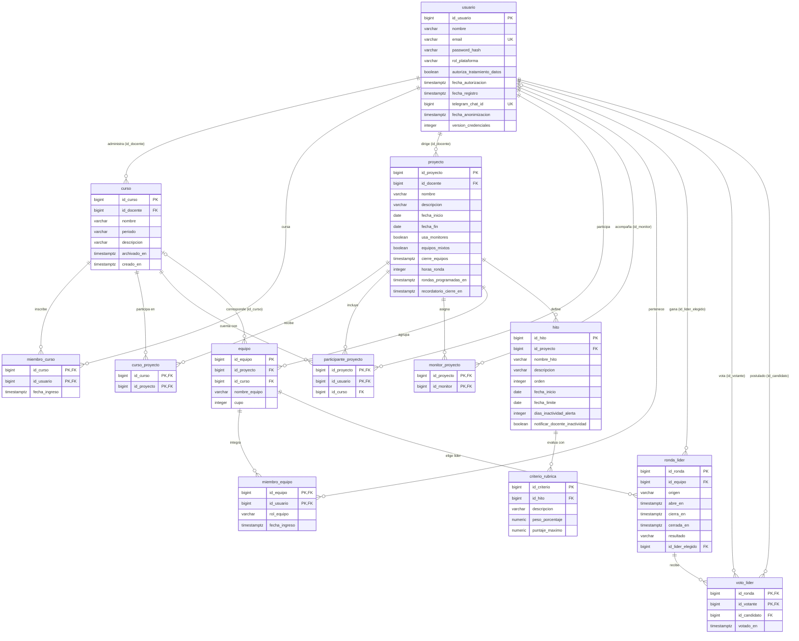
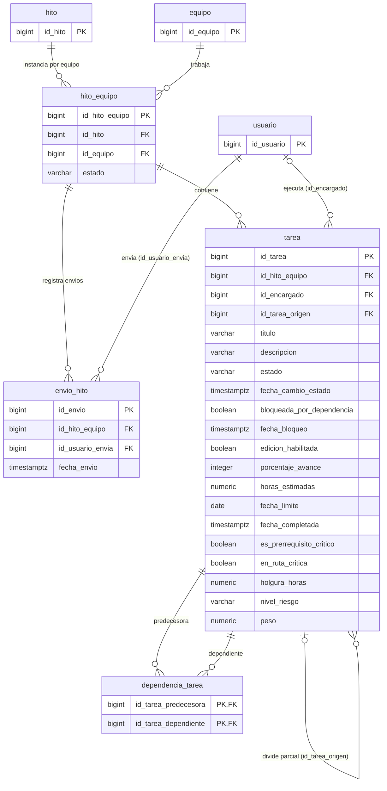
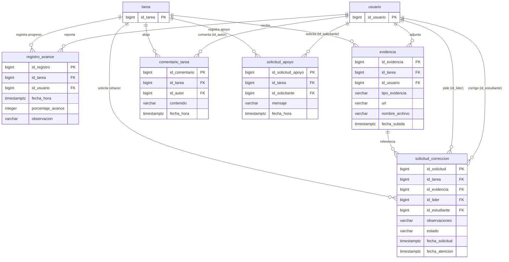
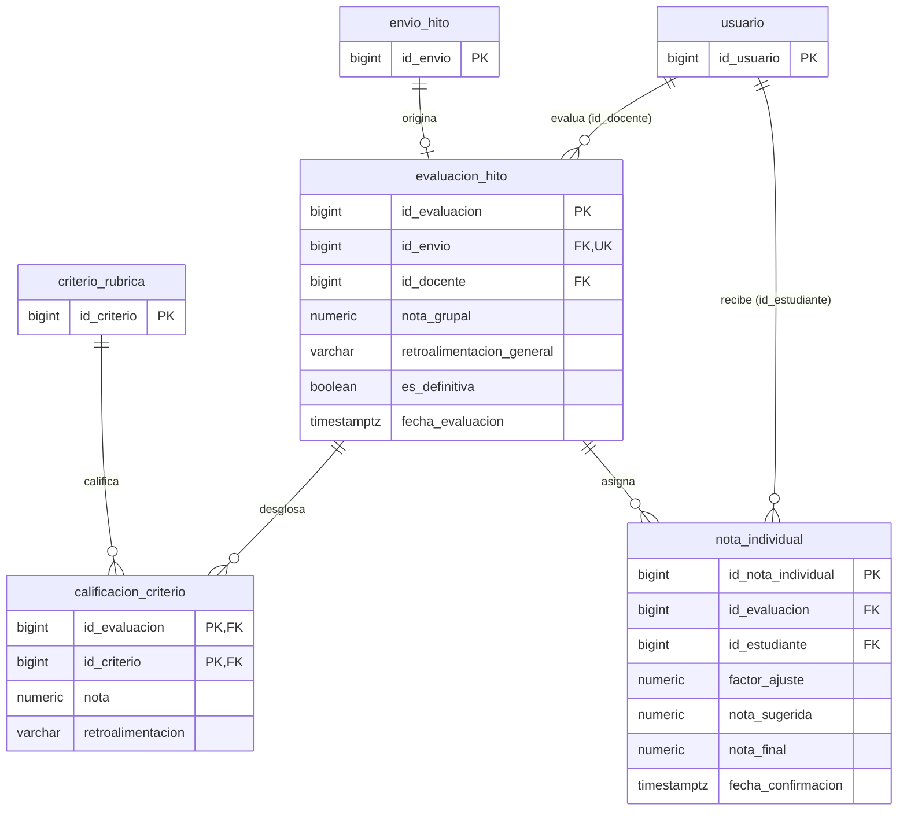
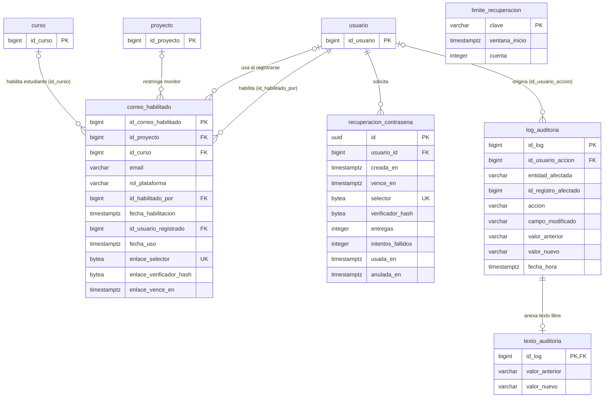
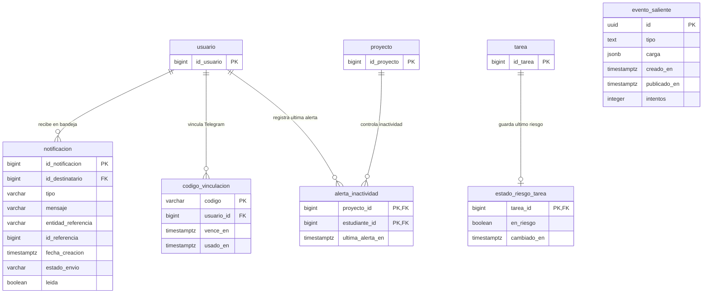
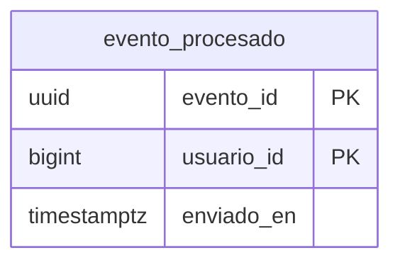

# 04. Modelo de datos — UniProject

Este documento describe el modelo relacional real implementado en **PostgreSQL 18.6** mediante migraciones **Flyway** en SQL plano. La base de datos `uniproject` se divide en dos esquemas con roles de mínimo privilegio: el esquema `public` (35 tablas, dueño `uniproject_nucleo`) y el esquema `agente` (1 tabla, dueño `uniproject_agente` sin permisos sobre `public`).

---

## 4.1. Esquema `public` — Configuración académica

Este grupo modela la estructura académica creada por el docente: cursos con sus estudiantes (`curso`, `miembro_curso`) asignados a proyectos (`curso_proyecto`, `participante_proyecto`), proyectos con fechas límite, modo mixto (`equipos_mixtos`), cierre de autoinscripción (`cierre_equipos`) y duración de rondas (`horas_ronda`), equipos con cupo opcional (`cupo`) y como máximo un líder (`miembro_equipo_un_lider_uk`), votación de líder por rondas (`ronda_lider`, `voto_lider`), asignación opcional de monitores (`usa_monitores`), hitos ordenados con configuración opcional de alerta de inactividad (`V7`) y criterios de rúbrica por hito.

**Fuentes:** [`V3__modelo_dominio.sql`](../../nucleo/src/main/resources/db/migration/V3__modelo_dominio.sql), [`V4__anonimizacion.sql`](../../nucleo/src/main/resources/db/migration/V4__anonimizacion.sql), [`V5__recuperacion_contrasena.sql`](../../nucleo/src/main/resources/db/migration/V5__recuperacion_contrasena.sql), [`V7__alerta_inactividad_opcional.sql`](../../nucleo/src/main/resources/db/migration/V7__alerta_inactividad_opcional.sql), [`V11__cursos_y_equipos.sql`](../../nucleo/src/main/resources/db/migration/V11__cursos_y_equipos.sql).

---

## 4.2. Esquema `public` — Ejecución (tablero, entregas y dependencias)

Cada pareja `(hito, equipo)` se materializa en `hito_equipo`, cuyo identificador (`id_hito_equipo`) gobierna el bloqueo pesimista (`BloqueoHito`), las rutas del tablero y el envío a revisión (`envio_hito`). Las tareas conservan su cálculo más reciente de ruta crítica (`en_ruta_critica`, `holgura_horas`, `nivel_riesgo`) y el enlace `id_tarea_origen` cuando proceden de una reasignación parcial (RF11).

**Fuentes:** [`V3__modelo_dominio.sql`](../../nucleo/src/main/resources/db/migration/V3__modelo_dominio.sql), [`BloqueoHito.java`](../../nucleo/src/main/java/co/uniproject/nucleo/ejecucion/servicio/BloqueoHito.java), [`RecalculoTareas.java`](../../nucleo/src/main/java/co/uniproject/nucleo/ejecucion/servicio/RecalculoTareas.java).

---

## 4.3. Esquema `public` — Ejecución (avances, evidencias, correcciones y apoyo)

Estas cinco tablas registran la actividad operativa sobre cada tarea: historial de porcentajes (`registro_avance`), archivos o enlaces (`evidencia`), retroalimentación de equipo, docente y monitor (`comentario_tarea`), solicitudes de corrección del líder (`solicitud_correccion`) y solicitudes de apoyo (`solicitud_apoyo`, añadida en la migración V6 para alojar texto libre borrable por Ley 1581 fuera de `log_auditoria`).

**Fuentes:** [`V3__modelo_dominio.sql`](../../nucleo/src/main/resources/db/migration/V3__modelo_dominio.sql), [`ServicioApoyo.java`](../../nucleo/src/main/java/co/uniproject/nucleo/ejecucion/servicio/ServicioApoyo.java), [`ServicioCorrecciones.java`](../../nucleo/src/main/java/co/uniproject/nucleo/ejecucion/servicio/ServicioCorrecciones.java), [`ServicioSupresion.java`](../../nucleo/src/main/java/co/uniproject/nucleo/seguridad/cuentas/ServicioSupresion.java).

---

## 4.4. Esquema `public` — Evaluación y calificación

Cada entrega (`envio_hito`) admite a lo sumo una evaluación (`evaluacion_hito_envio_uk`). El desglose por rúbrica se guarda en `calificacion_criterio` y las notas por integrante en `nota_individual`, donde `factor_ajuste` almacena el Índice de Contribución Efectiva (ICE) con 4 decimales y `nota_final` permanece nula hasta que el docente la confirma.

**Fuentes:** [`V3__modelo_dominio.sql`](../../nucleo/src/main/resources/db/migration/V3__modelo_dominio.sql), [`ServicioEvaluacion.java`](../../nucleo/src/main/java/co/uniproject/nucleo/evaluacion/servicio/ServicioEvaluacion.java), [`CalculadoraIce.java`](../../nucleo/src/main/java/co/uniproject/nucleo/evaluacion/calificacion/CalculadoraIce.java).

---

## 4.5. Esquema `public` — Trazabilidad y seguridad

Este grupo soporta la habilitación previa de correos —estudiantes por curso (`id_curso`, migración `V11`, que retiró `id_equipo_invitado` de `V8`), monitores por proyecto y docentes sin ámbito— con enlace de un solo uso con selector y hash SHA-256 (`V9`, `V10`), la recuperación de contraseña sin exponer códigos en claro y con limitación de tasa (`V5`), y la auditoría inmutable (`log_auditoria`) separada de los textos libres borrables por Ley 1581 (`texto_auditoria`, migración V6).

**Fuentes:** [`V3__modelo_dominio.sql`](../../nucleo/src/main/resources/db/migration/V3__modelo_dominio.sql), [`V5__recuperacion_contrasena.sql`](../../nucleo/src/main/resources/db/migration/V5__recuperacion_contrasena.sql), [`V9__enlace_registro.sql`](../../nucleo/src/main/resources/db/migration/V9__enlace_registro.sql), [`V11__cursos_y_equipos.sql`](../../nucleo/src/main/resources/db/migration/V11__cursos_y_equipos.sql), [`RegistroAuditoriaJdbc.java`](../../nucleo/src/main/java/co/uniproject/nucleo/trazabilidad/auditoria/RegistroAuditoriaJdbc.java).

---

## 4.6. Esquema `public` — Notificaciones, outbox y alertas

La outbox (`evento_saliente`) y la bandeja interna (`notificacion`) se insertan dentro de la misma transacción de negocio (`RegistroEventosJdbc` + `RegistroNotificacionesJdbc`). Las tablas `estado_riesgo_tarea` y `alerta_inactividad` persisten el último estado de alerta para no repetir avisos en cada ejecución horaria del programador.

**Fuentes:** [`V2__estado_alertas.sql`](../../nucleo/src/main/resources/db/migration/V2__estado_alertas.sql), [`V3__modelo_dominio.sql`](../../nucleo/src/main/resources/db/migration/V3__modelo_dominio.sql), [`V5__recuperacion_contrasena.sql`](../../nucleo/src/main/resources/db/migration/V5__recuperacion_contrasena.sql), [`RegistroEventosJdbc.java`](../../nucleo/src/main/java/co/uniproject/nucleo/notificaciones/RegistroEventosJdbc.java), [`PublicadorOutbox.java`](../../nucleo/src/main/java/co/uniproject/nucleo/notificaciones/PublicadorOutbox.java), [`ServicioVinculacion.java`](../../nucleo/src/main/java/co/uniproject/nucleo/vinculaciontelegram/ServicioVinculacion.java).

---

## 4.7. Esquema `agente` — Idempotencia del consumidor de Telegram

El agente de Telegram opera con el rol `uniproject_agente` sobre el esquema exclusivo `agente`, sin llaves foráneas ni permisos de lectura sobre `public`. La clave primaria compuesta `(evento_id, usuario_id)` garantiza idempotencia por evento y destinatario ante reintentos diferidos de RabbitMQ o duplicados de la outbox.

**Fuentes:** [`V1__evento_procesado.sql`](../../agente-telegram/src/main/resources/db/migration/V1__evento_procesado.sql), [`01-roles-y-esquemas.sh`](../../infra/postgres/init/01-roles-y-esquemas.sh), [`ConsumidorNotificaciones.java`](../../agente-telegram/src/main/java/co/uniproject/agente/consumo/ConsumidorNotificaciones.java).

---

## 4.8. Restricciones, triggers e índices importantes

### Restricciones `CHECK` de enumeraciones

| Tabla y columna | Valores permitidos | Restricción SQL | Migración |
|---|---|---|---|
| `usuario.rol_plataforma` | `'ADMINISTRADOR'`, `'DOCENTE'`, `'ESTUDIANTE'`, `'MONITOR'` | `usuario_rol_plataforma_ck` | [`V3__modelo_dominio.sql`](../../nucleo/src/main/resources/db/migration/V3__modelo_dominio.sql#L32) |
| `miembro_equipo.rol_equipo` | `'LIDER'`, `'INTEGRANTE'` | `miembro_equipo_rol_ck` | [`V3__modelo_dominio.sql`](../../nucleo/src/main/resources/db/migration/V3__modelo_dominio.sql#L72) |
| `hito_equipo.estado` | `'EN_CURSO'`, `'ENVIADO'`, `'EVALUADO'` | `hito_equipo_estado_ck` | [`V3__modelo_dominio.sql`](../../nucleo/src/main/resources/db/migration/V3__modelo_dominio.sql#L114) |
| `tarea.estado` | `'PENDIENTE'`, `'EN_PROGRESO'`, `'COMPLETADA'` | `tarea_estado_ck` | [`V3__modelo_dominio.sql`](../../nucleo/src/main/resources/db/migration/V3__modelo_dominio.sql#L149) |
| `tarea.nivel_riesgo` | `'BAJO'`, `'MEDIO'`, `'ALTO'` (o `NULL`) | `tarea_nivel_riesgo_ck` | [`V3__modelo_dominio.sql`](../../nucleo/src/main/resources/db/migration/V3__modelo_dominio.sql#L156) |
| `evidencia.tipo_evidencia` | `'PDF'`, `'IMAGEN'`, `'ENLACE'` | `evidencia_tipo_ck` | [`V3__modelo_dominio.sql`](../../nucleo/src/main/resources/db/migration/V3__modelo_dominio.sql#L200) |
| `solicitud_correccion.estado` | `'PENDIENTE'`, `'ATENDIDA'` | `solicitud_correccion_estado_ck` | [`V3__modelo_dominio.sql`](../../nucleo/src/main/resources/db/migration/V3__modelo_dominio.sql#L231) |
| `ronda_lider.origen` | `'PROGRAMADA'`, `'DEMANDA'` | `ronda_lider_origen_ck` | [`V11__cursos_y_equipos.sql`](../../nucleo/src/main/resources/db/migration/V11__cursos_y_equipos.sql#L70) |
| `ronda_lider.resultado` | `'LIDER_ELEGIDO'`, `'EMPATE'`, `'SIN_VOTOS'`, `'CANCELADA'` (o `NULL`) | `ronda_lider_resultado_ck` | [`V11__cursos_y_equipos.sql`](../../nucleo/src/main/resources/db/migration/V11__cursos_y_equipos.sql#L74-L75) |
| `notificacion.tipo` | Las 6 claves académicas más las 7 de cursos, equipos y votación (`curso.estudiante_agregado`, `equipo.votacion_abierta`, `equipo.lider_elegido`, `equipo.sin_lider`, `equipo.miembro_cambio`, `equipo.inscripcion_por_cerrar`, `equipo.inscripcion_resumen`) | `notificacion_tipo_ck` | [`V3__modelo_dominio.sql`](../../nucleo/src/main/resources/db/migration/V3__modelo_dominio.sql#L288-L295); ampliada en [`V12__eventos_cursos_y_equipos.sql`](../../nucleo/src/main/resources/db/migration/V12__eventos_cursos_y_equipos.sql#L22-L37) |
| `notificacion.entidad_referencia` | `'tarea'`, `'hito_equipo'`, `'equipo'`, `'curso'`, `'proyecto'` | `notificacion_entidad_ck` | [`V3__modelo_dominio.sql`](../../nucleo/src/main/resources/db/migration/V3__modelo_dominio.sql#L296); ampliada en [`V12__eventos_cursos_y_equipos.sql`](../../nucleo/src/main/resources/db/migration/V12__eventos_cursos_y_equipos.sql#L39-L41) |
| `notificacion.estado_envio` | `'EN_COLA'`, `'SIN_TELEGRAM'` | `notificacion_estado_envio_ck` | [`V3__modelo_dominio.sql`](../../nucleo/src/main/resources/db/migration/V3__modelo_dominio.sql#L297) |
| `correo_habilitado.rol_plataforma` | `'DOCENTE'`, `'ESTUDIANTE'`, `'MONITOR'` | `correo_habilitado_rol_ck` | [`V3__modelo_dominio.sql`](../../nucleo/src/main/resources/db/migration/V3__modelo_dominio.sql#L353) |
| `evento_saliente.tipo` | Las 6 claves académicas, las 2 de recuperación/contraseña y las 7 de cursos, equipos y votación | `evento_saliente_tipo_ck` | V1 del núcleo; ampliada en [`V5__recuperacion_contrasena.sql`](../../nucleo/src/main/resources/db/migration/V5__recuperacion_contrasena.sql#L44-L54) y [`V12__eventos_cursos_y_equipos.sql`](../../nucleo/src/main/resources/db/migration/V12__eventos_cursos_y_equipos.sql#L3-L20) |

### Invariantes `CHECK` de negocio y privacidad

| Tabla | Restricción | Qué garantiza | Migración |
|---|---|---|---|
| `usuario` | `usuario_email_ck`, `usuario_autorizacion_ck` | Correo en minúscula con `@`; `autoriza_tratamiento_datos` coincide con `fecha_autorizacion IS NOT NULL` (Ley 1581). | [`V3__modelo_dominio.sql`](../../nucleo/src/main/resources/db/migration/V3__modelo_dominio.sql#L31-L33) |
| `usuario` | `usuario_anonimizado_ck` | Si `fecha_anonimizacion IS NOT NULL`, la fila queda anonimizada (`Usuario anonimizado`, `anonimo-<id>@anonimo.invalid`, `password_hash = '!'`, `telegram_chat_id IS NULL`, autorización en `false`). | [`V4__anonimizacion.sql`](../../nucleo/src/main/resources/db/migration/V4__anonimizacion.sql#L8-L14) |
| `usuario` | `usuario_version_credenciales_ck` | `version_credenciales >= 0` para invalidar sesiones tras cambio o recuperación de clave. | [`V5__recuperacion_contrasena.sql`](../../nucleo/src/main/resources/db/migration/V5__recuperacion_contrasena.sql#L7) |
| `proyecto`, `hito`, `criterio_rubrica` | `proyecto_fechas_ck`, `hito_orden_ck`, `hito_fechas_ck`, `hito_inactividad_ck`, `criterio_rubrica_peso_ck`, `criterio_rubrica_puntaje_ck` | Coherencia de fechas, `orden >= 1`, `dias_inactividad_alerta` en `1..60` (o `NULL` desde `V7` para desactivar alerta), `peso_porcentaje` en `(0, 100]` y `puntaje_maximo > 0`. | [`V3__modelo_dominio.sql`](../../nucleo/src/main/resources/db/migration/V3__modelo_dominio.sql#L48-L103), [`V7__alerta_inactividad_opcional.sql`](../../nucleo/src/main/resources/db/migration/V7__alerta_inactividad_opcional.sql#L2) |
| `tarea`, `dependencia_tarea` | `tarea_avance_ck`, `tarea_completada_ck`, `tarea_bloqueo_ck`, `tarea_horas_ck`, `tarea_origen_ck`, `dependencia_tarea_distintas_ck` | Avance `0..100`; `COMPLETADA` equivale a `100` % y `fecha_completada IS NOT NULL`; `bloqueada_por_dependencia` equivale a `fecha_bloqueo IS NOT NULL`; sin auto-dependencia ni auto-origen. | [`V3__modelo_dominio.sql`](../../nucleo/src/main/resources/db/migration/V3__modelo_dominio.sql#L150-L174) |
| `evidencia`, `comentario_tarea`, `solicitud_correccion` | `evidencia_forma_ck`, `comentario_tarea_contenido_ck`, `solicitud_correccion_atencion_ck` | URL `http(s)://` sin nombre de archivo para `ENLACE`, o clave `evidencias/<uuid>.(pdf\|png\|jpg)` con nombre para archivos; comentario no vacío; `ATENDIDA` implica `fecha_atencion IS NOT NULL`. | [`V3__modelo_dominio.sql`](../../nucleo/src/main/resources/db/migration/V3__modelo_dominio.sql#L201-L232) |
| `evaluacion_hito`, `calificacion_criterio`, `nota_individual` | `evaluacion_hito_nota_ck`, `calificacion_criterio_nota_ck`, `nota_individual_factor_ck`, `nota_individual_sugerida_ck`, `nota_individual_final_ck`, `nota_individual_confirmacion_ck` | Escala de notas `0..5`; `factor_ajuste >= 0`; `nota_final` y `fecha_confirmacion` nulas o no nulas simultáneamente. | [`V3__modelo_dominio.sql`](../../nucleo/src/main/resources/db/migration/V3__modelo_dominio.sql#L246-L272) |
| `proyecto`, `equipo`, `ronda_lider` | `proyecto_horas_ronda_ck`, `equipo_cupo_ck`, `ronda_lider_fechas_ck`, `ronda_lider_cierre_ck` | `horas_ronda` en `1..336`; `cupo` nulo o mayor que 0; `cierra_en > abre_en`; `cerrada_en IS NULL` equivale a `resultado IS NULL`. | [`V11__cursos_y_equipos.sql`](../../nucleo/src/main/resources/db/migration/V11__cursos_y_equipos.sql#L77-L125) |
| `log_auditoria` | `log_auditoria_entidad_ck`, `log_auditoria_accion_ck` | `entidad_afectada` en minúsculas (`^[a-z_]{2,40}$`) y `accion` en mayúsculas (`^[A-Z_]{3,40}$`). | [`V3__modelo_dominio.sql`](../../nucleo/src/main/resources/db/migration/V3__modelo_dominio.sql#L316-L317) |
| `correo_habilitado` | `correo_habilitado_ambito_ck`, `correo_habilitado_uso_ck`, `correo_habilitado_enlace_ck`, `correo_habilitado_enlace_uso_ck` | Docentes sin proyecto ni curso, monitores con `id_proyecto` y sin curso, estudiantes con `id_curso` y sin proyecto (`V11`, que retiró `id_equipo_invitado`); enlace de registro (`V9`, `V10`) con selector (8 bytes), hash SHA-256 (32 bytes) y vencimiento, y nulo tras usarse. | [`V3__modelo_dominio.sql`](../../nucleo/src/main/resources/db/migration/V3__modelo_dominio.sql#L354-L355), [`V9__enlace_registro.sql`](../../nucleo/src/main/resources/db/migration/V9__enlace_registro.sql#L10-L19), [`V11__cursos_y_equipos.sql`](../../nucleo/src/main/resources/db/migration/V11__cursos_y_equipos.sql#L135-L138) |
| `recuperacion_contrasena`, `limite_recuperacion` | `recuperacion_contrasena_vigencia_ck`, `recuperacion_contrasena_codigo_ck`, `limite_recuperacion_clave_ck`, `limite_recuperacion_cuenta_ck` | Vigencia válida; selector (8 bytes) + hash (32 bytes); claves de límite de tasa con SHA-256 hex (`^(correo\|ip\|canje\|cambio):[0-9a-f]{64}$`). | [`V5__recuperacion_contrasena.sql`](../../nucleo/src/main/resources/db/migration/V5__recuperacion_contrasena.sql#L22-L39) |

### Restricciones `UNIQUE`, triggers e índices operativos

| Tipo | Nombre / definición | Tabla | Propósito y origen |
|---|---|---|---|
| `UNIQUE` | Unicidad sobre `(telegram_chat_id)` | `usuario` | Impide que un mismo chat de Telegram quede asociado a dos cuentas simultáneamente (V1 del núcleo; [`ControladorInternoTelegram.java`](../../nucleo/src/main/java/co/uniproject/nucleo/vinculaciontelegram/ControladorInternoTelegram.java#L58-L65)). |
| `UNIQUE` | `usuario_email_uk (email)` | `usuario` | Un correo por cuenta activa o anonimizada ([`V3__modelo_dominio.sql`](../../nucleo/src/main/resources/db/migration/V3__modelo_dominio.sql#L30)). |
| `UNIQUE` | `equipo_nombre_uk (id_proyecto, nombre_equipo)`, `hito_orden_uk (id_proyecto, orden)`, `hito_equipo_uk (id_hito, id_equipo)` | `equipo`, `hito`, `hito_equipo` | Evita nombres de equipo repetidos, órdenes duplicados y pares hito-equipo repetidos ([`V3__modelo_dominio.sql`](../../nucleo/src/main/resources/db/migration/V3__modelo_dominio.sql#L63-L113)). |
| `UNIQUE` parcial | `miembro_equipo_un_lider_uk` sobre `(id_equipo) WHERE rol_equipo = 'LIDER'` | `miembro_equipo` | Garantiza en base de datos el supuesto 2 de la entrega 1: como máximo un líder por equipo ([`V3__modelo_dominio.sql`](../../nucleo/src/main/resources/db/migration/V3__modelo_dominio.sql#L76)). |
| `UNIQUE` | `evaluacion_hito_envio_uk (id_envio)`, `nota_individual_uk (id_evaluacion, id_estudiante)` | `evaluacion_hito`, `nota_individual` | Una evaluación por entrega y una nota individual por estudiante y evaluación ([`V3__modelo_dominio.sql`](../../nucleo/src/main/resources/db/migration/V3__modelo_dominio.sql#L245-L268)). |
| `UNIQUE` | `curso_nombre_uk (id_docente, lower(nombre), lower(periodo))` | `curso` | Impide que un mismo docente cree dos cursos con el mismo nombre en el mismo periodo, sin distinguir mayúsculas ([`V11__cursos_y_equipos.sql`](../../nucleo/src/main/resources/db/migration/V11__cursos_y_equipos.sql#L15)). |
| `UNIQUE` parcial | `ronda_lider_abierta_uk` sobre `(id_equipo) WHERE cerrada_en IS NULL` | `ronda_lider` | Garantiza como máximo una ronda de votación abierta por equipo ([`V11__cursos_y_equipos.sql`](../../nucleo/src/main/resources/db/migration/V11__cursos_y_equipos.sql#L81)). |
| `UNIQUE` con nulos iguales | `correo_habilitado_uk UNIQUE NULLS NOT DISTINCT (email, id_proyecto, id_curso)` | `correo_habilitado` | Impide duplicar habilitaciones de docente (`id_proyecto IS NULL AND id_curso IS NULL`), de monitor por proyecto o de estudiante por curso ([`V11__cursos_y_equipos.sql`](../../nucleo/src/main/resources/db/migration/V11__cursos_y_equipos.sql#L140)). |
| `UNIQUE` parciales | `recuperacion_contrasena_selector_uk` (`V5`) y `correo_habilitado_enlace_selector_uk` (`V9`) | `recuperacion_contrasena`, `correo_habilitado` | Búsqueda en O(log n) por selector de 8 bytes solo cuando hay token vigente ([`V5__recuperacion_contrasena.sql`](../../nucleo/src/main/resources/db/migration/V5__recuperacion_contrasena.sql#L28-L29), [`V9__enlace_registro.sql`](../../nucleo/src/main/resources/db/migration/V9__enlace_registro.sql#L21-L22)). |
| `TRIGGER` | `log_auditoria_sin_cambios` (`BEFORE UPDATE OR DELETE FOR EACH ROW`) y `log_auditoria_sin_vaciado` (`BEFORE TRUNCATE FOR EACH STATEMENT`) → `log_auditoria_solo_insercion()` | `log_auditoria` | Impide cualquier alteración o borrado en la auditoría incluso al dueño de la tabla (`uniproject_nucleo`), lanzando `restrict_violation` (restricción 4e; [`V3__modelo_dominio.sql`](../../nucleo/src/main/resources/db/migration/V3__modelo_dominio.sql#L325-L339)). |
| `INDEX` parcial (`SKIP LOCKED`) | Índice parcial sobre `(creado_en) WHERE publicado_en IS NULL` | `evento_saliente` | Acelera la consulta `WHERE publicado_en IS NULL ORDER BY creado_en LIMIT 50 FOR UPDATE SKIP LOCKED` del sondeo de `PublicadorOutbox` (V1 del núcleo; `decisiones-tecnicas-java.md`). |
| Otros índices operativos | `notificacion_bandeja_idx`, `log_auditoria_registro_idx`, `log_auditoria_usuario_idx`, `correo_habilitado_pendiente_idx`, `correo_habilitado_curso_idx`, `curso_docente_idx`, `miembro_curso_usuario_idx`, `curso_proyecto_proyecto_idx`, `participante_proyecto_usuario_idx`, `participante_proyecto_curso_idx`, `voto_lider_candidato_idx` | Varias | Soportan la bandeja P10 ordenada por fecha descendente, consultas de historial, cursos, participación por proyecto, conteo de votos y habilitaciones pendientes por curso ([`V3__modelo_dominio.sql`](../../nucleo/src/main/resources/db/migration/V3__modelo_dominio.sql#L299-L357), [`V11__cursos_y_equipos.sql`](../../nucleo/src/main/resources/db/migration/V11__cursos_y_equipos.sql#L14-L141)). |

---

## 4.9. Diferencias frente al modelo de 19 tablas de la entrega 1

En `entrega1.md` sección 2.7 se planteaba un modelo relacional de **19 tablas**, que posteriormente se amplió a **20 tablas** en el diagrama previo al desarrollo ([`Archivos_contexto/diagrama-bd-actual.md`](../contexto/diagrama-bd-actual.md), cuyo título conservaba el rótulo «19 tablas»). En el sistema construido existen hoy **36 tablas de aplicación** (**35 en el esquema `public`** del núcleo y **1 en el esquema `agente`** del bot de Telegram):

| Cambio respecto a la entrega 1 / diagrama vigente | Qué se añadió o modificó | Por qué se cambió |
|---|---|---|
| **15 tablas nuevas en `public`** | `evento_saliente` (V1/V5/V12), `codigo_vinculacion` (V1), `estado_riesgo_tarea` (V2/V3), `alerta_inactividad` (V2/V3), `correo_habilitado` (V3/V9/V11), `recuperacion_contrasena` (V5), `limite_recuperacion` (V5), `texto_auditoria` (V6), `solicitud_apoyo` (V6), `curso` (V11), `miembro_curso` (V11), `curso_proyecto` (V11), `participante_proyecto` (V11), `ronda_lider` (V11) y `voto_lider` (V11). | Soportar outbox transaccional, vinculación a Telegram sin correo electrónico, deduplicación de alertas horarias, alta de cuentas por correo habilitado (por curso para estudiantes) y enlace de registro, recuperación de contraseña con limitación de tasa, separación de textos libres borrables por Ley 1581 respecto a `log_auditoria`, cursos académicos, autoinscripción a equipos con cupo y votación de líder por rondas. |
| **1 tabla nueva en esquema `agente`** | `agente.evento_procesado` (`(evento_id, usuario_id)`). | Garantizar consumo idempotente por evento y destinatario manteniendo al agente aislado del esquema `public` (Ley 1581). |
| **Columnas añadidas en `usuario`** | `telegram_chat_id` (V1), `fecha_anonimizacion` (`V4`) y `version_credenciales` (`V5`). | Vincular Telegram (`insertable = false, updatable = false` en JPA), suprimir cuentas sin romper llaves foráneas académicas e invalidar sesiones tras cambiar o restablecer contraseña. |
| **Alerta de inactividad opcional en `hito`** | `V7` eliminó `NOT NULL` de `hito.dias_inactividad_alerta` (manteniendo `CHECK 1..60` para valores no nulos). | Permitir que el docente deje hitos concretos sin alerta automática de inactividad (RF6). |
| **Columna `tarea.peso` sin uso en ICE** | Presente en `V3` (`numeric(6,2) NULL`) pero conservada en `NULL`. | El cálculo del Índice de Contribución Efectiva (`CalculadoraIce`) usa `horas_estimadas` en lugar de un peso manual separado. |
