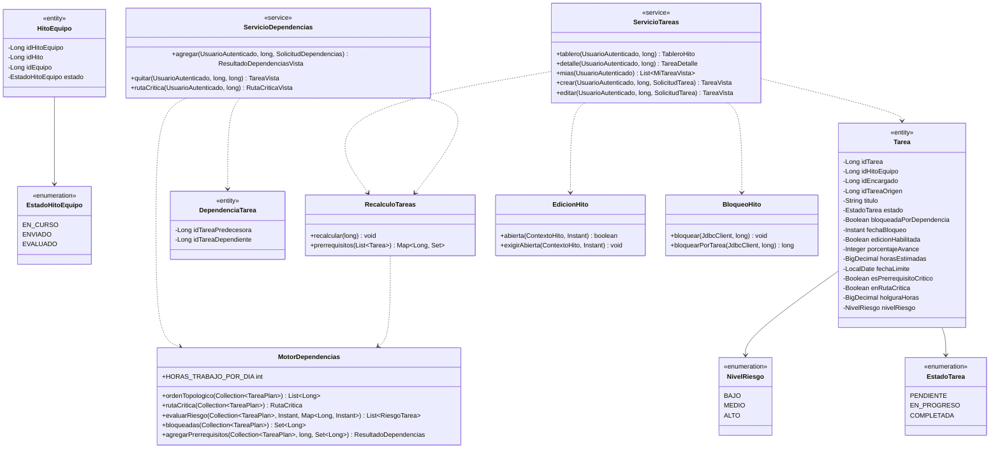
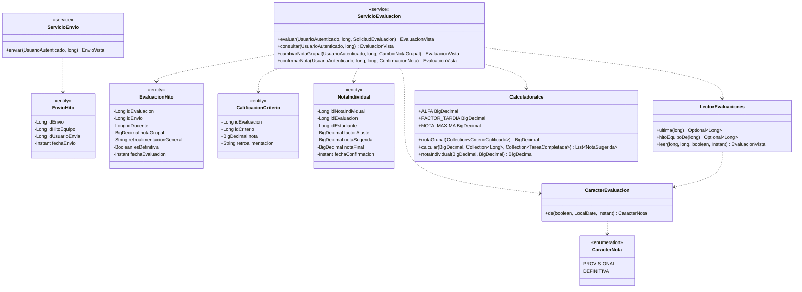
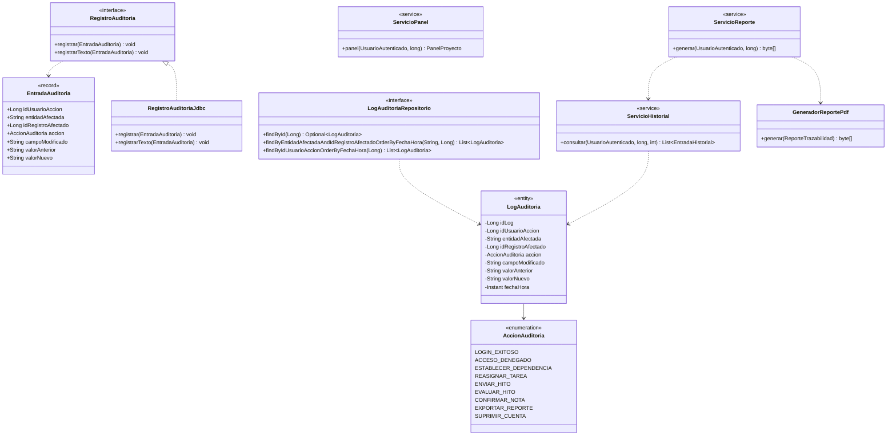
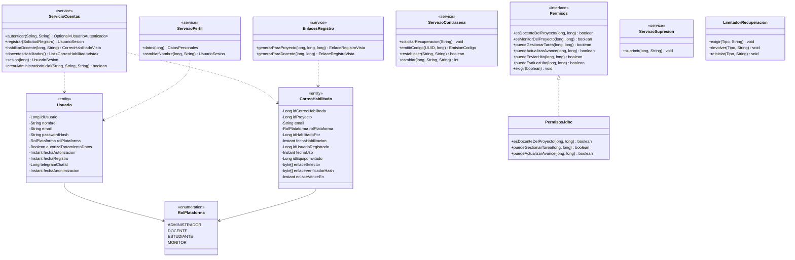
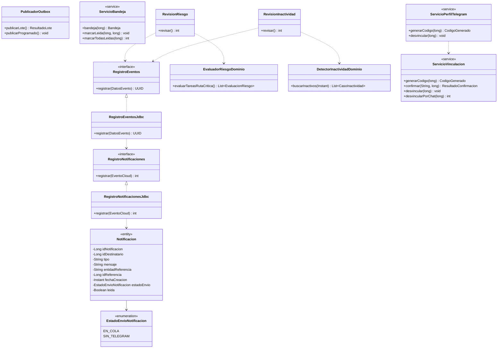
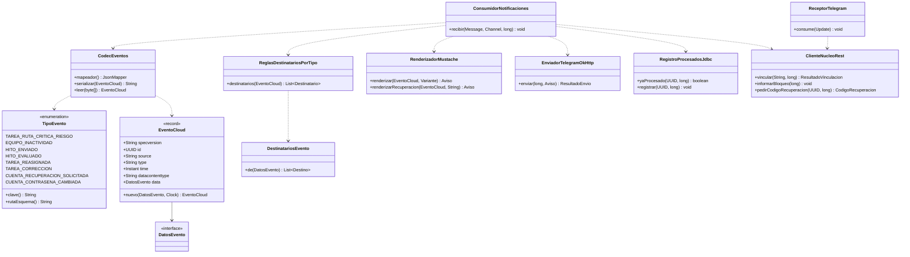
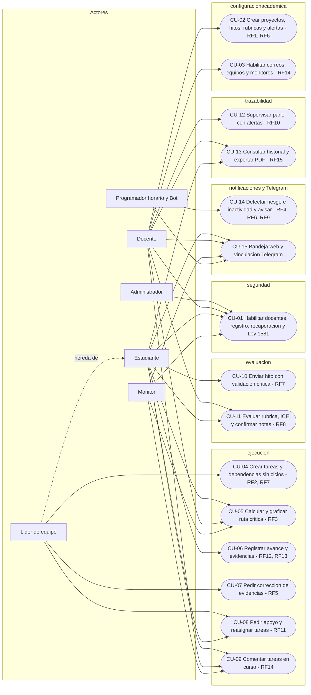

# 05. Modelo del dominio y casos de uso — UniProject

Este documento recoge los diagramas de clases reales de cada módulo de **UniProject** (entidades JPA, enumeraciones, servicios de aplicación y componentes de dominio puro) junto con el diagrama general de casos de uso y su correspondencia con los requerimientos funcionales de `entrega1.md`.

> **Por qué las entidades JPA usan atributos `Long` planos en lugar de asociaciones:** por la decisión arquitectónica DA-08 ([`03-decisiones.md`](03-decisiones.md) y `decisiones-tecnicas-java.md` sección 13), ninguna entidad de `nucleo` declara `@ManyToOne`, `@OneToMany` ni `@ManyToMany`. Cada clave foránea se mapea como un atributo `Long` explícito y las claves compuestas usan `@IdClass` (`MiembroEquipoId`, `MonitorProyectoId`, `DependenciaTareaId`, `CalificacionCriterioId`). Con `spring.jpa.open-in-view: false`, esto evita cargas perezosas imprevistas, consultas N+1 y acoplamiento entre módulos; las consultas compuestas se ejecutan en SQL fijo mediante `JdbcClient`.

---

## 5.1. Módulo `configuracionacademica`

```mermaid
classDiagram
    class RolEquipo {
        <<enumeration>>
        LIDER
        INTEGRANTE
    }

    class Proyecto {
        <<entity>>
        -Long idProyecto
        -Long idDocente
        -String nombre
        -String descripcion
        -LocalDate fechaInicio
        -LocalDate fechaFin
        -Boolean usaMonitores
    }

    class Hito {
        <<entity>>
        -Long idHito
        -Long idProyecto
        -String nombreHito
        -String descripcion
        -Integer orden
        -LocalDate fechaInicio
        -LocalDate fechaLimite
        -Integer diasInactividadAlerta
        -Boolean notificarDocenteInactividad
    }

    class CriterioRubrica {
        <<entity>>
        -Long idCriterio
        -Long idHito
        -String descripcion
        -BigDecimal pesoPorcentaje
        -BigDecimal puntajeMaximo
    }

    class Equipo {
        <<entity>>
        -Long idEquipo
        -Long idProyecto
        -String nombreEquipo
    }

    class MiembroEquipo {
        <<entity>>
        -Long idEquipo
        -Long idUsuario
        -RolEquipo rolEquipo
        -Instant fechaIngreso
    }

    class MonitorProyecto {
        <<entity>>
        -Long idProyecto
        -Long idMonitor
    }

    class ServicioProyectos {
        <<service>>
        +crear(UsuarioAutenticado, SolicitudProyecto) ProyectoVista
        +listar(UsuarioAutenticado) List~ProyectoVista~
        +detalle(UsuarioAutenticado, long) ProyectoDetalle
        +actualizar(UsuarioAutenticado, long, SolicitudProyecto) ProyectoVista
    }

    class ServicioHitos {
        <<service>>
        +crear(UsuarioAutenticado, long, SolicitudHito) HitoVista
        +actualizar(UsuarioAutenticado, long, SolicitudHito) HitoVista
        +crearCriterio(UsuarioAutenticado, long, SolicitudCriterio) CriterioVista
        +actualizarCriterio(UsuarioAutenticado, long, long, SolicitudCriterio) CriterioVista
        +eliminarCriterio(UsuarioAutenticado, long, long) void
    }

    class ServicioEquipos {
        <<service>>
        +crear(UsuarioAutenticado, long, SolicitudEquipo) EquipoVista
        +agregarMiembro(UsuarioAutenticado, long, SolicitudMiembro) EquipoVista
        +invitar(UsuarioAutenticado, long, SolicitudInvitacion) EstudianteProyectoVista
        +incorporarInvitado(long, long, long, long) boolean
        +quitarMiembro(UsuarioAutenticado, long, long) EquipoVista
        +cambiarLider(UsuarioAutenticado, long, SolicitudLider) EquipoVista
    }

    class ServicioCorreosProyecto {
        <<service>>
        +habilitar(UsuarioAutenticado, long, SolicitudCorreos) ResultadoHabilitacion
        +listar(UsuarioAutenticado, long) List~CorreoHabilitadoVista~
        +estudiantes(UsuarioAutenticado, long) List~EstudianteProyectoVista~
        +monitores(UsuarioAutenticado, long) List~MonitorVista~
        +quitarMonitor(UsuarioAutenticado, long, long) void
        +retirarCorreo(UsuarioAutenticado, long, long) void
        +generarEnlace(UsuarioAutenticado, long, long) EnlaceRegistroVista
    }

    class ApoyoConfiguracion {
        +completarHitosEquipo(long) int
        +vistaEquipo(Equipo) EquipoVista
    }

    MiembroEquipo --> RolEquipo
    ServicioProyectos ..> Proyecto
    ServicioProyectos ..> ApoyoConfiguracion
    ServicioHitos ..> Hito
    ServicioHitos ..> CriterioRubrica
    ServicioHitos ..> ApoyoConfiguracion
    ServicioEquipos ..> Equipo
    ServicioEquipos ..> MiembroEquipo
    ServicioEquipos ..> ApoyoConfiguracion
    ServicioCorreosProyecto ..> MonitorProyecto
```

El paquete `configuracionacademica` concentra la administración académica del docente (RF1, RF6, RF14 y habilitación de correos por proyecto). Al crear hitos o equipos, `ApoyoConfiguracion.completarHitosEquipo` genera automáticamente las filas `hito_equipo` faltantes mediante `INSERT ... ON CONFLICT DO NOTHING`.

**Fuentes:** [`Proyecto.java`](../../nucleo/src/main/java/co/uniproject/nucleo/configuracionacademica/dominio/Proyecto.java), [`Hito.java`](../../nucleo/src/main/java/co/uniproject/nucleo/configuracionacademica/dominio/Hito.java), [`CriterioRubrica.java`](../../nucleo/src/main/java/co/uniproject/nucleo/configuracionacademica/dominio/CriterioRubrica.java), [`Equipo.java`](../../nucleo/src/main/java/co/uniproject/nucleo/configuracionacademica/dominio/Equipo.java), [`MiembroEquipo.java`](../../nucleo/src/main/java/co/uniproject/nucleo/configuracionacademica/dominio/MiembroEquipo.java), [`MiembroEquipoId.java`](../../nucleo/src/main/java/co/uniproject/nucleo/configuracionacademica/dominio/MiembroEquipoId.java), [`MonitorProyecto.java`](../../nucleo/src/main/java/co/uniproject/nucleo/configuracionacademica/dominio/MonitorProyecto.java), [`MonitorProyectoId.java`](../../nucleo/src/main/java/co/uniproject/nucleo/configuracionacademica/dominio/MonitorProyectoId.java), [`RolEquipo.java`](../../nucleo/src/main/java/co/uniproject/nucleo/configuracionacademica/dominio/RolEquipo.java), [`ServicioProyectos.java`](../../nucleo/src/main/java/co/uniproject/nucleo/configuracionacademica/servicio/ServicioProyectos.java), [`ServicioHitos.java`](../../nucleo/src/main/java/co/uniproject/nucleo/configuracionacademica/servicio/ServicioHitos.java), [`ServicioEquipos.java`](../../nucleo/src/main/java/co/uniproject/nucleo/configuracionacademica/servicio/ServicioEquipos.java), [`ServicioCorreosProyecto.java`](../../nucleo/src/main/java/co/uniproject/nucleo/configuracionacademica/servicio/ServicioCorreosProyecto.java), [`ApoyoConfiguracion.java`](../../nucleo/src/main/java/co/uniproject/nucleo/configuracionacademica/servicio/ApoyoConfiguracion.java).

---

## 5.2. Módulo `ejecucion`

Para mantener cada diagrama legible, el módulo `ejecucion` se muestra en dos vistas: primero el núcleo del tablero, tareas y motor CPM/riesgo; luego el seguimiento de avances, evidencias, correcciones, apoyo y reasignación.

### 5.2.1. Tablero, tareas y motor de dependencias

`MotorDependencias` es una clase utilitaria Java pura (sin Spring ni acceso a BD) que calcula orden topológico de Kahn, ruta crítica (RF3), riesgo considerando `HORAS_TRABAJO_POR_DIA = 4` (RF9), bloqueos y detección de ciclos (restricción 4d). `RecalculoTareas` persiste ese resultado en `tarea` dentro de cada transacción de escritura, serializada por `BloqueoHito` sobre `hito_equipo`.

**Fuentes:** [`HitoEquipo.java`](../../nucleo/src/main/java/co/uniproject/nucleo/ejecucion/dominio/HitoEquipo.java), [`Tarea.java`](../../nucleo/src/main/java/co/uniproject/nucleo/ejecucion/dominio/Tarea.java), [`DependenciaTarea.java`](../../nucleo/src/main/java/co/uniproject/nucleo/ejecucion/dominio/DependenciaTarea.java), [`DependenciaTareaId.java`](../../nucleo/src/main/java/co/uniproject/nucleo/ejecucion/dominio/DependenciaTareaId.java), [`EstadoHitoEquipo.java`](../../nucleo/src/main/java/co/uniproject/nucleo/ejecucion/dominio/EstadoHitoEquipo.java), [`EstadoTarea.java`](../../nucleo/src/main/java/co/uniproject/nucleo/ejecucion/dominio/EstadoTarea.java), [`NivelRiesgo.java`](../../nucleo/src/main/java/co/uniproject/nucleo/ejecucion/dependencias/NivelRiesgo.java), [`MotorDependencias.java`](../../nucleo/src/main/java/co/uniproject/nucleo/ejecucion/dependencias/MotorDependencias.java), [`ServicioTareas.java`](../../nucleo/src/main/java/co/uniproject/nucleo/ejecucion/servicio/ServicioTareas.java), [`ServicioDependencias.java`](../../nucleo/src/main/java/co/uniproject/nucleo/ejecucion/servicio/ServicioDependencias.java), [`RecalculoTareas.java`](../../nucleo/src/main/java/co/uniproject/nucleo/ejecucion/servicio/RecalculoTareas.java), [`EdicionHito.java`](../../nucleo/src/main/java/co/uniproject/nucleo/ejecucion/servicio/EdicionHito.java), [`BloqueoHito.java`](../../nucleo/src/main/java/co/uniproject/nucleo/ejecucion/servicio/BloqueoHito.java).

### 5.2.2. Avances, evidencias, correcciones, apoyo y reasignación

```mermaid
classDiagram
    class TipoEvidencia {
        <<enumeration>>
        PDF
        IMAGEN
        ENLACE
    }

    class EstadoSolicitudCorreccion {
        <<enumeration>>
        PENDIENTE
        ATENDIDA
    }

    class TipoReasignacion {
        <<enumeration>>
        TOTAL
        PARCIAL
    }

    class RegistroAvance {
        <<entity>>
        -Long idRegistro
        -Long idTarea
        -Long idUsuario
        -Instant fechaHora
        -Integer porcentajeAvance
        -String observacion
    }

    class Evidencia {
        <<entity>>
        -Long idEvidencia
        -Long idTarea
        -Long idUsuario
        -TipoEvidencia tipoEvidencia
        -String url
        -String nombreArchivo
        -Instant fechaSubida
    }

    class ComentarioTarea {
        <<entity>>
        -Long idComentario
        -Long idTarea
        -Long idAutor
        -String contenido
        -Instant fechaHora
    }

    class SolicitudCorreccion {
        <<entity>>
        -Long idSolicitud
        -Long idTarea
        -Long idEvidencia
        -Long idLider
        -Long idEstudiante
        -String observaciones
        -EstadoSolicitudCorreccion estado
        -Instant fechaSolicitud
        -Instant fechaAtencion
    }

    class ServicioAvance {
        <<service>>
        +actualizar(UsuarioAutenticado, long, SolicitudAvance) TareaVista
    }

    class ServicioEvidencias {
        <<service>>
        +adjuntarArchivo(UsuarioAutenticado, long, MultipartFile) EvidenciaVista
        +adjuntarEnlace(UsuarioAutenticado, long, SolicitudEnlace) EvidenciaVista
        +listar(UsuarioAutenticado, long) List~EvidenciaVista~
        +descargar(UsuarioAutenticado, long) ArchivoEvidencia
    }

    class ServicioComentarios {
        <<service>>
        +listar(UsuarioAutenticado, long) List~ComentarioVista~
        +comentar(UsuarioAutenticado, long, SolicitudComentario) ComentarioVista
    }

    class ServicioCorrecciones {
        <<service>>
        +listar(UsuarioAutenticado, long) List~CorreccionVista~
        +solicitar(UsuarioAutenticado, long, PeticionCorreccion) CorreccionVista
    }

    class ServicioReasignacion {
        <<service>>
        +reasignar(UsuarioAutenticado, long, SolicitudReasignacion) ResultadoReasignacion
    }

    class ServicioApoyo {
        <<service>>
        +solicitar(UsuarioAutenticado, long, SolicitudApoyo) ApoyoVista
        +apoyos(UsuarioAutenticado, long) List~ApoyoVista~
        +carga(UsuarioAutenticado, long) List~CargaIntegrante~
    }

    Evidencia --> TipoEvidencia
    SolicitudCorreccion --> EstadoSolicitudCorreccion
    ServicioAvance ..> RegistroAvance
    ServicioEvidencias ..> Evidencia
    ServicioComentarios ..> ComentarioTarea
    ServicioCorrecciones ..> SolicitudCorreccion
    ServicioReasignacion ..> TipoReasignacion
```

Las operaciones de ejecución se reparten en seis servicios especializados. Destaca que `solicitud_apoyo` no tiene entidad JPA: `ServicioApoyo` inserta y consulta directamente con `JdbcClient`. `ServicioEvidencias` delega el almacenamiento físico en `AlmacenEvidencias` y valida tipos reales por firma binaria mediante `TipoArchivo`.

**Fuentes:** [`RegistroAvance.java`](../../nucleo/src/main/java/co/uniproject/nucleo/ejecucion/dominio/RegistroAvance.java), [`Evidencia.java`](../../nucleo/src/main/java/co/uniproject/nucleo/ejecucion/dominio/Evidencia.java), [`ComentarioTarea.java`](../../nucleo/src/main/java/co/uniproject/nucleo/ejecucion/dominio/ComentarioTarea.java), [`SolicitudCorreccion.java`](../../nucleo/src/main/java/co/uniproject/nucleo/ejecucion/dominio/SolicitudCorreccion.java), [`TipoEvidencia.java`](../../nucleo/src/main/java/co/uniproject/nucleo/ejecucion/dominio/TipoEvidencia.java), [`EstadoSolicitudCorreccion.java`](../../nucleo/src/main/java/co/uniproject/nucleo/ejecucion/dominio/EstadoSolicitudCorreccion.java), [`TipoReasignacion.java`](../../nucleo/src/main/java/co/uniproject/nucleo/ejecucion/servicio/TipoReasignacion.java), [`ServicioAvance.java`](../../nucleo/src/main/java/co/uniproject/nucleo/ejecucion/servicio/ServicioAvance.java), [`ServicioEvidencias.java`](../../nucleo/src/main/java/co/uniproject/nucleo/ejecucion/servicio/ServicioEvidencias.java), [`ServicioComentarios.java`](../../nucleo/src/main/java/co/uniproject/nucleo/ejecucion/servicio/ServicioComentarios.java), [`ServicioCorrecciones.java`](../../nucleo/src/main/java/co/uniproject/nucleo/ejecucion/servicio/ServicioCorrecciones.java), [`ServicioReasignacion.java`](../../nucleo/src/main/java/co/uniproject/nucleo/ejecucion/servicio/ServicioReasignacion.java), [`ServicioApoyo.java`](../../nucleo/src/main/java/co/uniproject/nucleo/ejecucion/servicio/ServicioApoyo.java), [`AlmacenEvidencias.java`](../../nucleo/src/main/java/co/uniproject/nucleo/ejecucion/servicio/AlmacenEvidencias.java), [`TipoArchivo.java`](../../nucleo/src/main/java/co/uniproject/nucleo/ejecucion/servicio/TipoArchivo.java).

---

## 5.3. Módulo `evaluacion`

`evaluacion` separa los motores Java puros (`CalculadoraIce` y `CaracterEvaluacion`) de los servicios transaccionales (`ServicioEnvio` y `ServicioEvaluacion`). El carácter `PROVISIONAL` o `DEFINITIVA` (`CaracterNota`, definido en `eventos-contrato`) se calcula al leer comparando el instante actual con el fin del día de `fecha_limite` en `America/Bogota`.

**Fuentes:** [`EnvioHito.java`](../../nucleo/src/main/java/co/uniproject/nucleo/evaluacion/dominio/EnvioHito.java), [`EvaluacionHito.java`](../../nucleo/src/main/java/co/uniproject/nucleo/evaluacion/dominio/EvaluacionHito.java), [`CalificacionCriterio.java`](../../nucleo/src/main/java/co/uniproject/nucleo/evaluacion/dominio/CalificacionCriterio.java), [`CalificacionCriterioId.java`](../../nucleo/src/main/java/co/uniproject/nucleo/evaluacion/dominio/CalificacionCriterioId.java), [`NotaIndividual.java`](../../nucleo/src/main/java/co/uniproject/nucleo/evaluacion/dominio/NotaIndividual.java), [`ServicioEnvio.java`](../../nucleo/src/main/java/co/uniproject/nucleo/evaluacion/servicio/ServicioEnvio.java), [`ServicioEvaluacion.java`](../../nucleo/src/main/java/co/uniproject/nucleo/evaluacion/servicio/ServicioEvaluacion.java), [`LectorEvaluaciones.java`](../../nucleo/src/main/java/co/uniproject/nucleo/evaluacion/servicio/LectorEvaluaciones.java), [`CalculadoraIce.java`](../../nucleo/src/main/java/co/uniproject/nucleo/evaluacion/calificacion/CalculadoraIce.java), [`CaracterEvaluacion.java`](../../nucleo/src/main/java/co/uniproject/nucleo/evaluacion/calificacion/CaracterEvaluacion.java), [`CaracterNota.java`](../../eventos-contrato/src/main/java/co/uniproject/eventos/datos/CaracterNota.java).

---

## 5.4. Módulo `trazabilidad`

`LogAuditoria` está anotada con `@Immutable` y `LogAuditoriaRepositorio` extiende `Repository` (sin `save` ni `delete`), mientras las inserciones pasan por `RegistroAuditoriaJdbc` (separando los textos libres en `texto_auditoria` mediante `registrarTexto`). Nota: `AccionAuditoria` define 28 constantes en el código; el diagrama muestra una selección representativa para mantener la legibilidad.

**Fuentes:** [`LogAuditoria.java`](../../nucleo/src/main/java/co/uniproject/nucleo/trazabilidad/dominio/LogAuditoria.java), [`AccionAuditoria.java`](../../nucleo/src/main/java/co/uniproject/nucleo/trazabilidad/auditoria/AccionAuditoria.java), [`EntradaAuditoria.java`](../../nucleo/src/main/java/co/uniproject/nucleo/trazabilidad/auditoria/EntradaAuditoria.java), [`RegistroAuditoria.java`](../../nucleo/src/main/java/co/uniproject/nucleo/trazabilidad/auditoria/RegistroAuditoria.java), [`RegistroAuditoriaJdbc.java`](../../nucleo/src/main/java/co/uniproject/nucleo/trazabilidad/auditoria/RegistroAuditoriaJdbc.java), [`LogAuditoriaRepositorio.java`](../../nucleo/src/main/java/co/uniproject/nucleo/trazabilidad/repositorio/LogAuditoriaRepositorio.java), [`ServicioPanel.java`](../../nucleo/src/main/java/co/uniproject/nucleo/trazabilidad/servicio/ServicioPanel.java), [`ServicioHistorial.java`](../../nucleo/src/main/java/co/uniproject/nucleo/trazabilidad/servicio/ServicioHistorial.java), [`ServicioReporte.java`](../../nucleo/src/main/java/co/uniproject/nucleo/trazabilidad/servicio/ServicioReporte.java), [`GeneradorReportePdf.java`](../../nucleo/src/main/java/co/uniproject/nucleo/trazabilidad/reporte/GeneradorReportePdf.java).

---

## 5.5. Módulo `seguridad`

`seguridad` centraliza el control de acceso (`Permisos`/`PermisosJdbc`, con 17 métodos de verificación sobre SQL `EXISTS` que devuelven 403 si el ID no existe), la gestión de cuentas por habilitación y enlace (`ServicioCuentas`, `EnlacesRegistro`), el cambio y recuperación de contraseñas (`ServicioContrasena`, `LimitadorRecuperacion`) y los derechos de acceso, rectificación y supresión de la Ley 1581 (`ServicioPerfil`, `ServicioSupresion`).

**Fuentes:** [`Usuario.java`](../../nucleo/src/main/java/co/uniproject/nucleo/seguridad/dominio/Usuario.java), [`CorreoHabilitado.java`](../../nucleo/src/main/java/co/uniproject/nucleo/seguridad/dominio/CorreoHabilitado.java), [`RolPlataforma.java`](../../nucleo/src/main/java/co/uniproject/nucleo/seguridad/dominio/RolPlataforma.java), [`Permisos.java`](../../nucleo/src/main/java/co/uniproject/nucleo/seguridad/permisos/Permisos.java), [`PermisosJdbc.java`](../../nucleo/src/main/java/co/uniproject/nucleo/seguridad/permisos/PermisosJdbc.java), [`ServicioCuentas.java`](../../nucleo/src/main/java/co/uniproject/nucleo/seguridad/cuentas/ServicioCuentas.java), [`EnlacesRegistro.java`](../../nucleo/src/main/java/co/uniproject/nucleo/seguridad/cuentas/EnlacesRegistro.java), [`ServicioContrasena.java`](../../nucleo/src/main/java/co/uniproject/nucleo/seguridad/cuentas/ServicioContrasena.java), [`ServicioPerfil.java`](../../nucleo/src/main/java/co/uniproject/nucleo/seguridad/cuentas/ServicioPerfil.java), [`ServicioSupresion.java`](../../nucleo/src/main/java/co/uniproject/nucleo/seguridad/cuentas/ServicioSupresion.java), [`LimitadorRecuperacion.java`](../../nucleo/src/main/java/co/uniproject/nucleo/seguridad/cuentas/LimitadorRecuperacion.java).

---

## 5.6. Módulos `notificaciones` y `vinculaciontelegram`

Ambos módulos completan la capa de notificaciones del núcleo: `RegistroEventosJdbc` persiste de forma atómica en `evento_saliente` y `notificacion`, `PublicadorOutbox` sondea con `FOR UPDATE SKIP LOCKED`, las revisiones horarias evalúan riesgo e inactividad mediante `EvaluadorRiesgoDominio` y `DetectorInactividadDominio`, y `ServicioVinculacion` / `ServicioPerfilTelegram` administran los enlaces profundos con el bot.

**Fuentes:** [`Notificacion.java`](../../nucleo/src/main/java/co/uniproject/nucleo/notificaciones/dominio/Notificacion.java), [`EstadoEnvioNotificacion.java`](../../nucleo/src/main/java/co/uniproject/nucleo/notificaciones/dominio/EstadoEnvioNotificacion.java), [`RegistroEventos.java`](../../nucleo/src/main/java/co/uniproject/nucleo/notificaciones/RegistroEventos.java), [`RegistroEventosJdbc.java`](../../nucleo/src/main/java/co/uniproject/nucleo/notificaciones/RegistroEventosJdbc.java), [`PublicadorOutbox.java`](../../nucleo/src/main/java/co/uniproject/nucleo/notificaciones/PublicadorOutbox.java), [`RegistroNotificaciones.java`](../../nucleo/src/main/java/co/uniproject/nucleo/notificaciones/bandeja/RegistroNotificaciones.java), [`RegistroNotificacionesJdbc.java`](../../nucleo/src/main/java/co/uniproject/nucleo/notificaciones/bandeja/RegistroNotificacionesJdbc.java), [`ServicioBandeja.java`](../../nucleo/src/main/java/co/uniproject/nucleo/notificaciones/bandeja/ServicioBandeja.java), [`RevisionRiesgo.java`](../../nucleo/src/main/java/co/uniproject/nucleo/notificaciones/programador/RevisionRiesgo.java), [`RevisionInactividad.java`](../../nucleo/src/main/java/co/uniproject/nucleo/notificaciones/programador/RevisionInactividad.java), [`EvaluadorRiesgoDominio.java`](../../nucleo/src/main/java/co/uniproject/nucleo/notificaciones/programador/EvaluadorRiesgoDominio.java), [`DetectorInactividadDominio.java`](../../nucleo/src/main/java/co/uniproject/nucleo/notificaciones/programador/DetectorInactividadDominio.java), [`ServicioVinculacion.java`](../../nucleo/src/main/java/co/uniproject/nucleo/vinculaciontelegram/ServicioVinculacion.java), [`ServicioPerfilTelegram.java`](../../nucleo/src/main/java/co/uniproject/nucleo/vinculaciontelegram/ServicioPerfilTelegram.java).

---

## 5.7. Módulos `eventos-contrato` y `agente-telegram`

`DatosEvento` es una interfaz sellada (`sealed interface`) implementada por los 8 records de evento (`TareaRutaCriticaRiesgo`, `EquipoInactividad`, `HitoEnviado`, `HitoEvaluado`, `TareaReasignada`, `TareaCorreccion`, `RecuperacionSolicitada`, `ContrasenaCambiada`). En `agente-telegram`, el consumidor coordina validación JSON Schema, reglas de destinatarios, idempotencia JDBC, renderizado Mustache, envío por Bot API y llamadas internas al núcleo sin tocar el esquema `public`.

**Fuentes:** [`EventoCloud.java`](../../eventos-contrato/src/main/java/co/uniproject/eventos/EventoCloud.java), [`TipoEvento.java`](../../eventos-contrato/src/main/java/co/uniproject/eventos/TipoEvento.java), [`DatosEvento.java`](../../eventos-contrato/src/main/java/co/uniproject/eventos/datos/DatosEvento.java), [`CodecEventos.java`](../../eventos-contrato/src/main/java/co/uniproject/eventos/CodecEventos.java), [`DestinatariosEvento.java`](../../eventos-contrato/src/main/java/co/uniproject/eventos/DestinatariosEvento.java), [`ConsumidorNotificaciones.java`](../../agente-telegram/src/main/java/co/uniproject/agente/consumo/ConsumidorNotificaciones.java), [`ReglasDestinatariosPorTipo.java`](../../agente-telegram/src/main/java/co/uniproject/agente/destinatarios/ReglasDestinatariosPorTipo.java), [`RenderizadorMustache.java`](../../agente-telegram/src/main/java/co/uniproject/agente/plantillas/RenderizadorMustache.java), [`EnviadorTelegramOkHttp.java`](../../agente-telegram/src/main/java/co/uniproject/agente/telegram/EnviadorTelegramOkHttp.java), [`ReceptorTelegram.java`](../../agente-telegram/src/main/java/co/uniproject/agente/telegram/ReceptorTelegram.java), [`ClienteNucleoRest.java`](../../agente-telegram/src/main/java/co/uniproject/agente/vinculacion/ClienteNucleoRest.java).

---

## 5.8. Casos de uso del sistema (RF1–RF15)

El diagrama refleja los cinco actores humanos reales (incluyendo `ADMINISTRADOR`, añadido frente a `entrega1.md` sección 2.2) más el programador horario y el bot de Telegram como actor secundario. El **Líder de equipo** hereda los permisos de **Estudiante** y suma las operaciones de gestión sobre tareas (`puedeGestionarTarea`, `puedeGestionarHitoEquipo`).

### Trazabilidad rápida de requerimientos funcionales (RF1–RF15)

| RF | Implementación principal en el código | Diferencia relevante frente a la entrega 1 |
|---|---|---|
| **RF1** | [`ControladorProyectos.java`](../../nucleo/src/main/java/co/uniproject/nucleo/configuracionacademica/web/ControladorProyectos.java), [`ControladorHitos.java`](../../nucleo/src/main/java/co/uniproject/nucleo/configuracionacademica/web/ControladorHitos.java) | La suma exacta de `peso_porcentaje = 100` se exige al evaluar el hito (`ServicioEvaluacion`), permitiendo construir criterios gradualmente sin pasar de 100 % (`ServicioHitos`). |
| **RF2** | [`ControladorTareas.java`](../../nucleo/src/main/java/co/uniproject/nucleo/ejecucion/web/ControladorTareas.java), [`ServicioDependencias.java`](../../nucleo/src/main/java/co/uniproject/nucleo/ejecucion/servicio/ServicioDependencias.java) | Las dependencias solo se permiten entre tareas del mismo `hito_equipo`; el filtro cíclico evalúa candidatos uno a uno. |
| **RF3** | [`MotorDependencias.java`](../../nucleo/src/main/java/co/uniproject/nucleo/ejecucion/dependencias/MotorDependencias.java), [`RutaCritica.tsx`](../../web/src/paginas/RutaCritica.tsx) | Calcula CPM en tiempo lineal y persiste `en_ruta_critica` y `holgura_horas` en `tarea` tras cada cambio (`RecalculoTareas`). |
| **RF4** | [`RevisionRiesgo.java`](../../nucleo/src/main/java/co/uniproject/nucleo/notificaciones/programador/RevisionRiesgo.java), [`ConsumidorNotificaciones.java`](../../agente-telegram/src/main/java/co/uniproject/agente/consumo/ConsumidorNotificaciones.java) | Avisos por bandeja interna P10 (`notificacion`) y Telegram vía outbox + RabbitMQ (sin correos electrónicos). |
| **RF5** | [`ServicioCorrecciones.java`](../../nucleo/src/main/java/co/uniproject/nucleo/ejecucion/servicio/ServicioCorrecciones.java), [`ServicioEvidencias.java`](../../nucleo/src/main/java/co/uniproject/nucleo/ejecucion/servicio/ServicioEvidencias.java) | Al pedir corrección sobre una tarea `COMPLETADA`, vuelve a `EN_PROGRESO` con `99` % y bloquea volver a `100` % hasta adjuntar nueva evidencia. |
| **RF6** | [`DetectorInactividadDominio.java`](../../nucleo/src/main/java/co/uniproject/nucleo/notificaciones/programador/DetectorInactividadDominio.java), [`V7__alerta_inactividad_opcional.sql`](../../nucleo/src/main/resources/db/migration/V7__alerta_inactividad_opcional.sql) | Desde `V7`, la alerta es opcional por hito (`dias_inactividad_alerta = NULL` la desactiva). |
| **RF7** | [`ServicioEnvio.java`](../../nucleo/src/main/java/co/uniproject/nucleo/evaluacion/servicio/ServicioEnvio.java), [`ControladorEnvioEvaluacion.java`](../../nucleo/src/main/java/co/uniproject/nucleo/evaluacion/web/ControladorEnvioEvaluacion.java) | Cualquier miembro del equipo puede enviar el hito (no solo el líder); devuelve `409 PRERREQUISITOS_INCOMPLETOS` con los títulos pendientes. |
| **RF8** | [`ServicioEvaluacion.java`](../../nucleo/src/main/java/co/uniproject/nucleo/evaluacion/servicio/ServicioEvaluacion.java), [`CalculadoraIce.java`](../../nucleo/src/main/java/co/uniproject/nucleo/evaluacion/calificacion/CalculadoraIce.java) | El paso a `DEFINITIVA` al vencer se evalúa dinámicamente al leer (`CaracterEvaluacion`) sin job programado; permite ajustar `nota_grupal` y confirmar `nota_final`. |
| **RF9** | [`MotorDependencias.java`](../../nucleo/src/main/java/co/uniproject/nucleo/ejecucion/dependencias/MotorDependencias.java), [`EvaluadorRiesgoDominio.java`](../../nucleo/src/main/java/co/uniproject/nucleo/notificaciones/programador/EvaluadorRiesgoDominio.java) | Convierte días de calendario a tiempo de trabajo útil (`HORAS_TRABAJO_POR_DIA = 4`). |
| **RF10** | [`ServicioPanel.java`](../../nucleo/src/main/java/co/uniproject/nucleo/trazabilidad/servicio/ServicioPanel.java), [`PanelDocente.tsx`](../../web/src/paginas/PanelDocente.tsx) | Reutiliza `DetectorInactividad` para inactivos y consulta tareas con `bloqueada_por_dependencia` mayor a 48 horas. |
| **RF11** | [`ServicioReasignacion.java`](../../nucleo/src/main/java/co/uniproject/nucleo/ejecucion/servicio/ServicioReasignacion.java) | Soporta reasignación `TOTAL` y `PARCIAL` (creando subtarea con `id_tarea_origen` y dependencias heredadas) con auditoría inmutable y evento `tarea.reasignada`. |
| **RF12** | [`ServicioAvance.java`](../../nucleo/src/main/java/co/uniproject/nucleo/ejecucion/servicio/ServicioAvance.java), [`ControladorEvidencias.java`](../../nucleo/src/main/java/co/uniproject/nucleo/ejecucion/web/ControladorEvidencias.java) | Valida PDF, PNG y JPEG por bytes mágicos (`TipoArchivo`, hasta 10 MB) o URL `http://`/`https://`. |
| **RF13** | [`PermisosJdbc.java`](../../nucleo/src/main/java/co/uniproject/nucleo/seguridad/permisos/PermisosJdbc.java) | Unifica permisos en consultas SQL `EXISTS`; los IDs inexistentes responden `403` auditado en lugar de `404`. |
| **RF14** | [`ServicioComentarios.java`](../../nucleo/src/main/java/co/uniproject/nucleo/ejecucion/servicio/ServicioComentarios.java), [`ServicioCorreosProyecto.java`](../../nucleo/src/main/java/co/uniproject/nucleo/configuracionacademica/servicio/ServicioCorreosProyecto.java) | Los monitores se habilitan por proyecto cuando `usa_monitores = true`; pueden comentar en hitos abiertos sin alterar avance, estado ni ver notas individuales o historial. |
| **RF15** | [`ServicioReporte.java`](../../nucleo/src/main/java/co/uniproject/nucleo/trazabilidad/servicio/ServicioReporte.java), [`GeneradorReportePdf.java`](../../nucleo/src/main/java/co/uniproject/nucleo/trazabilidad/reporte/GeneradorReportePdf.java) | Genera el PDF en memoria con Apache PDFBox 3.0.8 sin almacenarlo en disco y audita `EXPORTAR_REPORTE`. |
