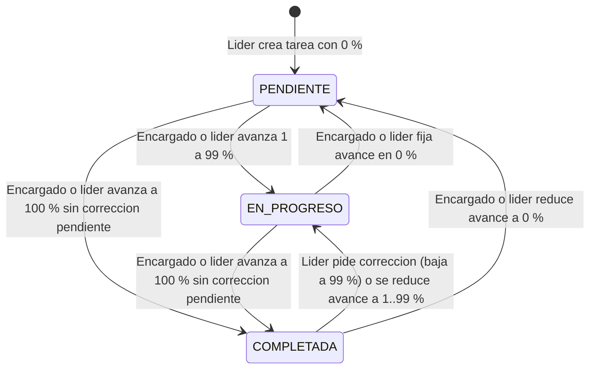
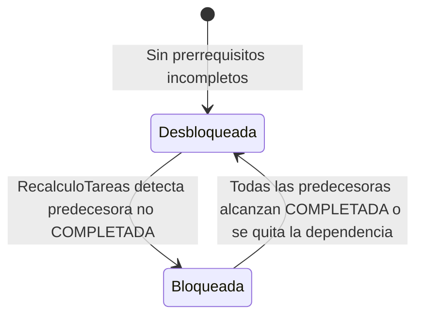
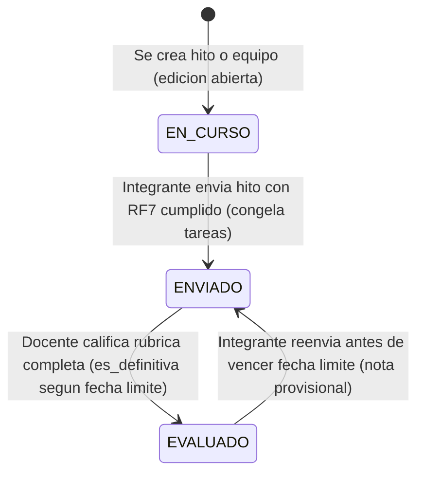
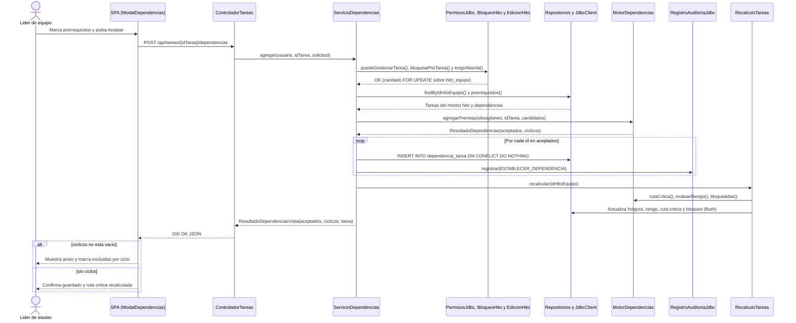
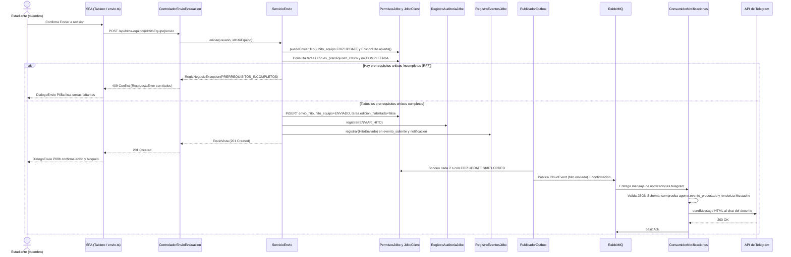
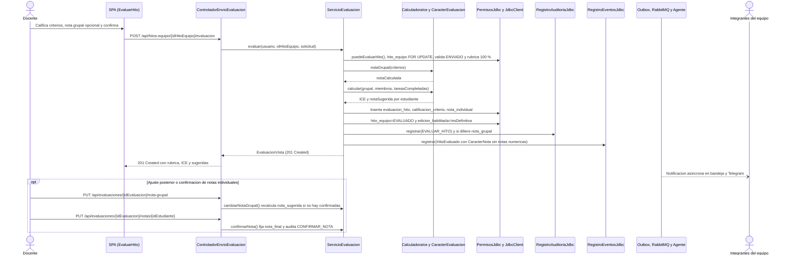
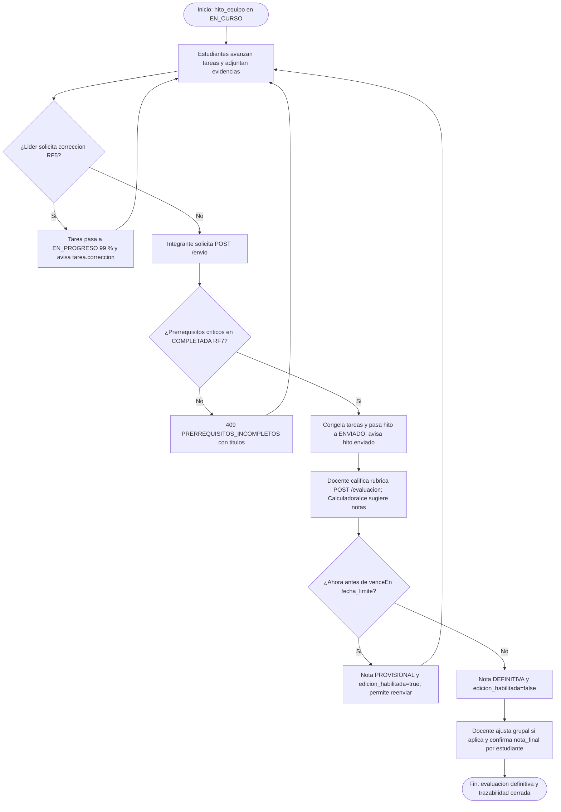
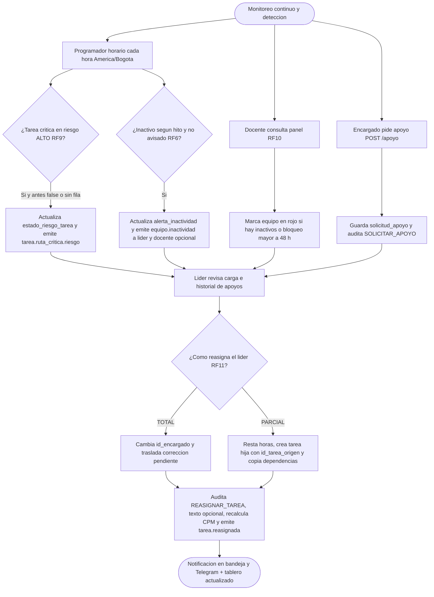

# 06. Comportamiento y flujos dinámicos — UniProject

Este documento rehace los diagramas de estados, secuencia, actividades y casos de uso exigidos en `entrega1.md` sección 2.7 **a partir del comportamiento real verificado en el código fuente**, señalando expresamente las diferencias frente a lo planeado inicialmente.

---

## 6.1. Diagramas de estado

### 6.1.1. Estado de la tarea (`EstadoTarea` y bloqueo por dependencias)

El enum `EstadoTarea` se deriva de forma determinista de `porcentaje_avance` en [`ServicioAvance.java`](../../nucleo/src/main/java/co/uniproject/nucleo/ejecucion/servicio/ServicioAvance.java) (`0` → `PENDIENTE`, `1..99` → `EN_PROGRESO`, `100` → `COMPLETADA`) y se refuerza en PostgreSQL con `tarea_completada_ck`. La solicitud de corrección (`ServicioCorrecciones`) devuelve una tarea `COMPLETADA` a `EN_PROGRESO` con `99` % e impide volver a `100` % (`409 CORRECCION_PENDIENTE`) hasta adjuntar una nueva evidencia. Todas las transiciones anteriores exigen además `EdicionHito.abierta(...) == true` (no estar congelado en `ENVIADO` ni vencido en `EVALUADO`) y no tener prerrequisitos sin completar.

El bloqueo por dependencias es una bandera ortogonal (`bloqueada_por_dependencia` + `fecha_bloqueo`), recalculada por `MotorDependencias.bloqueadas` en `RecalculoTareas`. Mientras esté bloqueada, `ServicioAvance` rechaza cualquier actualización de avance con `409 TAREA_BLOQUEADA` y los detalles de las predecesoras pendientes.

**Fuentes:** [`EstadoTarea.java`](../../nucleo/src/main/java/co/uniproject/nucleo/ejecucion/dominio/EstadoTarea.java), [`ServicioTareas.java`](../../nucleo/src/main/java/co/uniproject/nucleo/ejecucion/servicio/ServicioTareas.java), [`ServicioAvance.java`](../../nucleo/src/main/java/co/uniproject/nucleo/ejecucion/servicio/ServicioAvance.java), [`ServicioCorrecciones.java`](../../nucleo/src/main/java/co/uniproject/nucleo/ejecucion/servicio/ServicioCorrecciones.java), [`ServicioEvidencias.java`](../../nucleo/src/main/java/co/uniproject/nucleo/ejecucion/servicio/ServicioEvidencias.java), [`RecalculoTareas.java`](../../nucleo/src/main/java/co/uniproject/nucleo/ejecucion/servicio/RecalculoTareas.java), [`EdicionHito.java`](../../nucleo/src/main/java/co/uniproject/nucleo/ejecucion/servicio/EdicionHito.java).

### 6.1.2. Estado del hito del equipo (`EstadoHitoEquipo`)

`ENVIADO` congela todas las tareas del `hito_equipo` (`tarea.edicion_habilitada = false` y `EdicionHito.abierta == false`) hasta que el docente evalúa. Si evalúa antes del fin del día de `fecha_limite` en `America/Bogota`, `es_definitiva` queda en `false`, se reactiva `edicion_habilitada = true` y el equipo puede seguir editando y reenviar el hito (`EVALUADO` → `ENVIADO`). Cuando vence `fecha_limite`, el carácter `DEFINITIVA` y el cierre de edición se calculan dinámicamente al leer (`CaracterEvaluacion.de` y `EdicionHito.abierta`) sin necesidad de una transición escrita en BD.

**Fuentes:** [`EstadoHitoEquipo.java`](../../nucleo/src/main/java/co/uniproject/nucleo/ejecucion/dominio/EstadoHitoEquipo.java), [`EdicionHito.java`](../../nucleo/src/main/java/co/uniproject/nucleo/ejecucion/servicio/EdicionHito.java), [`ServicioEnvio.java`](../../nucleo/src/main/java/co/uniproject/nucleo/evaluacion/servicio/ServicioEnvio.java), [`ServicioEvaluacion.java`](../../nucleo/src/main/java/co/uniproject/nucleo/evaluacion/servicio/ServicioEvaluacion.java), [`CaracterEvaluacion.java`](../../nucleo/src/main/java/co/uniproject/nucleo/evaluacion/calificacion/CaracterEvaluacion.java), [`FechasDominio.java`](../../nucleo/src/main/java/co/uniproject/nucleo/comun/FechasDominio.java).

---

## 6.2. Diagramas de secuencia

### 6.2.1. Establecer dependencias entre tareas

Si en `ModalDependencias` el líder desmarcó dependencias previas, la SPA invoca antes `DELETE /api/tareas/{idTarea}/dependencias/{idPrerrequisito}` (`ControladorTareas.quitarDependencia` → `ServicioDependencias.quitar`). Si al crear una tarea desde `ModalNuevaTarea` el líder elige «Bloqueada por» (RNF5 en 4 clics), el frontend llama primero `POST /api/hitos-equipo/{idHitoEquipo}/tareas` y luego `POST /api/tareas/{idTarea}/dependencias`.

> **Diferencia frente a lo planeado en la entrega 1:** `ServicioDependencias.agregar` **no** inserta eventos en la outbox (`evento_saliente`). `RecalculoTareas` deja actualizados `en_ruta_critica`, `holgura_horas`, `nivel_riesgo` y `bloqueada_por_dependencia` en `tarea`; el aviso automático `tarea.ruta_critica.riesgo` lo emite después el programador horario (`RevisionRiesgo` + `EvaluadorRiesgoDominio`) si una tarea crítica entra en riesgo `ALTO`.

**Fuentes:** [`ModalDependencias.tsx`](../../web/src/tarea/ModalDependencias.tsx), [`dependencias.ts`](../../web/src/tarea/dependencias.ts), [`ControladorTareas.java`](../../nucleo/src/main/java/co/uniproject/nucleo/ejecucion/web/ControladorTareas.java), [`ServicioDependencias.java`](../../nucleo/src/main/java/co/uniproject/nucleo/ejecucion/servicio/ServicioDependencias.java), [`MotorDependencias.java`](../../nucleo/src/main/java/co/uniproject/nucleo/ejecucion/dependencias/MotorDependencias.java), [`RecalculoTareas.java`](../../nucleo/src/main/java/co/uniproject/nucleo/ejecucion/servicio/RecalculoTareas.java), [`RegistroAuditoriaJdbc.java`](../../nucleo/src/main/java/co/uniproject/nucleo/trazabilidad/auditoria/RegistroAuditoriaJdbc.java).

### 6.2.2. Envío de hito para revisión académica

A diferencia de la entrega 1 (donde `SistemaNotificaciones` aparecía como un actor síncrono y se contemplaba correo electrónico), cualquier integrante del equipo puede disparar el envío, la entrega queda auditada y el aviso al docente queda persistido en la bandeja interna (`notificacion`) y en `evento_saliente` dentro de la misma transacción, despachándose de forma asíncrona por RabbitMQ y `agente-telegram`.

**Fuentes:** [`Tablero.tsx`](../../web/src/paginas/Tablero.tsx), [`envio.ts`](../../web/src/tarea/envio.ts), [`ControladorEnvioEvaluacion.java`](../../nucleo/src/main/java/co/uniproject/nucleo/evaluacion/web/ControladorEnvioEvaluacion.java), [`ServicioEnvio.java`](../../nucleo/src/main/java/co/uniproject/nucleo/evaluacion/servicio/ServicioEnvio.java), [`RegistroEventosJdbc.java`](../../nucleo/src/main/java/co/uniproject/nucleo/notificaciones/RegistroEventosJdbc.java), [`PublicadorOutbox.java`](../../nucleo/src/main/java/co/uniproject/nucleo/notificaciones/PublicadorOutbox.java), [`ConsumidorNotificaciones.java`](../../agente-telegram/src/main/java/co/uniproject/agente/consumo/ConsumidorNotificaciones.java), [`EnviadorTelegramOkHttp.java`](../../agente-telegram/src/main/java/co/uniproject/agente/telegram/EnviadorTelegramOkHttp.java).

### 6.2.3. Evaluar hito

Si la evaluación se registra antes de vencer la fecha límite en `America/Bogota`, `es_definitiva` es `false` y el sistema vuelve a habilitar la edición de tareas (`edicion_habilitada = true`). Si la fecha límite ya venció, `es_definitiva` queda en `true` y las tareas permanecen cerradas. En `HitoEvaluado` nunca viajan notas numéricas hacia RabbitMQ ni Telegram, únicamente `PROVISIONAL` o `DEFINITIVA` (Ley 1581).

**Fuentes:** [`EvaluarHito.tsx`](../../web/src/paginas/EvaluarHito.tsx), [`FormularioEvaluacion.tsx`](../../web/src/evaluacion/FormularioEvaluacion.tsx), [`ControladorEnvioEvaluacion.java`](../../nucleo/src/main/java/co/uniproject/nucleo/evaluacion/web/ControladorEnvioEvaluacion.java), [`ServicioEvaluacion.java`](../../nucleo/src/main/java/co/uniproject/nucleo/evaluacion/servicio/ServicioEvaluacion.java), [`CalculadoraIce.java`](../../nucleo/src/main/java/co/uniproject/nucleo/evaluacion/calificacion/CalculadoraIce.java), [`CaracterEvaluacion.java`](../../nucleo/src/main/java/co/uniproject/nucleo/evaluacion/calificacion/CaracterEvaluacion.java), [`TarjetaNotaGrupal.tsx`](../../web/src/evaluacion/TarjetaNotaGrupal.tsx), [`TablaNotasIndividuales.tsx`](../../web/src/evaluacion/TablaNotasIndividuales.tsx).

---

## 6.3. Diagramas de actividades

### 6.3.1. Flujo de entrega y evaluación

Este diagrama refleja las tres reglas reales que gobiernan el flujo: (1) una solicitud de corrección (`ServicioCorrecciones`) bloquea completar al 100 % hasta subir nueva evidencia, (2) mientras el hito esté `EVALUADO` antes del vencimiento, `EdicionHito.abierta` sigue siendo `true` y el equipo puede editar y volver a enviar (`ServicioEnvio`), y (3) al vencer el día en `America/Bogota`, `CaracterEvaluacion` pasa la nota a `DEFINITIVA` de forma automática en lectura.

**Fuentes:** [`ServicioAvance.java`](../../nucleo/src/main/java/co/uniproject/nucleo/ejecucion/servicio/ServicioAvance.java), [`ServicioCorrecciones.java`](../../nucleo/src/main/java/co/uniproject/nucleo/ejecucion/servicio/ServicioCorrecciones.java), [`ServicioEnvio.java`](../../nucleo/src/main/java/co/uniproject/nucleo/evaluacion/servicio/ServicioEnvio.java), [`ServicioEvaluacion.java`](../../nucleo/src/main/java/co/uniproject/nucleo/evaluacion/servicio/ServicioEvaluacion.java), [`EdicionHito.java`](../../nucleo/src/main/java/co/uniproject/nucleo/ejecucion/servicio/EdicionHito.java), [`CaracterEvaluacion.java`](../../nucleo/src/main/java/co/uniproject/nucleo/evaluacion/calificacion/CaracterEvaluacion.java).

### 6.3.2. Resolución de cuellos de botella

A diferencia de la entrega 1, el flujo real distingue con precisión qué dispara notificaciones y qué queda solo en plataforma: `RevisionRiesgo` y `RevisionInactividad` emiten eventos a la outbox solo al cambiar de estado (evitando alertas repetidas cada hora); `ServicioApoyo` guarda la solicitud en `solicitud_apoyo` y `log_auditoria` sin enviar evento a RabbitMQ; y `ServicioReasignacion` ofrece división parcial con herencia automática de dependencias predecesoras y sucesoras antes de recalcular el grafo.

**Fuentes:** [`RevisionRiesgo.java`](../../nucleo/src/main/java/co/uniproject/nucleo/notificaciones/programador/RevisionRiesgo.java), [`EvaluadorRiesgoDominio.java`](../../nucleo/src/main/java/co/uniproject/nucleo/notificaciones/programador/EvaluadorRiesgoDominio.java), [`RevisionInactividad.java`](../../nucleo/src/main/java/co/uniproject/nucleo/notificaciones/programador/RevisionInactividad.java), [`DetectorInactividadDominio.java`](../../nucleo/src/main/java/co/uniproject/nucleo/notificaciones/programador/DetectorInactividadDominio.java), [`ServicioPanel.java`](../../nucleo/src/main/java/co/uniproject/nucleo/trazabilidad/servicio/ServicioPanel.java), [`ServicioApoyo.java`](../../nucleo/src/main/java/co/uniproject/nucleo/ejecucion/servicio/ServicioApoyo.java), [`ServicioReasignacion.java`](../../nucleo/src/main/java/co/uniproject/nucleo/ejecucion/servicio/ServicioReasignacion.java).

---

## 6.4. Casos de uso detallados (reescritos según el comportamiento real)

### Caso de uso 1: Establecer dependencias

| Elemento | Especificación real en el código |
|---|---|
| **Actor principal** | Líder de equipo (`miembro_equipo.rol_equipo = 'LIDER'`). |
| **Descripción** | Permite al líder definir qué tareas del mismo `hito_equipo` deben completarse antes de iniciar otra, rechazando ciclos y recalculando la ruta crítica, holguras, riesgo y bloqueos. |
| **Precondición** | Sesión activa como líder del equipo; hito de equipo editable (`EdicionHito.abierta == true`); existen tareas en el mismo `hito_equipo`. |
| **Flujo principal** | 1. El líder abre el detalle de una tarea (`/tareas/{idTarea}`) y pulsa «Establecer dependencias» (`ModalDependencias`), o bien selecciona «Bloqueada por» al crearla (`ModalNuevaTarea`). 2. La SPA carga las tareas del hito (`GET /api/hitos-equipo/{idHitoEquipo}/tareas`). 3. Si se quitaron dependencias previas, la SPA envía `DELETE /api/tareas/{idTarea}/dependencias/{idPrerrequisito}`. 4. Para las nuevas dependencias seleccionadas (máximo 50), la SPA envía `POST /api/tareas/{idTarea}/dependencias` (`ControladorTareas.agregarDependencias` → `ServicioDependencias.agregar`). 5. El servicio valida permiso de líder (`PermisosJdbc.puedeGestionarTarea`), toma candado `BloqueoHito.bloquearPorTarea`, verifica que los candidatos pertenezcan al mismo `hito_equipo` y llama a `MotorDependencias.agregarPrerrequisitos`. 6. Inserta en `dependencia_tarea` los candidatos aceptados, registra cada alta en `log_auditoria` (`ESTABLECER_DEPENDENCIA`) y ejecuta `RecalculoTareas.recalcular` (actualiza `en_ruta_critica`, `holgura_horas`, `nivel_riesgo`, `bloqueada_por_dependencia` y `fecha_bloqueo`). 7. La SPA muestra confirmación (`200 OK` con `ResultadoDependenciasVista`). |
| **Flujos alternos** | - **FA-1 (Dependencia circular):** si uno o más candidatos son la misma tarea o alcanzan a `idTarea` en el grafo (`MotorDependencias.alcanza`), se devuelven en el arreglo `ciclicos` de la respuesta `200 OK`, se guardan los demás en `aceptados` y `ModalDependencias` resalta en rojo las excluidas. - **FA-2 (Prerrequisito de otro hito):** `400 PRERREQUISITO_DE_OTRO_HITO`. - **FA-3 (Hito congelado o vencido):** `409 HITO_NO_EDITABLE`. - **FA-4 (No es líder o tarea inexistente):** `403 ACCESO_DENEGADO` auditado. |
| **Postcondición** | Las relaciones válidas persisten en `dependencia_tarea`; si alguna predecesora no está en `COMPLETADA`, la tarea dependiente queda con `bloqueada_por_dependencia = true` (lo que impide avanzar porcentaje en `ServicioAvance`) y el tablero refleja la ruta crítica recalculada. |
| **Diferencias con `entrega1.md`** | (1) Se incorporó el flujo rápido de 4 clics desde `ModalNuevaTarea` (encadenando `POST /api/hitos-equipo/{idHitoEquipo}/tareas` y `POST /api/tareas/{idTarea}/dependencias`, RNF5); (2) además de recalcular la ruta crítica, recalcula holguras, riesgo y fechas de bloqueo para el panel RF10; (3) no emite eventos a la outbox en el acto. |

**Fuentes:** [`ModalDependencias.tsx`](../../web/src/tarea/ModalDependencias.tsx), [`ModalNuevaTarea.tsx`](../../web/src/tablero/ModalNuevaTarea.tsx), [`ControladorTareas.java`](../../nucleo/src/main/java/co/uniproject/nucleo/ejecucion/web/ControladorTareas.java), [`ServicioDependencias.java`](../../nucleo/src/main/java/co/uniproject/nucleo/ejecucion/servicio/ServicioDependencias.java), [`MotorDependencias.java`](../../nucleo/src/main/java/co/uniproject/nucleo/ejecucion/dependencias/MotorDependencias.java).

---

### Caso de uso 2: Enviar hito

| Elemento | Especificación real en el código |
|---|---|
| **Actores** | Estudiante (cualquier miembro del equipo, líder o integrante), Sistema de notificaciones asíncrono (`PublicadorOutbox`, RabbitMQ y `agente-telegram`). |
| **Descripción** | Envía el `hito_equipo` a revisión del docente, congela la edición de sus tareas, audita el envío y notifica al docente en la bandeja web y por Telegram. |
| **Precondición** | Sesión activa de un miembro del equipo (`PermisosJdbc.puedeEnviarHito`); `hito_equipo` en estado `EN_CURSO` o bien en `EVALUADO` antes de vencer la fecha límite (`EdicionHito.abierta == true`). |
| **Flujo principal** | 1. En `/equipos/{idEquipo}/tablero`, el estudiante pulsa «Enviar a revisión» y confirma en `ConfirmarEnvio`. 2. La SPA invoca `POST /api/hitos-equipo/{idHitoEquipo}/envio` (`ControladorEnvioEvaluacion.enviar` → `ServicioEnvio.enviar`). 3. El servicio verifica permiso de integrante, adquiere `BloqueoHito.bloquear(hito_equipo)` y confirma `EdicionHito.abierta`. 4. Consulta las tareas del `hito_equipo` con `es_prerrequisito_critico = true AND estado <> 'COMPLETADA'`. 5. Al no haber pendientes, inserta fila en `envio_hito`, actualiza `hito_equipo.estado = 'ENVIADO'` y `tarea.edicion_habilitada = false`, y audita `ENVIAR_HITO`. 6. Invoca `RegistroEventosJdbc.registrar(HitoEnviado)` dentro de la misma transacción: guarda el CloudEvent en `evento_saliente` y registra la notificación en `notificacion` para el docente. 7. Devuelve `201 Created` (`EnvioVista`); la SPA muestra `DialogoEnvio` (P08b). 8. De forma asíncrona, `PublicadorOutbox` publica `hito.enviado` a `uniproject.eventos` y `agente-telegram` entrega el aviso HTML al chat vinculado del docente. |
| **Flujos alternos** | - **FA-1 (Prerrequisitos críticos incompletos — RF7):** en el paso 4, si existen tareas críticas sin completar, lanza `409 PRERREQUISITOS_INCOMPLETOS` con la lista de títulos en `RespuestaError.detalles`; `DialogoEnvio` (P08a) los lista al estudiante y no se modifica el hito. - **FA-2 (Hito ya enviado o cerrado):** en el paso 3, responde `409 HITO_NO_ENVIABLE`. - **FA-3 (No es miembro del equipo):** `403 ACCESO_DENEGADO` auditado. |
| **Postcondición** | En éxito: existe registro en `envio_hito`, `hito_equipo` pasa a `ENVIADO`, las tareas quedan bloqueadas para edición y el docente tiene la alerta en `/notificaciones` (y Telegram si está vinculado). En fallo: no hay envío y el hito conserva su estado previo. |
| **Diferencias con `entrega1.md`** | (1) La SPA incluye confirmación modal previa (`ConfirmarEnvio`); (2) también admite reenvío cuando el hito fue evaluado con nota provisional y sigue antes de `fecha_limite`; (3) el aviso al docente dejó de ser por correo electrónico y funciona mediante bandeja P10 + outbox + RabbitMQ + Telegram. |

**Fuentes:** [`Tablero.tsx`](../../web/src/paginas/Tablero.tsx), [`envio.ts`](../../web/src/tarea/envio.ts), [`ControladorEnvioEvaluacion.java`](../../nucleo/src/main/java/co/uniproject/nucleo/evaluacion/web/ControladorEnvioEvaluacion.java), [`ServicioEnvio.java`](../../nucleo/src/main/java/co/uniproject/nucleo/evaluacion/servicio/ServicioEnvio.java), [`EdicionHito.java`](../../nucleo/src/main/java/co/uniproject/nucleo/ejecucion/servicio/EdicionHito.java).

---

### Caso de uso 3: Evaluar hito

| Elemento | Especificación real en el código |
|---|---|
| **Actores** | Docente (dueño del proyecto), Sistema de notificaciones asíncrono (`PublicadorOutbox`, RabbitMQ y `agente-telegram`). |
| **Descripción** | Permite al docente revisar las entregas, calificar cada criterio de la rúbrica, fijar u omitir una nota grupal manual, generar las notas individuales sugeridas por ICE y notificar a los integrantes. |
| **Precondición** | Sesión activa del docente dueño del proyecto (`PermisosJdbc.puedeEvaluarHito`); `hito_equipo.estado == 'ENVIADO'`; los pesos de `criterio_rubrica` del hito suman exactamente `100`; el equipo tiene al menos un integrante. |
| **Flujo principal** | 1. El docente entra a `/hitos/{idHitoEquipo}/evaluar` (`EvaluarHito.tsx`), que consulta `GET /api/hitos-equipo/{idHitoEquipo}/tareas`, `GET /api/proyectos/{idProyecto}` y (si hubo evaluación previa) `GET /api/hitos-equipo/{idHitoEquipo}/evaluacion`. 2. Revisa las entregas por tarea y diligencia nota y retroalimentación por cada criterio (más nota grupal y retroalimentación general opcionales) en `FormularioEvaluacion`. 3. Al confirmar, la SPA envía `POST /api/hitos-equipo/{idHitoEquipo}/evaluacion` (`ControladorEnvioEvaluacion.evaluar` → `ServicioEvaluacion.evaluar`). 4. El servicio bloquea `hito_equipo`, valida estado `ENVIADO`, suma de pesos `= 100` y notas dentro de `0..puntaje_maximo`. 5. `CalculadoraIce.notaGrupal` calcula la nota base de la rúbrica; toma `solicitud.notaGrupal()` si se indicó o la calculada si faltaba. Calcula el ICE y `nota_sugerida` de cada integrante usando las tareas `COMPLETADA` a tiempo (`f = 1`) o tarde (`f = 0,5`). 6. Determina `es_definitiva = !ahora.isBefore(FechasDominio.venceEn(fechaLimite))`, inserta `evaluacion_hito`, `calificacion_criterio` y `nota_individual`, pasa `hito_equipo` a `EVALUADO` y ajusta `tarea.edicion_habilitada = !es_definitiva`. 7. Registra auditoría (`EVALUAR_HITO` y `ACTUALIZAR nota_grupal` si difiere de la calculada) y emite `HitoEvaluado` (solo con carácter `PROVISIONAL` o `DEFINITIVA`, sin notas numéricas) en `evento_saliente` + `notificacion`. 8. Opcionalmente, el docente ajusta la nota grupal (`PUT /api/evaluaciones/{idEvaluacion}/nota-grupal`) mientras no haya notas confirmadas, y confirma la nota final por integrante (`PUT /api/evaluaciones/{idEvaluacion}/notas/{idEstudiante}`). |
| **Flujos alternos** | - **FA-1 (Fin del plazo):** si `ahora >= FechasDominio.venceEn(fechaLimite)` en `America/Bogota`, `es_definitiva` se guarda como `true`, `tarea.edicion_habilitada` queda en `false` y el aviso sale con carácter `DEFINITIVA`. - **FA-2 (Rúbrica incompleta o fuera de rango):** `409 PESOS_NO_SUMAN_100`, `400 RUBRICA_INCOMPLETA` o `400 NOTA_FUERA_DE_RANGO`. - **FA-3 (Hito no enviado o equipo vacío):** `409 HITO_NO_ENVIADO` o `409 EQUIPO_SIN_INTEGRANTES`. - **FA-4 (Cambio de nota grupal tras confirmar individuales):** `PUT /nota-grupal` responde `409 NOTAS_CONFIRMADAS`. |
| **Postcondición** | La evaluación y el desglose quedan guardados, cada integrante recibe el aviso (`notificacion` y Telegram si vinculó chat) con el carácter de la nota, y solo el docente ve los ICE y notas sugeridas de todo el equipo (cada estudiante ve exclusivamente su propia fila en `GET /api/hitos-equipo/{idHitoEquipo}/evaluacion`). |
| **Diferencias con `entrega1.md`** | (1) La calificación grupal y la confirmación de notas individuales son endpoints independientes (`POST /evaluacion`, `PUT /nota-grupal` y `PUT /notas/{idEstudiante}`); (2) el paso de `PROVISIONAL` a `DEFINITIVA` al vencer `fecha_limite` se calcula al leer (`CaracterEvaluacion`) sin proceso en lote; (3) la notificación externa omite calificaciones numéricas por cumplimiento de la Ley 1581. |

**Fuentes:** [`EvaluarHito.tsx`](../../web/src/paginas/EvaluarHito.tsx), [`ControladorEnvioEvaluacion.java`](../../nucleo/src/main/java/co/uniproject/nucleo/evaluacion/web/ControladorEnvioEvaluacion.java), [`ServicioEvaluacion.java`](../../nucleo/src/main/java/co/uniproject/nucleo/evaluacion/servicio/ServicioEvaluacion.java), [`LectorEvaluaciones.java`](../../nucleo/src/main/java/co/uniproject/nucleo/evaluacion/servicio/LectorEvaluaciones.java), [`CalculadoraIce.java`](../../nucleo/src/main/java/co/uniproject/nucleo/evaluacion/calificacion/CalculadoraIce.java), [`CaracterEvaluacion.java`](../../nucleo/src/main/java/co/uniproject/nucleo/evaluacion/calificacion/CaracterEvaluacion.java).
